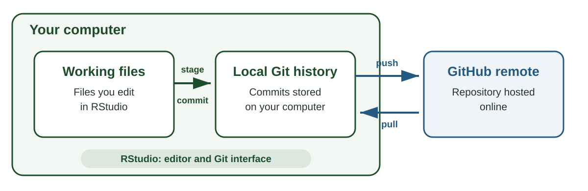
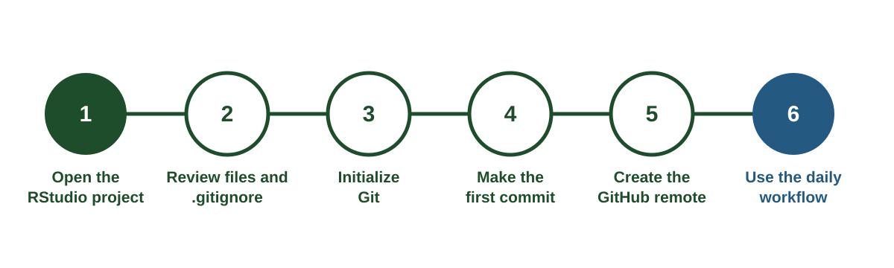
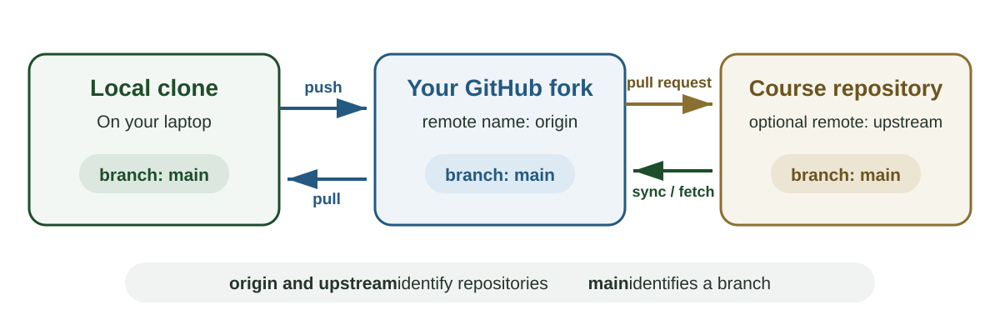

## Reading and today's path

**Gentzkow and Shapiro, *Code and Data for the Social Sciences*, Sections 1–4** [@gentzkow2014code]

**Bryan, *Excuse Me, Do You Have a Moment to Talk About Version Control?*, 2017** [@bryan2017version]

1. Organize a project so another researcher can follow it
2. Identify where undocumented memory enters the workflow
3. Set up Git, GitHub, and RStudio
4. Take one research project from its first commit through GitHub
5. Choose a workflow for team projects and public repositories

## Reproducibility starts with organization

Can another researcher reconstruct a result from the same inputs?

They need

- Original inputs
- Code for every transformation
- The order in which the code runs
- Software and package requirements
- The project version used for the result

Source: @gentzkow2014code

## Start with a recognizable project root

~~~text
research_project/
  README.md
  research_project.Rproj
  run_all.R
  code/
  data/
  output/
  docs/
  lab_diary.md
~~~

The `.Rproj` file opens this folder as the project root

## Separate files by function

~~~text
code/                    scripts and reusable functions
data/raw/                source files as retrieved
data/derived/            files constructed from source data
output/figures/          figures produced by code
output/tables/           tables produced by code
docs/                    codebook and project documentation
~~~

Raw inputs remain unchanged. Scripts rebuild derived data and outputs

## Paths should travel with the project

Use paths relative to the project root

~~~r
read.csv("data/raw/streamflow.csv")
~~~

A path beginning with one person's user directory usually fails on another computer

~~~r
read.csv("C:/Users/jane/Desktop/streamflow.csv")
~~~

## Automate the sequence

`run_all.R` records the order of operations

~~~r
source("code/00_setup.R")
source("code/01_get_cdl.R")
source("code/02_get_streamflow.R")
source("code/03_get_weather.R")
source("code/04_get_acs.R")
source("code/05_build_daily.R")
source("code/06_outputs.R")
~~~

One command rebuilds the project from documented inputs

## Where does memory enter the workflow?

Consider one result in your current research project

- Which steps happen through code
- Which steps happen through menus or manual edits
- Where the order of operations is recorded
- Which inputs can change over time
- What another researcher would need to ask before running it

## Documentation replaces memory

Different records answer different questions

| Record | Question it answers |
|---|---|
| Scripts and `run_all.R` | What operations produced the result |
| README | How should a new researcher run the project |
| Codebook | What do the variables and values mean |
| Retrieval log | Where and when did the inputs originate |
| Lab diary | Why did the researcher make a decision |
| Version history | What changed across project states |

## What version control adds

Version control gives a project a documented history. At selected points, it records the state of the project's files together with the author, date, and reason for the change.

That history allows a researcher to compare versions, recover earlier work, and identify the exact project state used for an analysis or manuscript.

Source: @bryan2017version

## Git, GitHub, and RStudio have different roles

| Tool | Role |
|---|---|
| **Git** | Software that records the history of a project on your computer |
| **GitHub** | An online service that hosts a copy of a Git project and supports sharing |
| **RStudio** | An editor that lets you work with project files and run Git through buttons, menus, and the Terminal |

A Git project can remain entirely on one computer. GitHub adds an online copy. RStudio calls Git commands on your behalf [@bryan2017version]

## One project can exist in three locations

{fig-alt="A research project's working files and local Git history are on the student's computer, while a remote copy is hosted on GitHub. Commits connect working files to local history, and push and pull connect local history to GitHub."}

::: notes
Walk from left to right. Saving changes the working files. Committing records a checkpoint in local Git history. Pushing copies local commits to GitHub. Pulling brings commits from GitHub into the local repository.
:::

## Version control vocabulary

| Term | Meaning |
|---|---|
| **Repository** | A project and its Git history |
| **Working directory** | The files currently visible in the project folder |
| **Tracked file** | A file whose changes Git follows |
| **Staging area** | The changes selected for the next commit |
| **Commit** | A recorded checkpoint in the project history |
| **Diff** | The lines added, removed, or changed |

## Version control vocabulary

| Term | Meaning |
|---|---|
| **Commit message** | A short explanation attached to a commit |
| **Tag** | A fixed readable name for a selected commit |
| **Local** | The repository on your computer |
| **Remote** | A connected repository hosted online |
| **Main** | The conventional name for the project's primary branch |
| **Push** | Send local commits to a remote |
| **Pull** | Bring remote commits into the local repository |

## Branches move while tags stay fixed

| | Branch | Tag |
|---|---|---|
| **What it identifies** | The current commit in an ongoing line of work | One selected commit |
| **What happens after a new commit** | The branch name advances to the new commit | The tag remains with the selected commit |
| **Common use** | Developing and reviewing changes | Marking a release, data freeze, or submitted version |

A tag such as `v1.0` gives one commit a durable name that is easier to recognize than its commit hash

::: notes
Git permits a tag to be deleted and recreated, but the usual practice is to treat a published tag as fixed. A tag does not create a separate line of development. To continue developing from a tagged commit, create a branch from that tag.
:::

## Saving, committing, and pushing are separate actions

**Save** writes the current file to the working directory

**Commit** records selected changes in the local Git history

**Push** sends local commits to GitHub

::: notes
A saved file can remain uncommitted. A local commit can remain unpushed. Ask students where each action stores information.
:::

## One-time setup

Complete these steps once on each computer

1. Install Git
2. Create a GitHub account
3. Tell Git your name and email
4. Create a GitHub personal access token
5. Store the token for RStudio and Git
6. Verify the connection

The demo repository provides detailed instructions in [`docs/setup-rstudio.md`](https://github.com/laurenchenarides/arec_570_demo/blob/main/docs/setup-rstudio.md)

## Step 1: install Git

Download Git from [git-scm.com/downloads](https://git-scm.com/downloads)

Restart RStudio after installation, then, in your Console window, run

~~~r
system("git --version")
~~~

A successful check prints a version such as `git version 2.55.0.windows.3`

## Steps 2 and 3: create accounts and identify yourself

Create an account at [github.com](https://github.com)

Install two helper packages and configure Git

~~~r
install.packages(c("usethis", "gitcreds"))

usethis::use_git_config(
  user.name = "Your Name",
  user.email = "you@example.edu"
)
~~~

Use an email connected to your GitHub account

## Steps 4 and 5: connect GitHub

Create a personal access token

~~~r
usethis::create_github_token()
~~~

Copy the token from GitHub, then store it

~~~r
gitcreds::gitcreds_set()
~~~

Treat the token like a password. Keep it out of scripts, `.Renviron`, and commits

## Step 6: verify the setup

Run

~~~r
usethis::git_sitrep()
~~~

Check for

- The expected Git version
- Your name and email
- A stored GitHub token
- A recognized GitHub account

::: notes
Pause for a live RStudio walkthrough. Open the Terminal to show `git --version`, then run `usethis::git_sitrep()` in the Console. Ask students to compare their output with the projected output.
:::

## Case 1: your own research project

You have an existing RStudio project with scripts, data documentation, and early results

Your goal is to

1. Review which files belong in Git
2. Initialize the local repository
3. Make the first commit
4. Create a private GitHub repository
5. Use the workflow during each research session

## Start-to-finish workflow

{fig-alt="Six steps for placing an existing RStudio project under version control: open the project, review files, initialize Git, commit, create the GitHub remote, and begin the daily workflow."}

## Open the project in RStudio

Open the `.Rproj` file inside the project root

Confirm that

- The project name appears in the upper-right corner
- The Files pane begins at the project root
- Relative paths run successfully
- The project contains a README or equivalent instructions

## Decide what Git should track

Track files that explain, run, or report the research

- Source code
- README files and project documentation
- Data dictionaries and retrieval logs
- Small configuration files without credentials
- Manuscript and presentation source files

Generated outputs can follow the project team's publication and archival policy

## Use `.gitignore` for excluded files

Common exclusions include

- API keys and credentials
- Confidential or restricted data
- Large source files stored in an archive
- Derived files rebuilt by code
- R session files such as `.RData` and `.Rhistory`

`.gitignore` applies to files Git has not started tracking

## Check before the first commit

Open `.gitignore` and review every file in the project

- Does any file contain a password or API key
- Does the project contain restricted or licensed data
- Is a large file available from a stable archive or reproducible download
- Can a derived file be rebuilt by the project scripts
- Does each tracked file help explain, run, or report the research

Revoke any credential that enters a commit because earlier commits retain its contents

## Initialize the local repository

Run in the RStudio Console

~~~r
usethis::use_git()
~~~

RStudio may restart the project. A **Git** tab should then appear beside Environment and History

This command creates the hidden `.git` directory that stores local history

## Git records changes through three states

| State | Meaning |
|---|---|
| **Working directory** | Files currently being edited |
| **Staging area** | Changes selected for the next commit |
| **Commit** | A recorded checkpoint with an explanatory message |

Staging lets one work session become several coherent commits

## Read the RStudio Git pane

| Status | Meaning |
|---|---|
| `M` | A tracked file was modified |
| `?` | A new file is untracked |
| `A` | A new file is staged for its first commit |
| `D` | A tracked file was deleted |
| `R` | A tracked file was renamed or moved |

**Diff** shows changed lines. The **Staged** boxes select changes for the next commit

## Make the first commit

1. Open the Git pane
2. Select **Diff** and inspect the proposed files
3. Stage the files that belong in the repository
4. Enter `Create initial project structure`
5. Select **Commit**

The commit now exists in local Git history

## Create the private GitHub repository

Run in the RStudio Console

~~~r
usethis::use_github(private = TRUE)
~~~

This command

- Creates a GitHub repository under your account
- Connects the local repository to the GitHub remote
- Names that remote `origin`
- Pushes the current branch and commits

## `main` and `origin` name different things

| Name | Type | What to look for |
|---|---|---|
| `main` | Branch | The project's primary line of commits |
| `origin` | Remote | The GitHub repository connected to the local project |

Check the current branch and connected remotes in the RStudio Terminal

~~~bash
git branch --show-current
git remote -v
~~~

`main` appears as a branch. `origin` appears beside the GitHub URL used for pull and push

## The everyday Git workflow

1. **Pull** before beginning a work session
2. Make one coherent change
3. Inspect the changed lines with **Diff**
4. Stage the files that belong to the change
5. Write a specific message and **Commit**
6. **Push** the commits to GitHub

Repeat the edit, inspect, stage, and commit steps as the work develops

## Follow along in RStudio

In a practice project

1. Add one sentence to `README.md`
2. Save the file
3. Inspect the changed line with **Diff**
4. Stage `README.md`
5. Commit with `Clarify project research question`
6. Push the commit
7. Open GitHub and locate the same commit

::: notes
Show each location after every action. After saving, point to the modified status in RStudio. After committing, show History. After pushing, refresh GitHub and open the commit.
:::

## The corresponding Git commands

~~~bash
git pull
git status
git diff
git add README.md
git diff --staged
git commit -m "Clarify project research question"
git push
~~~

The RStudio buttons run these commands

Companion reference: [`docs/git-in-rstudio.md`](https://github.com/laurenchenarides/arec_570_demo/blob/main/docs/git-in-rstudio.md)

## A diff shows what changed

~~~diff
- This project studies water use
+ This project studies how irrigation restrictions affect water use
~~~

The diff records the changed text

The commit message records the reason for that change

~~~text
Clarify treatment and outcome in research question
~~~

## Write messages for future readers

| General message | Research-specific message |
|---|---|
| `updates` | `Code suppressed ACS estimates as missing` |
| `fixed bug` | `Keep FIPS codes as text to preserve leading zeros` |
| `final version` | `Restrict sample to the April–September growing season` |

A useful message identifies the completed change. Add an explanation when a change alters the sample or interpretation

## History makes earlier states inspectable

Use **History** in RStudio or **Commits** on GitHub to inspect

- The files changed in a commit
- The exact lines added and removed
- The author and date
- The commit message
- The identifier for the checkpoint

Tags such as `5.2-retrieve` give a readable name to a particular commit

## What if you want to start from an existing repository?

A remote repository already exists when

- A coauthor invites you to a team repository
- You want your own linked copy of public work
- You want to contribute a change to another repository

The starting action depends on ownership and purpose

## Where we left off in Lecture 5.2

The `arec_570_demo` project retrieved land-use, streamflow, weather, and Census data through APIs

- R scripts recorded the requests
- Raw downloads preserved the responses
- A retrieval log recorded source, date, and parameters

## Follow-along repository

[`arec_570_demo`](https://github.com/laurenchenarides/arec_570_demo) develops in stages across Unit 5

| Tag | Lecture | Addition |
|---|---|---|
| `5.2-retrieve` | API collection | Retrieval script |
| `5.3-structure` | Structure and Git | Folders, `run_all.R`, and `.gitignore` |
| `5.4-collaborate` | Collaboration | Issues, branches, and pull requests |
| `5.5-report` | Reporting | Codebook, sample, and data section |

## Completed before class

Lecture 5.2 assigned Parts One and Two of [`docs/setup-rstudio.md`](https://github.com/laurenchenarides/arec_570_demo/blob/main/docs/setup-rstudio.md)

- Install Git and restart RStudio
- Create a GitHub account
- Configure your Git name and email
- Create and store a GitHub personal access token
- Request, activate, and store a Census API key
- Run `usethis::git_sitrep()` without errors
- Confirm `nzchar(Sys.getenv("CENSUS_API_KEY"))` returns `TRUE`

Bring the laptop used to complete these steps

## Vocabulary for shared repositories

| Term | Meaning |
|---|---|
| **Clone** | A local copy of a remote repository and its history |
| **Fork** | A linked GitHub copy under your account |

Lecture 5.4 will cover branches, merges, and pull requests

## Choose how your local project begins

| Situation | Starting action |
|---|---|
| You have access to a team repository | **Clone** the team repository |
| You want a linked copy of public or course work | **Fork**, then **clone** your fork |

Cloning is the step that creates the working project on your computer

## Case 2: clone a team repository

Your advisor adds you to an existing private repository for a joint project

The team already shares one GitHub repository. You need a local copy containing the same files and history

Use **clone** when the repository already exists and you have permission to work in it

## Clone the team repository in RStudio

In RStudio

1. Copy the repository's HTTPS URL from **Code**
2. Select **File > New Project > Version Control > Git**
3. Paste the URL and choose a parent folder
4. Select **Create Project**

Cloning copies files and history, names the team repository `origin`, and usually opens its default branch, `main`

## Case 3: fork public or course work

You want your own copy of the course repository and need to receive later course updates

Use **fork** when you want a linked GitHub copy under your account

A fork supports

- Receiving later updates from the original repository
- Developing changes in a repository you control
- Proposing changes through a pull request

After creating the fork on GitHub, clone your fork to RStudio

## Follow along: fork the demo

Open [github.com/laurenchenarides/arec_570_demo](https://github.com/laurenchenarides/arec_570_demo) while signed in

1. Select **Fork**
2. Clear **Copy the main branch only** so the lecture tags are included
3. Select **Create fork**
4. Confirm the address is `github.com/your-username/arec_570_demo`

Your fork remains linked to the course repository for later synchronization

## Follow along: clone your fork

1. On your fork, select **Code** and copy the HTTPS URL
2. In RStudio select **File > New Project > Version Control > Git**
3. Paste the URL and choose a parent folder such as `GitProjects`
4. Select **Create Project**
5. Confirm the project name appears in the upper-right corner
6. Confirm a **Git** tab appears beside Environment and History

The local repository's `origin` points to your fork

## Origin, upstream, and `main`

{fig-alt="A local clone on a laptop and a personal GitHub fork are connected through push and pull. The personal fork is labeled origin. The original course repository is labeled upstream and sends updates to the fork through GitHub's Sync fork action. Each repository contains a branch named main."}

::: notes
Emphasize that `main` is a branch in each repository. `origin` and `upstream` identify repositories from the perspective of the local project. In this course, students use GitHub's Sync fork action, so they do not need to configure a local `upstream` remote.
:::

## Read the three names in this exercise

| Name | Type | Meaning in this exercise |
|---|---|---|
| `main` | Branch | The primary line of commits in each repository |
| `origin` | Local remote name | Your fork on GitHub |
| `upstream` | Fork relationship or remote name | The original course repository |

**Course updates:** **Sync fork** updates your fork from the course repository. **Pull** then updates local `main` from `origin`

`upstream` appears in `git remote -v` only when configured as a second remote. Lecture 5.4 creates a separate branch and merges its commits into `main`

## Which action fits the project?

A. Your advisor adds you to a private team repository

B. You want your own version of the course demo and need later course updates

::: notes
Ask for the action and the reason. A is clone. B is fork and clone.
:::

## Why synchronize local and remote history?

A commit initially exists only in the repository where it was created

- **Push** makes local commits available on GitHub
- **Pull** brings GitHub commits to the computer
- Regular synchronization gives collaborators access to current work
- Frequent pulls reduce the number of changes that must be reconciled later

## Pull and push synchronize commits

**Pull** brings remote commits into the local repository

**Push** sends local commits to the remote repository

When GitHub reports newer remote commits

1. Pull the remote commits
2. Review any conflicts Git reports
3. Complete the merge if required
4. Push the combined history

Lecture 5.4 develops branches, conflicts, and pull requests

## Common problems and first checks

| Problem | First check |
|---|---|
| The Git tab is missing | Confirm the `.Rproj` inside a Git repository is open |
| Git rejects a commit | Check the configured name and email with `usethis::git_sitrep()` |
| GitHub rejects authentication | Check whether the personal access token is present and current |
| A push is rejected | Pull and inspect the incoming commits |
| A file never appears in the Git pane | Check the patterns in `.gitignore` |

Record the exact error message when asking for help

## Apply the workflow to your research project

For one current project, identify

1. The project root
2. The command or script that reproduces the main result
3. The files Git should track
4. The files `.gitignore` should exclude
5. The people who need repository access
6. The next research decision that deserves a commit

Share one unresolved choice with the class

## Return to Gentzkow and Shapiro

How do the reading's recommendations appear in the demo repository?

- Automation through `run_all.R`
- Separate directories for code, raw data, derived data, and outputs
- Relative paths from the project root
- Version history for code and documentation
- README files that describe execution and file roles

Which recommendation requires the largest change in your current workflow?

## Before you leave

Confirm that your fork contains one new commit from today's exercise

Be prepared to show

- The line you changed
- The commit message
- The same commit in RStudio and on GitHub
- One file your research repository should exclude

## Summary

**Project structure** records where inputs, code, and outputs belong

**Git** records local changes as commits

**GitHub** hosts a remote repository for sharing and collaboration

**RStudio** provides an interface for editing files and using Git

**Clone and fork** describe different ways to begin from an existing repository

**Pull, edit, inspect, stage, commit, and push** form the everyday workflow

## References {.smaller}

::: {#refs}
:::

## Course navigation

- [All lectures](https://laurenchenarides.github.io/csu-arec-570/lectures/lectures.html)
- [Schedule and preparation](https://laurenchenarides.github.io/csu-arec-570/2026/schedule.html)
- [Course reading list](https://laurenchenarides.github.io/csu-arec-570/2026/readings.html)
- [Download this lecture as a PDF](https://laurenchenarides.github.io/csu-arec-570/lectures/lecture5.3.pdf)
