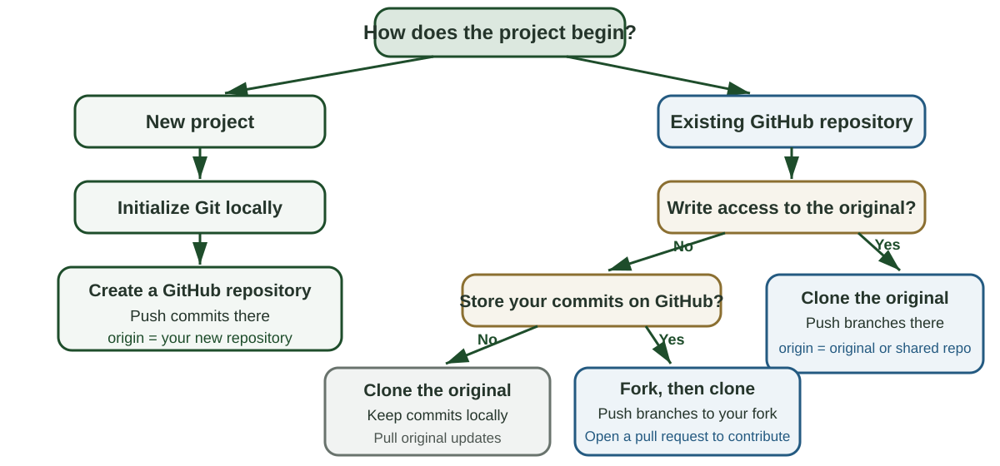

## Reading and sequence

**Gentzkow and Shapiro, *Code and Data for the Social Sciences*, Sections 5-8 and the Code Style appendix** [@gentzkow2014code]

1. Distinguish cloning, forking, and repository permissions
2. Follow one research task through a branch, pull request, review, and merge
3. Use keys, abstraction, documentation, management, and code style to make the task reviewable
4. Apply the workflow to a current research project

## Where we left off

Lecture 5.3 established a version control workflow for an individual research project

- Organize the project around inputs, code, and outputs
- Use Git to record local commits
- Use GitHub to share the repository
- Clone an existing team repository when you have access

We stopped before **Case 3: fork public or course work**

## Choose how the project reaches your computer

{fig-alt="A decision tree distinguishes four starting points. A new project is initialized locally and connected to a new GitHub repository. An existing repository is cloned directly when the student has write access. Without write access, the student clones directly for local use or forks and then clones when commits need to be stored on GitHub."}

::: notes
Start with the desired destination for future commits. A clone creates the local repository in every pathway involving an existing GitHub repository. A fork adds a personal GitHub repository before that clone.
:::

## Clone creates the local working repository

Cloning creates a complete local Git repository from a remote repository

- The clone includes the files and commit history
- Git names the source repository `origin`
- A commit records a version in the local repository
- Fetch and pull bring later updates from `origin`
- Push copies local commits to `origin` when your GitHub account has write access

The clone records the remote repository as `origin` so Git knows where to fetch, pull, and push

The remote repository's permissions determine whether GitHub accepts a push

## A fork is your GitHub copy of the original repository

GitHub creates the fork under your account and records which repository it came from

- Clone the fork to create the local working repository
- The local name `origin` points to your fork
- Push sends your local commits to your fork
- A pull request asks the original repository's owners to accept your commits
- Sync or fetch can bring later changes from the original repository into your work

Your fork and the original remain separate repositories

## Case 3: contribute without write access

You plan to make changes to the course repository and lack write access to it

1. Fork the course repository on GitHub
2. Clone your fork to the computer
3. Create a branch, commit, and push to your fork
4. Open a pull request if you want to propose the changes to the course repository
5. Bring later course updates into the fork when needed

The course repository changes only when its owner accepts and merges a pull request

## Follow along: fork the demo

Open [github.com/laurenchenarides/arec_570_demo](https://github.com/laurenchenarides/arec_570_demo) while signed in

1. Select **Fork**
2. Clear **Copy the main branch only** so the lecture tags are included
3. Select **Create fork**
4. Confirm the address is `github.com/your-username/arec_570_demo`

Your fork remains linked to the course repository for later synchronization

## Follow along: clone your fork

1. On your fork, select **Code** and copy the HTTPS URL
2. In RStudio select **File > New Project > Version Control > Git**
3. Paste the URL and choose a parent folder such as `GitProjects`
4. Select **Create Project**
5. Confirm the project name appears in the upper-right corner
6. Confirm a **Git** tab appears beside Environment and History

The local repository's `origin` points to your fork

## Origin, upstream, and `main`

{fig-alt="A local clone and personal GitHub fork exchange commits through push and pull. The fork is origin. Sync or fetch brings updates from the original course repository, which can be added as upstream. A pull request proposes changes from the fork to the original. Each repository contains a branch named main."}

::: notes
Emphasize that `main` is a branch in each repository. `origin` is created automatically by cloning. `upstream` is a conventional name that the user adds when using terminal commands to communicate directly with the original repository.
:::

## Read the three names in this exercise

| Name | Type | Meaning in this exercise |
|---|---|---|
| `main` | Branch name | The primary line of accepted commits in each repository |
| `origin` | Remote nickname | The GitHub repository that was cloned, here your fork |
| `upstream` | Remote nickname | The original repository, added manually for terminal synchronization |

Use `git remote -v` to see which remote nicknames exist locally

::: notes
GitHub records the fork relationship on the website even when the local repository has only `origin`. The name `upstream` exists locally only after the user adds it.
:::

## Update a fork through GitHub

On your fork's GitHub page

1. Select **Sync fork**
2. Select **Update branch** when updates are available

GitHub copies accepted commits from the original repository's `main` into your fork's `main`

Changes on a separate branch do not interfere with synchronizing `main`

In RStudio

3. Switch to `main`
4. Select **Pull** in the Git pane
5. Confirm Git reports that local `main` is current

::: notes
The update path is original `main` to fork `main` to local `main`
:::

## Update a fork through the terminal

Add the original repository as `upstream` once

```bash
git remote add upstream https://github.com/laurenchenarides/arec_570_demo.git
git remote -v
```

Bring later updates into local `main`, then update the fork

```bash
git fetch upstream
git switch main
git merge --ff-only upstream/main
git push origin main
```

::: notes
The `--ff-only` option updates `main` only when Git can move it directly to the newer upstream commit. It stops when local `main` contains competing commits. Keeping project work on separate branches makes this update path easier to maintain.
:::

## Pull and push synchronize commits

**Pull** brings commits from the current branch on `origin` into the local branch

**Push** sends local commits from the current branch to the matching branch on `origin`

When GitHub contains newer commits

1. Pull the remote commits
2. Review any conflict Git reports
3. Complete the merge when required
4. Push the combined history

## Create a branch from current `main`

In the RStudio Git pane

1. Confirm the branch menu shows `main`
2. Select **New Branch**
3. Name the branch `add-daily-panel`
4. Keep **Sync branch with remote** selected
5. Select **Create**

The terminal equivalent is

```bash
git switch -c add-daily-panel
git push -u origin add-daily-panel
```

## Work and commit on the branch

1. Edit the files required by the task
2. Run the relevant scripts and inspect the outputs
3. Inspect the diff in the RStudio Git pane
4. Stage the files that belong to the task
5. Commit with a message that describes the research change
6. Push the branch to GitHub

```text
Join streamflow and weather by date
```

Each commit should leave the branch in a state another researcher can inspect

## Open a pull request

After pushing the branch, GitHub offers **Compare & pull request**

- Set the base branch to `main`
- Set the compare branch to `add-daily-panel`
- Use the deliverable as the title
- Explain what changed and why
- Report how the change was checked

To practice without proposing a change to the course repository, set the **base repository** to your fork

## Review the research change

The **Files changed** tab shows the exact proposed edits

A reviewer can ask

- Does each table have a clear unit of observation
- Are keys unique and nonmissing
- Does the join use the intended matching relationship
- Do the scripts rebuild the stated outputs
- Are thresholds, units, and missing values documented
- Does the pull request contain one coherent task

## Revise through the same branch

Review comments identify a question or requested change on a specific line

The author then

1. Edits the branch in RStudio
2. Runs the relevant checks
3. Commits the revision
4. Pushes the branch again

The new commit appears in the same pull request and preserves the review record

## Merge, then update local `main`

After approval on GitHub

1. Select **Merge pull request**
2. Delete the remote task branch

Back in RStudio

3. Switch to `main`
4. Pull the merged commits from `origin/main`
5. Confirm the project runs from the updated `main`
6. Delete the local task branch when it is no longer needed

## When Git reports a merge conflict

A conflict occurs when the branches being combined changed the same part of a file in different ways

- Git pauses the pull or merge
- The Git pane identifies each conflicted file
- The file contains both versions between conflict markers
- The researcher decides what the final file should contain

Git preserves both versions because it cannot determine which edit is correct for the project

::: notes
Conflict markers begin with `<<<<<<<`, separate the versions with `=======`, and end with `>>>>>>>`. `HEAD` identifies the version on the branch currently checked out. The other label identifies the incoming branch or commit.
:::

## Resolve a merge conflict

1. Open every file marked as conflicted
2. Find each set of conflict markers
3. Compare the current and incoming versions
4. Keep one version, combine them, or write a new final version
5. Delete all conflict markers and save the file
6. Run the checks affected by the change
7. Stage the resolved files and complete the merge commit

The commit message should summarize the resolution when the choice affects the research record

## Collaboration vocabulary

| Term | Meaning in this workflow |
|---|---|
| **Branch** | A line of commits for one proposed change |
| **Pull request** | A request to review and merge one branch |
| **Review** | Comments, requested revisions, or approval |
| **Merge** | The operation that adds accepted commits to `main` |
| **Conflict** | Competing edits that require a human decision |

# Gentzkow and Shapiro: data and code practices

## The reading's five practices

Gentzkow and Shapiro organize the assigned sections around five practices [@gentzkow2014code]

- **Keys** state what each row represents
- **Abstraction** gives repeated logic one maintained implementation
- **Documentation** records sources, definitions, and decisions
- **Management** assigns tasks and records their status
- **Code style** makes the implementation easier to inspect

## Keys define the observations

A **key** is a field or combination of fields that uniquely identifies a row

| Data structure | One row represents | Possible key |
|---|---|---|
| Household survey | One household in one wave | `household_id`, `wave` |
| County panel | One county in one year | `county_fips`, `year` |
| Parcel transactions | One recorded sale | `transaction_id` |

Cleaned tables should have keys that are unique and nonmissing

Source: @gentzkow2014code, Section 5

## Check keys before combining tables

For every table

1. State what one row represents
2. Identify the field or fields that should be unique
3. Check for missing key values
4. Check for duplicate key values

Before a join, state whether each key should appear once or many times in each table

After a join, confirm that the resulting rows still represent the intended unit of observation

## Keep each table at the level it describes

Keeping data normalized means storing each fact once at its natural unit

| Table | Natural key | One row represents |
|---|---|---|
| States | `state_id` | One state |
| Counties | `county_id` | One county |
| County population | `county_id`, `year` | One county in one year |

Store state attributes in the state table and county attributes in the county table

Combine tables when the analysis requires information from more than one level

Source: @gentzkow2014code, Section 5

## Abstraction gives repeated logic one definition

Abstraction places a repeated operation in one function or program

- The operation has a descriptive name
- Inputs and outputs are explicit
- Repeated calls use the same maintained implementation
- Changes to the operation are made in one place

Gentzkow and Shapiro recommend abstraction when it removes repetition or clarifies the operation

Source: @gentzkow2014code, Section 6

## When should a step become a function?

- Is the same logic repeated in several scripts
- Would one name make the purpose easier to recognize
- Can the inputs and outputs be stated clearly
- Can the function reject invalid inputs with a useful message
- Can the function be checked separately from the full project

Keep a one-time transformation in the script when its direct form is easier to read

## Documentation records research decisions

Code names and structure should explain the operation itself

Documentation should record information such as

- The source of a definition or threshold
- The reason for an unexpected choice
- The units and reference period
- A limitation a future user could miss
- The inputs and outputs of each script

Maintain documentation alongside the code it describes

Source: @gentzkow2014code, Section 7

## Documentation has different scopes

| Location | What it records |
|---|---|
| `README.md` | Project purpose and reproduction steps |
| Data dictionary | Variable definitions, units, and codes |
| Script header | Purpose, inputs, outputs, and dependencies |
| Lab diary | Decisions, attempts, and unresolved questions |
| Task record | Deliverable, owner, status, and completion criteria |

Each layer answers a different question about the project

## Management makes responsibility and status visible

Gentzkow and Shapiro recommend a task system with clear ownership and a durable record [@gentzkow2014code]

| Research-management need | Possible record |
|---|---|
| Define the task | Task plan or lab diary entry |
| Assign responsibility | Named owner in a shared task list |
| State completion criteria | Checklist in the task plan |
| Record discussion | Comments attached to the task |
| Track status | Shared task list |
| Preserve the result | Link to the completed files or output |

Keep decisions with the task so a collaborator can find them later

## Code style supports review

- Give scripts and functions one clear purpose
- Use names that identify the concept and unit
- Make function inputs and outputs explicit
- Separate key calculations from setup code
- Write logical conditions in the form a reader would describe them
- Use consistent naming and indentation across the project
- Return informative errors for invalid inputs

Source: @gentzkow2014code, Code Style appendix

## Questions for evaluating a research workflow

- Does every cleaned table have a unique and nonmissing key
- Does each table store information at a consistent level
- Is repeated logic defined in one maintained place
- Can the documentation be kept current as the project changes
- Does every task have an owner, status, and completion criteria
- Can another researcher follow the names and control flow in the code

These questions summarize Sections 5–8 and the Code Style appendix

# Apply the ideas to your research

## Apply the workflow to your research project

Choose one task you expect to complete next

- What concrete deliverable defines the task
- Who owns the task
- Which inputs or prior decisions it requires
- What conditions define completion
- What branch name describes the change
- Which dataset key or code check matters most
- What evidence a reviewer should inspect

Be prepared to share the task and one completion criterion

## Before you leave

Show one of the following

- A branch created for a current research task
- A commit that records a coherent change
- A draft pull-request description for a proposed change

Also identify the key of one dataset used in that task

## Summary

**Sync, fetch, and pull** bring accepted remote commits into the current project history

**Branches and commits** organize one research task and its version history

**Pull requests and review** make proposed changes visible before they enter `main`

**Keys and explicit join relationships** protect the unit of observation

**Abstraction, documentation, management, and code style** make research changes easier to inspect and reuse

## References {.smaller}

::: {#refs}
:::

## Course navigation

- [All lectures](lectures.qmd)
- [Schedule and preparation](../2026/schedule.qmd)
- [Course reading list](../2026/readings.qmd)
