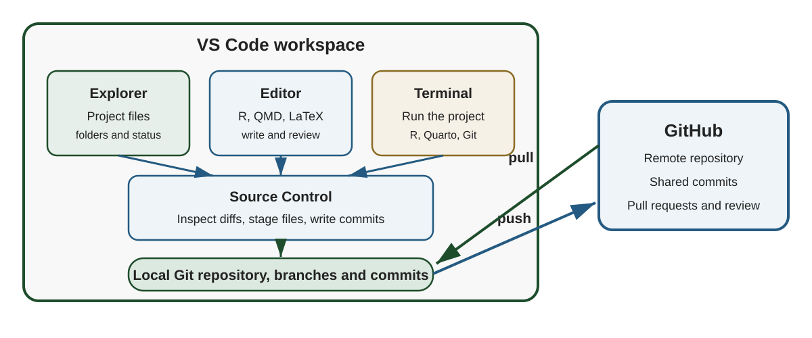
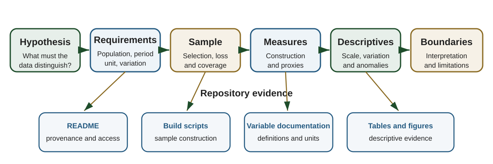

## Today's sequence

**VS Code as the research workspace**

- Open and run a research repository
- Review changes and use Git
- Connect local commits to GitHub

**The data section and connecting it with your repository evidence**

- Establish data fit for the hypotheses
- Document the sample and variable construction
- Develop the empirical setting with descriptive statistics
- Link manuscript claims to code and outputs

# VS Code as a research workspace

## The IDE brings the workflow into one window

{fig-alt="A VS Code workspace contains the file explorer, editor, terminal, and source control view. Source control records commits in the local Git repository, which exchanges commits with GitHub through push and pull."}

::: notes
Allocate about one third of class to this section. The main point is that VS Code provides interfaces to the project files, R and Quarto, the local Git repository, and the GitHub remote.
:::

## Required tools for the VS Code workflow

| Tool | Role in the workflow | Check |
|---|---|---|
| Git | Local version history | `git --version` |
| R | Statistical computing | `R --version` |
| VS Code | Editor and integrated workspace | Open the application |
| R extension | R terminal, completion, plots, and help | Create an R terminal |
| Quarto extension | Edit, execute, render, and preview `.qmd` files | Preview a `.qmd` file |

Install the R language server from an R console

```r
install.packages("languageserver")
```

::: notes
Sources: [R in VS Code](https://code.visualstudio.com/docs/languages/r) and [Quarto in VS Code](https://quarto.org/docs/tools/vscode/)
:::

## Windows in the workspace

| VS Code area | What to verify |
|---|---|
| Explorer | Project structure and expected files |
| Status bar | Active branch and repository status |
| Source Control | Uncommitted and staged changes |
| Terminal | Working directory and available software |
| Extensions | R and Quarto support enabled for this workspace |

Start the session by pulling accepted commits into the current branch

## Starting from a local folder

1. Locate your existing local folder
2. Select **File > Open Folder** and choose the repository root
3. Select **Manage** folder, and then **Trust**


## Connecting to GitHub

Starting from the folder open in VS Code

1. Open **Source Control** and select **Initialize Repository**
2. Add a `.gitignore` before the first commit
3. Review the files, stage them, and create the first commit
4. Select **Publish Branch** and sign in to GitHub if prompted
5. Choose whether the GitHub repository will be public or private
6. Open the repository on GitHub and confirm that the commit appears

Initializing creates the local Git history and publishing creates the GitHub copy


## The Git cycle in Source Control

1. Pull the current branch and switch to a task branch
2. Edit and run the project
3. Inspect each changed file and stage the intended changes
4. Commit with a message that describes the research change
5. Push the branch to GitHub

The Source Control view and terminal operate on the same local Git repository

Source: [Source control in VS Code](https://code.visualstudio.com/docs/sourcecontrol/overview)

## Diff review before committing

Ask four questions

- Does every changed file belong to this task
- Do the additions implement the intended research decision
- Did an output, credential, or large data file enter the change accidentally
- Can the commit message explain the change without opening every file

Stage a coherent set of files after reviewing the diff

## Cloning a repo 

Starting from a repository that already exists on GitHub

1. Copy the repository URL from GitHub
2. Open the Command Palette in VS Code and select **Git: Clone**
3. Paste the URL and choose the parent folder for the local copy
4. Open the cloned repository and select **Trust**
5. Check the active branch and run `git status`

The clone includes the project files and Git history


# VS Code Demo


# Writing the data section

## The data section makes an empirical argument

The section should establish that the observed data can evaluate the hypotheses from your conceptual framework

What needs to be communicated:

- The population and setting correspond to the research question
- The sample contains the observations and variation required by the hypotheses
- The measures represent the concepts in the framework
- The construction rules can be reproduced
- The limitations define the scope of interpretation


## Evidence chain for a data section

{fig-alt="The conceptual hypothesis determines data requirements, the analytic sample, variable construction, descriptive evidence, and the boundaries of the empirical claim. Repository artifacts support each step."}

::: notes
Use this diagram to organize the remainder of the lecture. The manuscript states each link. The repository documents and implements the sample, measures, and descriptive outputs.
:::

## Hypotheses determine data requirements

| Part of a hypothesis | What the data section must establish |
|---|---|
| Outcome | The measure, unit, and reference period |
| Explanatory factor | The observed variable that represents the proposed mechanism |
| Comparison | The groups, places, or periods that generate variation |
| Population | The units to which the hypothesis applies |
| Conditions | The controls, restrictions, and assumptions needed for interpretation |

The hypothesis determines the observations, measures, and variation the data section must establish

## Data section components

1. **Data source** explains where the records came from and what they cover
2. **Sample selection** explains which observations enter the analysis
3. **Variable construction** explains how the analysis measures were created
4. **Desriptive evidence**

Together, these components let the reader understand and reproduce the analytic data

## The data checklist lists what your data section must report

- One page, with one row for each item the data section must state
- Rows follow the components on the previous slide, plus the fit to your hypotheses and the repository
- Write each answer as the sentence you would put in the paper
- Unit 6 adds a parallel checklist for the empirical strategy section

[Open the data checklist](../files/data-checklist.qmd)

::: notes
The checklist consolidates the slides in this lecture: the fit-to-hypothesis table, the four data-section components, missing data and proxies, and the repository audit. Rows tagged GS come from Gentzkow and Shapiro; rows tagged AJAE come from the journal's author guidelines, which ask that data sources be stated clearly and that data, code, and a readme be provided on acceptance.
:::

## 1. Data source

Address the questions that determine provenance and coverage

- Who collected or assembled the data
- Why the data were collected
- When and where collection occurred
- Who or what was observed
- How observations were recorded
- Which population the source covers
- Which access, licensing, or confidentiality conditions apply

Add information that affects interpretation or replication

## 2. Sample selection

Report

- The population from which the sample is drawn
- Every inclusion and exclusion rule
- The order in which the rules are applied
- The observations lost at each consequential step
- Whether attrition or missingness differs across groups or time
- How the analytic sample compares with the population of interest

Explain how each rule affects the claims the sample can support

## 3. Variable construction

A reader needs to visualize the unit of observation (what one row represents)

For each central variable report

- The concept from the framework
- The source fields
- The unit and reference period
- The aggregation or transformation
- The interpretation of the resulting value
- The treatment of missing or implausible values
- The limitations of the measure

Give enough information for another researcher to reconstruct the variable

## Missing data and sample loss

For every consequential restriction state

- Which field is missing or invalid
- How many observations are affected
- Whether the loss is concentrated by place, time, product, or group
- How the analysis treats the affected observations
- How the restriction changes the interpretation of the sample

## Imputation documentation

Report

- Which variables contain imputed values
- The unit and time window used for imputation
- The algorithm and predictors
- The assumptions required by the method
- The number and share of values imputed
- An indicator that identifies imputed observations
- A sensitivity analysis using observed values

Keep the original value and the imputed value in separate fields

## Proxies and empirical scope

A proxy is an observed measure used to represent an unobserved concept

For each proxy

- Name the concept the hypothesis requires
- Define the observed measure
- Explain why the measure represents the concept
- Identify the relevant dimensions the measure omits
- Limit the empirical claim to what the measure can support

Measurement limits should appear in the data section and in the interpretation of the results

## 4. Descriptive statistics as evidence

Descriptive evidence helps the reader trust that the data is fit to test the hypotheses

These should show

- The scale and composition of the analytic sample
- The variation required to evaluate the hypotheses
- The distribution and units of the central measures
- Differences across periods or comparison groups
- Extreme values, missingness, and panel imbalance
- Patterns that motivate later estimation

Design the table after deciding which empirical questions it should answer

## A descriptive paragraph has four jobs

1. **Orient** the reader to the sample, unit, period, and comparison
2. **Identify** the pattern that matters for the research question
3. **Quantify** its magnitude with a small number of interpretable values
4. **Qualify** the pattern with sample composition or measurement information

## Roles of tables, figures, text, and the repository

| Element | Job |
|---|---|
| Table body | Complete values, units, and sample sizes |
| Table notes | Definitions, weights, transformations, and sample restrictions |
| Figure | Time patterns, distributions, or comparisons |
| Main text | Interpretation tied to the research question |
| Repository | Code that constructs every reported value |

Check that statistics compared in the text use the same sample and unit

# The repository supports the data section

## The paper and repository answer connected questions

| Manuscript question | Repository evidence |
|---|---|
| Where do the data come from | README data overview and access documentation |
| How is the sample constructed | SQL build and panel-construction scripts |
| How are variables defined | README variable table and transformation code |
| How are exclusions applied | Analysis-sample filters in code |
| Where do descriptive values come from | Ordered scripts that write tables and figures |
| How can the analysis be rerun | Quick Start, package list, configuration, and master script |

## The README is the entry point

A project README should document

- The research question and empirical setting
- Required SQL builds and local configuration
- The command that runs the analysis
- Data coverage and access restrictions
- Core variables and their interpretation
- Known limitations
- The mapping from scripts to manuscript sections and outputs

A new collaborator should know where to begin after reading the README

## Git tracking by access and purpose

| Track in Git | Keep outside Git |
|---|---|
| Source code and SQL | Licensed transaction records |
| README and variable documentation | Credentials and connection strings |
| Package and software requirements | Computer-specific configuration |
| Small metadata and public inputs | Large intermediate data files |
| Selected tables and figures | Regenerable bulk outputs |

Use `.gitignore` for restricted, sensitive, computer-specific, and regenerable files

Document how an authorized user supplies each required local input

## Computing environment

Record

- R and external software requirements
- Package names and versions when version differences matter
- Database or API dependencies
- Required environment variables or configuration fields
- The order of scripts
- Random seeds for stochastic procedures
- The expected output folders

Provide a safe example configuration with placeholder values when local settings are required

## Repository audit

- Can I identify the project purpose and empirical setting
- Can I find the analytic unit, key, sample period, and central variables
- Can I distinguish source data, intermediate data, and final outputs
- Can I locate every sample restriction and transformation
- Can I reproduce the descriptive tables from documented inputs
- Can I identify restricted materials and the process for authorized access
- Can I connect each manuscript table and figure to the script that produces it

# Apply the workflow to your project

## Fit-to-hypothesis matrix

Choose one hypothesis from your conceptual framework

| Component | Your project |
|---|---|
| Hypothesis | What relationship will be evaluated |
| Required observations | Who or what must be observed |
| Required variation | Across whom, where, or when |
| Constructed measures | How the concepts become variables |
| Sample restrictions | Which observations enter the analysis |
| Main limitation | Which interpretation requires care |
| Repository evidence | Which file documents or implements the step |

## Data-section spine

Write one or two sentences for each heading

:::: {.columns}

::: {.column width="50%"}
1. **Source and provenance**
2. **Coverage and population**
3. **Sample selection**
4. **Observation unit and key**
:::

::: {.column width="50%"}
5. **Variable construction**
6. **Missing data and imputation**
7. **Limitations and scope**
8. **Descriptive evidence**
:::

::::


## Summary

**VS Code** brings the project files, R or Quarto execution, Git, and GitHub into one workspace

**The data section** establishes provenance, sample construction, variable construction, and interpretive scope

**Descriptive statistics** develop the empirical setting and quantify the variation relevant to the hypotheses

**The repository** provides the documentation and code needed to verify and reproduce the data section

## Resources and course navigation

- [Price-gouging research repository](https://github.com/laurenchenarides/price_gouging)
- [Source control in VS Code](https://code.visualstudio.com/docs/sourcecontrol/overview)
- [R in VS Code](https://code.visualstudio.com/docs/languages/r)
- [Quarto in VS Code](https://quarto.org/docs/tools/vscode/)
- [Data checklist](https://laurenchenarides.github.io/csu-arec-570/files/data-checklist.html)
- [All lectures](https://laurenchenarides.github.io/csu-arec-570/lectures/lectures.html)
- [Schedule and preparation](https://laurenchenarides.github.io/csu-arec-570/2026/schedule.html)
- [Course reading list](https://laurenchenarides.github.io/csu-arec-570/2026/readings.html)

# Appendix: price-gouging example

These slides show how the reporting principles appear in one applied project

## Research question and testable hypotheses

:::: {.columns}

::: {.column width="42%"}
**Research question**

> How did grocery retailers adjust prices and dollar margins during COVID-19 states of emergency, when anti-price-gouging laws, demand, and wholesale costs changed at the same time?
:::

::: {.column width="58%"}
**Framework-derived hypotheses**

1. Retail prices and dollar margins differ across the pre-SOE, SOE, and post-SOE periods
2. Within-chain price differences vary with state enforcement status if APG protections affect pricing
3. Retail prices respond to wholesale acquisition costs, and pass-through may change during the SOE
4. More frequent promotions can reduce net transaction prices while posted prices remain similar
:::

::::

::: notes
The framework allows several mechanisms to operate at the same time. Higher demand and wholesale costs can create upward price pressure. APG protections can constrain price increases. Chain-level pricing can limit cross-state price differences. Promotions can lower the price paid at the register. The data section must establish whether the data contain the outcomes, mechanisms, comparisons, and timing required to evaluate these hypotheses.
:::

## Data provenance and scope

The opening paragraph identifies the source, records, period, locations, firms, and geography

> We use item-level scanner data from DecaData, which report daily retail transactions from January 1, 2018, through July 17, 2023 for 549 grocery stores affiliated with three major retail chains operating across five Southeastern U.S. states

::: notes
Source: `manuscript_v13.tex`, Data Source subsection. Ask students what they know after one sentence and what questions still remain.
:::

## What the opening sentence establishes

- The data provider
- The type and frequency of the records
- The observation period
- The number and type of locations
- The number of chains
- The geographic coverage

The remaining source description explains the chains, product records, and access conditions

## Sample entry and selection rules

The price-gouging manuscript reports a three-stage product-selection procedure

1. Restrict the universe to 47 perishable fruit and vegetable categories
2. Apply a coverage screen around policy activation and expiration
3. Rank passing products by sales and volume and select five items

**Coverage screen:** present in 80 percent of both 26-week windows, observed for five weeks on each side, and passing in 75 percent of stores

## Analytic sample construction

| Stage | Result |
|---|---|
| Item-level transactions | 74 product categories |
| Perishable produce restriction | 47 candidate categories |
| Coverage screen | Products observed near activation and expiration |
| Sales and volume ranking | Five focal products |
| Analytic restrictions | Positive quantity, price, and wholesale cost |
| Final panel | 604,121 store-product-week observations |

The manuscript should report the counts available at each consequential stage

## Observation unit and key

The analysis aggregates transactions to the **store-product-week** level

| Index | Meaning |
|---|---|
| $i$ | Store |
| $j$ | Product |
| $s$ | State |
| $t$ | Week |

The key is the combination of store, product, and week

State identifies the policy environment associated with each store

## Net retail price construction

For store $i$, product $j$, state $s$, and week $t$

$$
p^{net}_{jist}
=
\frac{\sum_{d \in t} net\_sales_{ijsd}}
     {\sum_{d \in t} volume_{ijsd}}
$$

- The numerator is total transaction revenue after promotional discounts
- The denominator is total units or pounds sold
- The ratio is the average price paid at the register
- Units follow the product, pounds for random-weight produce and units for packaged lettuce

## Cost and margin construction

Average wholesale acquisition cost

$$
w_{jist}
=
\frac{\sum_{d \in t} total\_cost_{ijsd}}
     {\sum_{d \in t} volume_{ijsd}}
$$

Retail-wholesale margin

$$
M^{net}_{jist}=p^{net}_{jist}-w_{jist}
$$

The shared product, store, week, and physical unit give the spread a direct interpretation

## Policy measures

The empirical setting determines three periods for each state

- **Pre-SOE** weeks before the emergency declaration
- **SOE** weeks when the declaration and associated APG protections were active
- **Post-SOE** weeks after the declaration expired

$SOE_{st}$ links the state-level legal setting to each store-product-week

$Dur_{st}$ counts weeks since activation during the emergency period

Report the date source and the rule used to assign partial weeks

## Sample restrictions and missing observations

The analysis requires positive quantities, retail prices, and wholesale costs

Price-change models also require consecutive observations for the same store and product

The data section should report

- The number of observations removed by each restriction
- The concentration of losses by product, store, state, and period
- The implications for the analytic sample and each hypothesis

## Proxies, interpretation, and scope

| Construct | Available measure | Scope of interpretation |
|---|---|---|
| Consumer price | Net transaction price | Average register price for the item within the week |
| Retailer input cost | Wholesale acquisition cost | Procurement cost recorded in the point-of-sale system |
| Retail margin | Net price minus acquisition cost | Retail-wholesale spread |
| Policy exposure | Active state emergency declaration | Statutory APG exposure by state and week |

Labor, logistics, handling, shrink, and spoilage remain outside the observed cost measure

## Limitations and empirical claims

The manuscript identifies three central boundaries

- Wholesale acquisition cost captures one component of retailer cost
- Category-level averages can change with the composition of products purchased
- Policy exposure varies at the state-week level across five states

These boundaries guide the language used for margins, price indexes, and policy interpretation

## Price and margin claims

| Empirical claim | Data feature that supports it | Boundary |
|---|---|---|
| Prices changed during the SOE | Weekly net price for the same products and stores | Other contemporaneous changes remain part of the reduced-form setting |
| Margins changed during the SOE | Retail price and acquisition cost use the same unit | The spread omits other retailer costs |

## Uniformity and pass-through claims

| Empirical claim | Data feature that supports it | Boundary |
|---|---|---|
| Pricing uniformity changed | Multiple stores within the same chain and week | Store coverage changes over time |
| Pass-through changed | Retail and wholesale price changes are observed together | Wholesale costs may reflect shared upstream conditions |

## Establish the scale and composition

The descriptive section begins with the analytic scale

> The panel covers 604,121 observations across 549 unique store locations and three retail chains operating in five Southeastern states from January 2018 through July 2023

It then reports changes in store coverage over time and identifies which retailers account for the decline

This information prepares the reader to evaluate panel balance and sample composition

## Describe patterns relevant to the hypotheses

The manuscript connects three pieces of descriptive evidence

> Upon the SOE activation in March 2020, total weekly volume rose sharply, increasing 27.4 percent relative to the four preceding weeks

> Both nominal and real prices fell immediately at activation and remained below their pre-SOE range for the duration of enforcement

> Wholesale costs were generally unchanged across periods for most products. Dollar margins narrowed during the SOE for all five products

::: notes
Source: `manuscript_v13.tex`, Descriptive Evidence section. The sentences move from demand conditions to prices, wholesale costs, and margins. Each pattern corresponds to an element of the research question or framework.
:::

## How the descriptive discussion is organized

| Job | Evidence used in the example |
|---|---|
| Orient | Sample size, stores, chains, states, and period |
| Identify | Volume, price, cost, and margin patterns during the SOE |
| Quantify | A 27.4 percent increase in volume and product-level changes |
| Qualify | Changes in store coverage and differences across products |

The discussion gives the reader context for the regression results that follow

## Scripts mirror the data argument

The [price-gouging repository](https://github.com/laurenchenarides/price_gouging) connects manuscript statements to the code and outputs that support them

| Repository artifact | Data-section role |
|---|---|
| `code/00_read_in_data.R` | Retrieves source tables and assembles the initial panel |
| `code/02_build_panel.R` | Constructs measures, timing variables, and the estimation sample |
| `code/03_descriptive_tables.R` | Produces coverage and descriptive tables |
| `code/run_all.R` | Runs the scripts in the intended order |
| `code/sql/` | Documents upstream construction of the source tables |
| `tables_latex/` and `figures/` | Store manuscript-ready outputs |

## Manuscript statements and repository artifacts

| Manuscript statement | Supporting artifact |
|---|---|
| Final sample contains 604,121 observations | Summary table produced by `03_descriptive_tables.R` |
| The key is store-product-week | Panel-construction code and README data structure |
| Net price is transaction revenue divided by volume | Variable-construction code and README definition |
| Five products pass the selection procedure | Product coverage output and selection code |
| Descriptive means differ across SOE periods | Period-means table and figure scripts |

This mapping helps a coauthor, reviewer, or future researcher verify a statement efficiently
