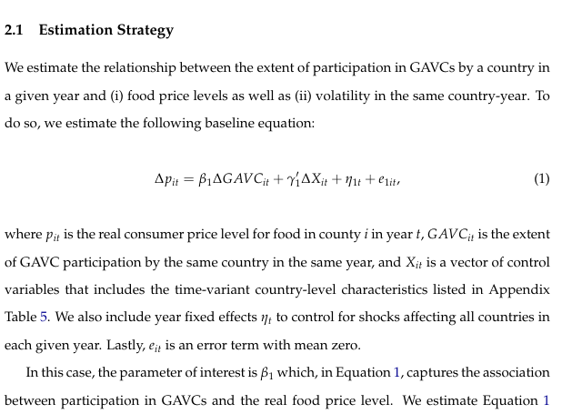
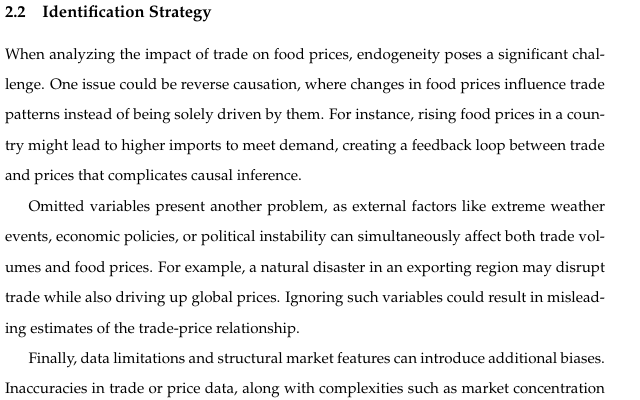
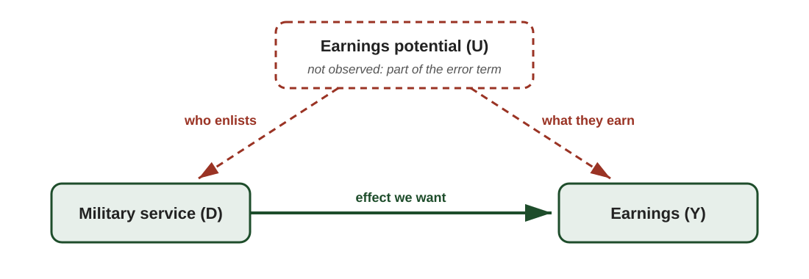
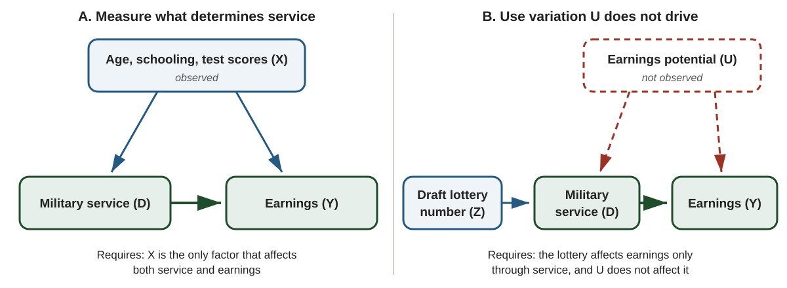

## Before class {.dense}

:::: {.columns}

::: {.column width="50%"}
**Assigned**

- Angrist and Pischke, *Mostly Harmless Econometrics*, Chapters 1 to 3 [@angrist2009mostly]
- Jurajda, “Lecture Notes on Identification Strategies” [@jurajda2007identification]
- Timmins and Schlenker, “Reduced-Form Versus Structural Modeling in Environmental and Resource Economics” [@timmins2009reduced]
:::

::: {.column width="50%"}
**Also used in these slides**

- Bellemare, “How to Write Applied Papers in Economics,” from Lecture 2.3 [@bellemare2020applied]
- AJAE Author Guidelines [@ajae2026guidelines]
- Athey and Imbens, “The State of Applied Econometrics,” on robustness and sensitivity (assigned for 6.3) [@athey2017state]
- Gentzkow and Shapiro on keys, from Lecture 5.4 [@gentzkow2014code]
- Published example: @dalheimer2026gavc
- Climate example: @mendelsohn1994ricardian; @schlenker2005irrigation; @deschenes2007climate; @schlenker2009nonlinear; @burke2016adaptation
:::

::::

Readings and course handouts are available on [Canvas](https://colostate.instructure.com/courses/230315/pages/readings).

::: notes
Timing for 75 minutes: 5 minutes on readings and resources, about 55 minutes on content, and 10 minutes on the writing task at the end.
:::

## Use the empirical strategy checklist to guide what this section should report

- One page checklist, parallel to the [data checklist](../files/data-checklist.qmd){target="_blank" rel="noopener"} from Lecture 5.5
- Rows 1 to 9 include what every paper should report; rows 10 to 17 depend on the design
- Each row is tagged with the lecture that covers it; today covers rows 1 to 9
- Built from Bellemare's Section 5, Angrist and Pischke's Chapter 1, and the AJAE Author Guidelines

[Open the empirical strategy checklist](../files/empirical-strategy-checklist.qmd){target="_blank" rel="noopener"}

::: notes
Each row is tagged with its source. Rows tagged B come from Bellemare's description of the estimation and identification strategy. Rows tagged AJAE come from the journal's author guidelines and final checklist, which require appendices to be cited as online supplementary material and require data, code, and a readme on acceptance. Unmarked rows are course standards; the AJAE refereeing criteria (Lecture 7.1) do not list requirements for the empirical section.
:::

## The methods map helps you match a method to your question

<iframe src="../files/includes/ag-econ-methods-map.html#example" width="100%" height="320" style="border:1px solid #ccc;" title="Ag econ methods map"></iframe>

A map of methods, a decision tree, the four choices every empirical strategy states, structural estimation details for 6.2, and the climate example we use today. Use it as a reference while writing.

[Open the methods map in a new tab](../files/includes/ag-econ-methods-map.html){target="_blank" rel="noopener"}

::: notes
How the map was created: [LC to confirm before class].

The map lists anchor papers for each method. The climate papers used today have been checked against Crossref; the remaining anchor papers are being checked before later lectures use them.
:::

# What must the empirical strategy section accomplish?

## Research FAQs

Social science is interested in cause-and-effect relationships

Before starting your research, ask:

- What is the causal relationship of interest?
- What experiment could ideally be used to capture the causal effect of interest?
- What is your identification strategy?
- What is your mode of statistical inference?

These questions are answered throughout the paper, but formally written up in the methods (or empirical strategy) section

::: aside
Source: @angrist2009mostly, Chapter 1.
:::

## Where the empirical strategy section lives in your paper

1. Introduction
2. Background or Literature Review
3. Conceptual Framework
4. Data and Summary Evidence
5. **Empirical Strategy** & **Identification Strategy**
6. Results
7. Discussion (or Policy Implications, or Managerial Implications)
8. Conclusion

Bellemare calls this section the Empirical Framework, and some papers place it before the data section [@bellemare2020applied].

::: notes
Bellemare's outline for an applied paper: Introduction, Theoretical Framework, Data and Descriptive Statistics, Empirical Framework, Results and Discussion, Summary and Concluding Remarks. He notes that the data and empirical sections are often swapped; the Dalheimer and Bellemare paper on the next slides puts the empirical framework first.

Two differences from his outline. He argues that a separate literature review is "almost always entirely unwarranted" in a journal article and recommends a short review of the five to ten closest studies in the introduction; a separate review fits a thesis or dissertation chapter. He recommends a background section when the reader needs institutional detail, such as the provisions of a law.
:::

## The empirical strategy section turns a prediction from your framework into an estimating equation

- Conceptual framework (Unit 4) gives you guidance on developing testable predictions
- Data (Unit 5) gives you guidance on describing your data, the unit of observation, and the measures that make your data fit for use
- Methods (this unit) explains how to turn the conceptual model into an equation with estimable parameters, and why the data identify them

::: notes
This slide places the section in the paper. The rest of the lecture follows the order of the section itself: the estimation strategy (equation, estimator, inference), then the identification strategy (assumption, threats, robustness), then one research question answered three ways.
:::

## Four terms come up in every empirical strategy section

- **Parameter of interest:** the coefficient that answers your research question
- **Estimator:** the method that turns data into an estimate of that parameter, such as OLS, maximum likelihood, or a difference in means
- **Inference:** how you measure the uncertainty in the estimate, through standard errors, clustering, and hypothesis tests
- **Identifying assumption:** the condition under which the parameter you estimate equals the relationship you want to learn about

::: notes
Students often use "estimator" and "identification" interchangeably. They are separate choices. The same identifying assumption can be paired with different estimators, and a correct estimator cannot fix a comparison that is not identified.

Ask: which of the four is hardest to write down for your proposal right now?
:::

## Bellemare splits the section into what you estimate and why it identifies a causal effect

**Estimation strategy**

The equations, the estimator, and how inference is done


**Identification strategy**

The feature of the data that supports a causal interpretation, or, the manner in which a researcher uses observational data to approximate a real experiment

Use these as the two parts of your section [@bellemare2020applied].


::: notes
This is the structure from the Bellemare reading in Lecture 2.3, Section 5. His Section 5.1 covers the equation, the estimator, hypothesis tests, and standard errors. Section 5.2 covers identification and the threats to it.
:::

## Example: Estimation strategy 

{height=480px fig-alt="Section 2.1, Estimation Strategy, from Dalheimer and Bellemare. The text states the relationship estimated, displays Equation 1, defines each variable, the year fixed effects, and the error term, and names beta 1 as the parameter of interest."}

::: aside
Source: @dalheimer2026gavc, Section 2.1 (accepted version posted on Bellemare's website).
:::

::: notes
A published paper states the equation, then defines every term

Point out the sequence: the relationship in words, the equation, a definition of every term, then one sentence naming the parameter of interest. The next paragraph explains why they first-difference the equation, which is the estimator choice.

Two small inconsistencies are worth noticing: the text defines $p_{it}$ for "county $i$" in a country-level paper, and the equation uses $e_{1it}$ while the text defines $e_{it}$. Referees catch these, and they are why every term should be defined with the same notation used in the equation.

Footnote 5 in the paper explains why the authors do not cluster standard errors after first-differencing. That is an inference decision stated with a reason.
:::

## Example: Identification strategy

{height=440px fig-alt="Section 2.2, Identification Strategy, from Dalheimer and Bellemare. The text discusses reverse causation, omitted variables, and measurement error in turn as threats to estimating the effect of trade on food prices."}

::: aside
Source: @dalheimer2026gavc, Section 2.2 (accepted version posted on Bellemare's website).
:::

::: notes
Identification strategy explains what in the data supports a causal interpretation

The section walks through Bellemare's threats in order: reverse causation, omitted variables, and measurement error. Only after naming them does it explain the shift-share instrumental variable design that addresses them. We return to this structure in the identification strategy section.
:::

## The following questions help organize the section, typically answered in the order they appear in a paper {.dense}

| Subsection | Question | Where the answer appears |
|---|---|---|
| Estimation strategy | 1. What is the relationship of interest? | The estimating equation and the parameter of interest |
| | 2. How will you measure uncertainty? | The estimator, the standard errors, the clustering level, and why |
| Identification strategy | 3. Is that relationship causal? | Whether the parameter is causal, and if not, what it describes |
| | 4. What experiment would ideally measure it? | The effect you are trying to estimate |
| | 5. What variation identifies it, and what must be true of that variation? | The identifying assumption |
| | 6. What could make the identifying assumption fail? | The threats, and the design choice or robustness check that handles each |

: {tbl-colwidths="[20,42,38]"}

Adapted from @angrist2009mostly, Chapter 1, and @bellemare2020applied, Section 5.

::: notes
Angrist and Pischke ask four questions, starting with "What is the causal relationship of interest?" Not every paper estimates a causal relationship. A descriptive paper or a forecasting paper still needs an estimating equation; it states what the parameter describes and does not claim more. That is why the causal question is separate here.

The order follows Bellemare: the estimation strategy (equation, estimator, inference) comes first, then the identification strategy (assumption, threats, robustness). The rest of the lecture follows the same order.
:::

# What's included in the estimation strategy subsection

## Write the equation so a referee never has to ask what a symbol means

- Latin letters for variables (a, b, c, ...), Greek ($\alpha, \beta, \gamma, $...) letters for parameters
- Subscripts run from the smallest unit to the largest
- Define every term directly below the equation
- Give each specification its own coefficient labels
- The unit of observation matches the key in your data section

Source: @bellemare2020applied, Section 5.1.

::: notes
Bellemare also asks for the estimator by name (OLS, linear probability model, probit, maximum likelihood) and for the standard errors to say what they are robust to. "Robust standard errors" is not enough; "robust to heteroskedasticity" is.

The next slide explains the last rule. Lecture 6.2 opens with the first two.
:::

## The unit of observation describes a row; the key identifies it in the file {.dense}

The unit tells the reader what each row means. The key lets you check that there is exactly one row per unit before you estimate [@gentzkow2014code].

| | Unit of observation | Key |
|---|---|---|
| **What it is** | What one row represents, in words | The field or fields whose values are unique for every row |
| **Panel weather model** | A county in a year | County FIPS code and year |
| **Price-gouging data (Lecture 5.5)** | One product at one store in one week | Store, product, and week identifiers |
| **Where it appears** | The data section and the equation's subscripts | The code that builds and merges the data |

::: notes
The two are the same idea at different levels: the unit is the description for the reader, and the key is how the computer enforces it. If two rows share the same key, either the key is incomplete or the data contain duplicates, and the estimate will weight some units twice. Gentzkow and Shapiro's chapter on keys (Lecture 5.4) covers how to check this.
:::

## The estimation strategy also names the estimator and says how inference is done

- The estimator by name, such as OLS, a linear probability model, probit, or maximum likelihood, and why
- The hypothesis being tested
- What the standard errors are robust to, such as heteroskedasticity
- Whether and how standard errors are clustered, at what level, and why
- Whether sampling weights are used, and how they were constructed

Source: @bellemare2020applied, Section 5.1.

::: notes
"Robust standard errors" alone is not enough, instead say "We used cluster-robust standard errors, clustering at the state level, to account for within-state correlation over time."

The clustering level usually follows the level at which the treatment varies or at which errors are correlated. In the panel weather example later today, neighboring counties share weather shocks.

We return to inference later in the unit, including how to handle a small number of clusters.
:::

## Note: Hypothesis testing and identification answer different questions

- **Hypothesis test:** is $\beta$ different from zero? This depends on the estimator and the standard errors
- **Identification:** does $\beta$ measure the causal effect? This depends on the identifying assumption
- A significant $\beta$ is evidence of a causal effect only if $\beta$ is identified
- More data makes the test more precise, but it does not change what $\beta$ measures; more data -> smaller standard error -> more precise

The identification strategy subsection explains why $\beta$ measures the effect you want.

::: notes
Bellemare (Section 5.1) notes that "a hypothesis test always tests for an equality sign." The paper's theoretical hypothesis may be that a treatment causes an increase in the outcome, but the statistical null is that the association between the two is not significantly different from zero. Identification is what connects the two.

The chain from earlier units: the conceptual framework gives a testable prediction (Unit 4); identification makes the coefficient a valid measure of that prediction; the hypothesis test says whether the data reject the null. A significant result supports the prediction only if the middle step holds.

Some identifying assumptions have testable implications, such as placebo, pre-trend, or balance tests; passing them adds credibility but does not prove the assumption. Athey and Imbens call placebo and related checks "supplementary analyses": they test implications of the identifying assumption, not the assumption itself. Core assumptions such as an exclusion restriction usually cannot be tested directly.

If the assumptions a paper can defend only bound the effect rather than pin down one value, the test asks whether the bounds exclude zero. Lecture 6.5 returns to statistical and economic significance with Gibson and Kim.
:::

# What's included in the identification strategy subsection

## Identification asks whether your data and assumptions determine the parameter you want to estimate {.dense}

- Suppose you had data on the entire population. The parameter is identified if only one value of it is consistent with those data
- If more than one value fits, the parameter is not identified, and a larger sample or a different estimator will not fix it
- Whether a parameter is identified depends on assumptions about how the data were generated

A directed acyclic graph (DAG) draws those assumptions: each arrow is a causal effect, and each missing arrow is an assumption

- **Example:** a paper wants to estimate the effect of military service on later earnings [@jurajda2007identification, Example 1.1]

::: notes
Bellemare (Section 5.2) uses "identification" in the sense most applied papers now use: causal identification, when a coefficient reflects a causal relationship rather than a partial correlation. He refers to Pearl's notation for this, the effect of setting a variable rather than observing it.

The next two slides use this question to show a parameter that is not identified and two ways to identify it.
:::

## When an unobserved factor drives both treatment and outcome, the effect is not identified {.dense}

{height=250px fig-alt="A directed acyclic graph. Military service points to earnings, the effect we want. Earnings potential, which is not observed, points to both military service and earnings."}

A comparison of veterans and nonveterans picks up both the effect and the path through earnings potential. With unlimited data it still cannot separate them [@jurajda2007identification, Example 1.1].

In regression terms, military service is **endogenous**: earnings potential is part of the error term and also affects who serves, so service is correlated with the error term.

::: notes
Jurajda asks: "Are the (minority) vets earning more because of the military service or are the high-earners more likely to enroll in the army?" The dashed path through earnings potential is selection bias, the term defined two slides from now.

Endogeneity is the regression name for the same problem. In $Y_i = \alpha + \beta D_i + \varepsilon_i$, the treatment $D$ is endogenous when it is correlated with the error term. Here earnings potential is not in the regression, so it sits in $\varepsilon$; because it also drives who serves, service and the error term move together, and the OLS coefficient mixes the effect of service with the effect of earnings potential. Selection bias, endogeneity, and the dashed path are three descriptions of one problem.

The four threats map onto this picture. Unobserved heterogeneity is the dashed node. Reverse causality would be an arrow from earnings back to service. Measurement error means the service box is recorded with error. Spillovers would be an arrow from one person's service to another person's earnings.
:::

## To show one thing causes another (the effect is identified) you must either control for shared causes, or isolate an exogenous source of variation {.dense}

{height=270px fig-alt="Two directed acyclic graphs. Panel A: observed age, schooling, and test scores point to both service and earnings; comparing people with the same values identifies the effect if these are the only common causes. Panel B: the draft lottery number points only to service; earnings potential points to service and earnings but not to the lottery."}

Both remove the endogeneity. A takes the shared causes out of the error term by controlling for them. B uses only the variation in service that the lottery creates, which is **exogenous**: unrelated to the error term.

::: aside
A: Angrist (1998), discussed in @angrist2009mostly, Chapter 3. B: the Vietnam-era draft lottery, Angrist (1990), in @jurajda2007identification, Example 3.11.
:::

::: notes
Panel A is selection on observed characteristics. The military screens applicants on age, schooling, and test scores, so comparing veterans and nonveterans with the same values identifies the effect, if nothing else drives both. Angrist and Pischke note that this is "clearly not guaranteed": applicants who drop out at the last minute may differ in earnings potential.

Panel B is an instrument. The lottery number changes who serves but is assigned at random, so earnings potential cannot affect it, and it should affect earnings only through service. It identifies the effect for men whose service depended on their lottery number.

The identifying assumption in each panel is the "Requires" line. That is the sentence a paper states in words. In regression terms, A assumes that after controlling for X, service is uncorrelated with the error term; B assumes the lottery is uncorrelated with the error term (Cov(Z, ε) = 0) and affects earnings only through service.
:::

## The identifying assumption says why the groups you compare are comparable

- Comparing treated and untreated units measures the treatment effect plus any difference that existed between the groups before treatment
- Jurajda's example: veterans may earn more because of military service, or because people with higher earnings potential were more likely to enlist
- That pre-existing difference is selection bias
- The identifying assumption states why selection bias is zero for your comparison
- The coefficient receives a causal interpretation because we successfully control for all mutually determining factors, or exploit variation orthogonal to the error term, ensuring the groups are identical on average except for the treatment itself


::: notes
The identifying assumption is the explicit claim that your statistical strategy has successfully killed off selection bias. 

Angrist and Pischke, Chapter 2, write this as a decomposition: the observed difference in means equals the average effect on the treated plus selection bias, the difference in untreated outcomes between the two groups. Students do not need the decomposition in their paper. They need the sentence that explains why the untreated outcomes of the two groups would have been the same.

Jurajda's notes describe identification as a search for variation that is unrelated to these pre-existing differences.
:::

## Bellemare asks every paper to address four threats to identification {.dense}

| Threat | What it means | Common responses |
|---|---|---|
| Reverse causality | The outcome affects the treatment | Measure treatment before the outcome; use an instrument |
| Unobserved heterogeneity | An omitted factor affects both treatment and outcome | Fixed effects, controls, or a design that holds the factor constant |
| Measurement error | The treatment is recorded with error; classical error biases the estimate toward zero | A second measure; an instrument |
| Spillovers | One unit's treatment affects another unit's outcome, now or later | Define units so spillovers stay within them; test for them |

Bellemare calls the first three sources of **endogeneity**: each makes the treatment correlated with the error term [@bellemare2020applied, Section 5.2].

::: notes
Bellemare asks authors to discuss each threat in turn, say whether it applies, and explain how the paper handles it. The response column lists common approaches; it is not from Bellemare.

His wording is "the three following sources of statistical endogeneity: (i) reverse causality, (ii) unobserved heterogeneity, and (iii) measurement error." Each puts something into the error term that moves with the treatment: the outcome feeding back into the treatment, an omitted factor that drives both, or the part of the treatment that was mismeasured. He treats spillovers separately because they are not endogeneity; they mean the effect on one unit depends on others' treatment, so the effect itself is not well defined.

Endogeneity is one way identification fails, not the only one. A parameter can also fail to be identified because of spillovers, or because a model has more parameters than the variation can determine. In Lecture 6.2, "endogenous variable" also has a structural meaning: a variable determined inside the model, such as price. It becomes an estimation problem when it is correlated with the error term, as with price and unobserved product quality in BLP.

He adds: "If your results are not causally identified, do not lie about what they can and cannot do."

The DAG from earlier shows each threat as a feature of the graph. The climate example later applies this table to one design.
:::

## Threats to identification and problems with inference are different

- **Threat to identification:** the estimate measures the wrong thing, and more data will not fix it
- **Problem with inference:** the estimate may measure the right thing, but its standard errors are too small, so the result looks more certain than it is
- Clustering standard errors is an inference choice: it changes the standard errors, not the estimate

Source: @bellemare2020applied, Sections 5.1 and 5.2.

::: notes
Example for inference: in the panel weather model, neighboring counties share weather shocks, so their errors are correlated. Treating them as independent makes the standard errors too small; clustering at a level that contains the correlation fixes the standard errors and leaves the estimate unchanged.

Students often list clustering as a threat. It is not a threat to identification: clustering does not change the point estimate. It changes how confident we are in it.

Robustness checks can address either problem: alternative samples or controls test the identifying assumption; alternative clustering levels test the inference choice.

We return to inference later in the unit, including how to handle a small number of clusters.
:::

## Robustness check or sensitivity analysis? {.dense}

Robustness checks vary your choices
- Re-estimate your model with another defensible outcome measure, treatment measure, estimator, functional form, or sample, and show the conclusion holds [@bellemare2020applied, Section 6.2]
- A placebo test estimates an effect that should be zero; Bellemare counts these as robustness checks, and Athey and Imbens list them separately

Sensitivity analyses relax your assumptions 
- Purpose is to ask how far the identifying assumption would have to fail before the conclusion changes, for example how strong an omitted variable would have to be [@athey2017state]

**Why papers include them:** researchers try many specifications before choosing one, so readers need evidence that the result was not selected for [@athey2017state]

::: notes
Athey and Imbens call these "supplementary analyses": their purpose is not a better estimate of the main effect but evidence on the credibility of the primary analysis. They cite Leamer on the gap between the single model that classical inference assumes and the many specifications researchers actually try. The sensitivity approaches they discuss include Rosenbaum and Rubin, Imbens, Altonji and coauthors, and Oster.

Bellemare frames robustness checks as a response to higher standards of evidence after the credibility revolution: authors "have to work hard to convince readers that their results were not cherrypicked."

This is why papers have a robustness section. Each check should name the threat or the choice it tests. Lecture 6.5 returns to this.

Note that "robust" in "robust standard errors" is a different use of the word: those standard errors are robust to a specific feature of the errors, such as heteroskedasticity.
:::

# Example: climate and U.S. agriculture

## The ideal experiment tells you which effect you are after

**Question:** How will a warmer climate affect U.S. agriculture?

- Ideal experiment: give some counties a permanently warmer climate, then wait decades
- Farmers would change crops, irrigation, and planting dates
- The target is a long-run effect that includes this adaptation
- A single hot year is a different experiment with a different answer

::: notes
Angrist and Pischke argue that describing the ideal experiment "helps you formulate causal questions precisely." Here it separates two effects that are easy to confuse: the effect of climate and the effect of weather.

Ask: in your proposal, what would you randomize, and how long would you wait to measure the outcome?
:::

## Three designs approximate this experiment, and each answers the six questions differently {.dense}

| Question | Ricardian | Panel weather | Long differences |
|---|---|---|---|
| 1. What is the relationship of interest? | | | |
| 2. How will you measure uncertainty? | | | |
| 3. Is that relationship causal? | | | |
| 4. What experiment would ideally measure it? | | | |
| 5. What variation identifies it, and what must be true of that variation? | | | |
| 6. What could make the identifying assumption fail? | | | |

: {tbl-colwidths="[37,21,21,21]"}

We fill in one column at a time. Each design responds to a weakness in the one before it.

::: notes
This table is the throughline for the example. The Ricardian model has an omitted-variable problem; the panel model removes it but changes the relationship estimated; long differences recover part of what the panel model loses. Each design gets two slides: the equation and the relationship of interest, then a slide that answers the remaining questions in the same order as the table.
:::

## The Ricardian model compares farmland values across counties with different climates

$$
V_c = \alpha + f(T_c, P_c) + X_c'\gamma + \varepsilon_c
$$

- $V_c$: farmland value per acre in county $c$
- $T_c, P_c$: long-run average temperature and precipitation
- $f(\cdot)$: a quadratic in temperature and precipitation; its slope in $T_c$ is the parameter of interest
- $X_c$: soil quality and other county characteristics

**1. Relationship of interest:** the long-run effect of climate on land values, including adaptation [@mendelsohn1994ricardian]

::: notes
The logic: land markets capitalize the expected profit from farming in a given climate, so land values already reflect how farmers have adapted.
:::

## The Ricardian assumption fails if anything that varies with climate is omitted, and irrigation does

- **2. Uncertainty:** neighboring counties share soils, markets, and climate, so their errors are correlated
- **3. Causal?** Yes, if the identifying assumption in 5 holds
- **4. Experiment it approximates:** counties assigned different climates long ago
- **5. Identifying assumption:** counties with different climates do not differ in other ways that affect land values
- **6. Threat to identification:** irrigated farms in drier, hotter counties draw water from elsewhere and have higher land values; Schlenker, Hanemann, and Fisher re-estimate the model for dryland counties [@schlenker2005irrigation]

::: notes
Irrigation is Bellemare's "unobserved heterogeneity" threat, and the response is a design choice: change the sample so the omitted factor no longer varies.

Discussion: which variable in your proposal could play the role of irrigation? Expect answers such as access to markets, local policy, or management practices that vary across space with the treatment.

Transition: any fixed county characteristic like irrigation access could be removed by comparing each county with itself. That is the next design.
:::

## The panel model removes fixed county differences by comparing each county with itself across years

$$
y_{ct} = g(W_{ct}) + \gamma_c + \delta_t + \varepsilon_{ct}
$$

- $y_{ct}$: log crop yield or farm profit in county $c$, year $t$
- $W_{ct}$: growing-season weather, such as degree days and precipitation
- $g(\cdot)$: the relationship between weather and the outcome; its slope is the parameter of interest
- $\gamma_c$: county fixed effects; $\delta_t$: year fixed effects

**1. Relationship of interest:** the short-run response of yields or profits to weather [@deschenes2007climate; @schlenker2009nonlinear]

::: notes
Deschênes and Greenstone use farm profits; Schlenker and Roberts use yields and allow temperature effects to be nonlinear. Both rely on the same variation.
:::

## Fixed effects solve the irrigation problem and change the relationship estimated

- **2. Uncertainty:** weather shocks hit neighboring counties together, so their errors are correlated
- **3. Causal?** Yes, for the effect of weather, if the identifying assumption in 5 holds
- **4. Experiment it approximates:** a randomly assigned hot or cool year
- **5. Identifying assumption:** within a county, hotter and cooler years do not differ in other ways that affect yields
- **6. Threat to identification:** measurement error in gridded weather, and price changes that spill over across counties

Farmers cannot fully adapt to one hot year, so the long-run effect can be larger or smaller than this estimate [@timmins2009reduced].

::: notes
County fixed effects remove everything fixed about a county, including irrigation access and long-run climate. What is left is weather.

Timmins and Schlenker give both directions. Long-run responses face fewer constraints, so long-run damages can be smaller. But some short-run responses cannot be sustained; their example is groundwater pumping, which works for one dry year and not for a permanently drier climate.

The point for the paper: gaining credibility also changed the relationship estimated, and the section has to say which one it estimates.

Transition: to recover adaptation without going back to a cross-section of levels, compare slow changes instead of yearly shocks.
:::

## Long differences compare slow changes in climate over decades

$$
\Delta \bar{y}_c = \alpha_s + \beta\, \Delta \bar{W}_c + \Delta \bar{\varepsilon}_c
$$

- $\Delta \bar{y}_c$: change in county $c$'s multi-year average outcome between two periods
- $\Delta \bar{W}_c$: change in its multi-year average weather over the same periods
- $\alpha_s$: state fixed effects; $\beta$: the parameter of interest

**1. Relationship of interest:** the response to gradual climate change, including adaptation [@burke2016adaptation]

::: notes
Burke and Emerick use recent temperature and precipitation trends.
:::

## Long differences recover the adaptation that the panel model misses

- **2. Uncertainty:** one observation per county leaves far fewer observations than the panel, and errors are still correlated across neighboring counties
- **3. Causal?** Yes, for the effect of gradual change, if the identifying assumption in 5 holds
- **4. Experiment it approximates:** a climate that warms slowly over decades
- **5. Identifying assumption:** within a state, counties that warmed more did not change in other ways that affect yields
- **6. Threat to identification:** other trends, such as technology adoption, that move with climate trends

::: notes
Comparing the long-differences estimate with the panel estimate for the same weather variable shows how much farmers adapted over the period. That comparison is only possible because the two designs estimate different relationships.
:::

## Each design answers the six questions differently {.dense}

| Question | Ricardian | Panel weather | Long differences |
|---|---|---|---|
| 1. What is the relationship of interest? | Long-run effect on land values | Short-run response to weather | Response to gradual change |
| 2. How will you measure uncertainty? | Errors correlated across space | Errors correlated across space | Fewer observations; errors correlated across space |
| 3. Is that relationship causal? | Yes, if 5 holds | Yes, if 5 holds | Yes, if 5 holds |
| 4. What experiment would ideally measure it? | Different climates long ago | A random hot or cool year | A slowly warming climate |
| 5. What variation identifies it, and what must be true of that variation? | Counties with different climates do not differ in other ways | Hotter and cooler years in a county do not differ in other ways | Counties that warmed more did not change in other ways |
| 6. What could make the identifying assumption fail? | Irrigation and other factors that vary with climate | Measurement error; price spillovers | Other trends, such as technology, that move with climate |

: {tbl-colwidths="[37,21,21,21]"}

::: notes
Your empirical strategy section answers these six questions for your design, in prose. It does not need a table like this one; the slide on writing with comments shows how to keep the questions in front of you while drafting.
:::

## Each design has to answer all four threats {.dense}

| Threat | Ricardian | Panel weather | Long differences |
|---|---|---|---|
| Reverse causality | Land values do not change the climate | Farm output does not change the weather | Farm output does not change climate trends |
| Unobserved heterogeneity | The main threat: irrigation and other factors that vary with climate | County and year fixed effects absorb fixed differences and national shocks | The main threat: other trends that move with climate trends |
| Measurement error | Reported land values may differ from sale prices | Gridded weather misses conditions on the farm | Averaging over several years reduces noise in weather |
| Spillovers | Land values reflect current crop prices, which warming everywhere would change | Year effects absorb national price changes | State effects absorb price changes common within a state |

: {tbl-colwidths="[19,27,27,27]"}

Each cell needs an answer: the threat does not apply, the design handles it, or a robustness check tests it.

::: notes
The four threats are Bellemare's list (Section 5.2). This table applies the general table from the identification strategy section to each design. Unobserved heterogeneity is the main threat for the Ricardian and long-differences designs; the panel design's fixed effects handle it, which leaves measurement error and spillovers as its main concerns.

Classical measurement error in weather attenuates the panel estimate toward zero. The Ricardian spillover row is a common critique: land values reflect current crop prices, and a warmer climate everywhere would change those prices.

The record on this design shows why data checks matter: Fisher, Hanemann, Roberts, and Schlenker [-@fisher2012comment] identified errors in the weather and climate data used by Deschênes and Greenstone, and Deschênes and Greenstone [-@deschenes2012reply] replied with corrected estimates.
:::

# Writing the section

## Put the six questions in your draft as comments, then answer each in prose

```latex
\section{Empirical Strategy}

\subsection{Estimation Strategy}
% What is the relationship of interest?
%   equation, every term defined, parameter of interest
% How will you measure uncertainty?
%   standard errors, clustering level, and why

\subsection{Identification Strategy}
% Is that relationship causal?
% What experiment would ideally measure it?
% What variation identifies it, and what must be true of that variation?
% What could make the identifying assumption fail?
%   each threat, and the design choice or robustness check that handles it
```

Lines that start with `%` do not appear in the compiled PDF. In Word, use comments; in Quarto or Markdown, use `<!-- -->`.

::: notes
The comments keep the six questions in front of you while you draft, and a coauthor can check that each one has an answer. Delete them before submission or leave them; they do not print. This follows Bellemare's split: inference belongs in the estimation strategy, and the threats belong in the identification strategy.
:::

## Writing task: your estimating equation and identifying assumption

For your own proposal:

1. Write the estimating equation
2. Define every term, including subscripts and the unit of observation
3. Name the parameter of interest and say whether it is causal
4. State the identifying assumption in one sentence

::: notes
10 minutes. This covers checklist rows 1 to 4 and 7. Students whose proposal is descriptive should still write the equation and state what the parameter describes.
:::

## References {.smaller}

::: {#refs}
:::

## Course navigation

- [All lectures](https://laurenchenarides.github.io/csu-arec-570/lectures/lectures.html)
- [Schedule and preparation](https://laurenchenarides.github.io/csu-arec-570/2026/schedule.html)
- [Course reading list](https://laurenchenarides.github.io/csu-arec-570/2026/readings.html)
- [Empirical strategy checklist](https://laurenchenarides.github.io/csu-arec-570/files/empirical-strategy-checklist.html){target="_blank" rel="noopener"}
- [Methods map](https://laurenchenarides.github.io/csu-arec-570/files/includes/ag-econ-methods-map.html){target="_blank" rel="noopener"}
- [Download this lecture as a PDF](https://laurenchenarides.github.io/csu-arec-570/lectures/lecture6.1.pdf)
