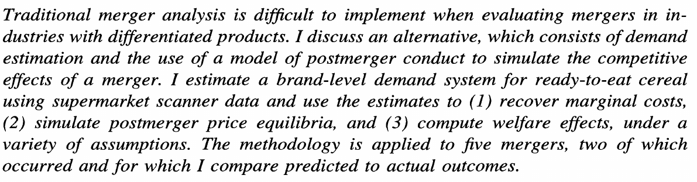
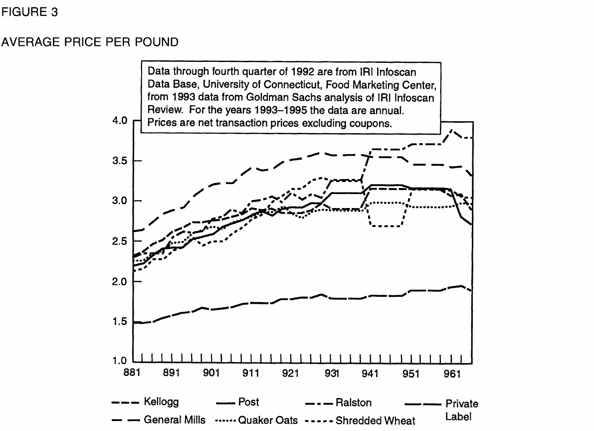
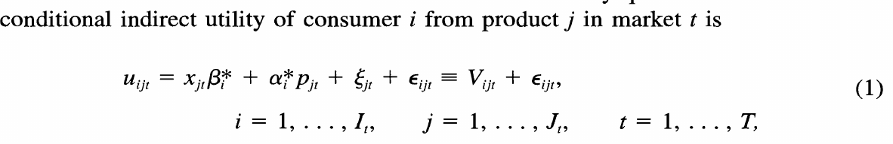
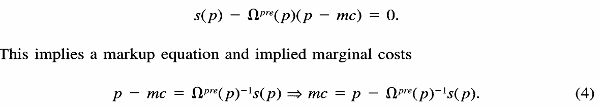
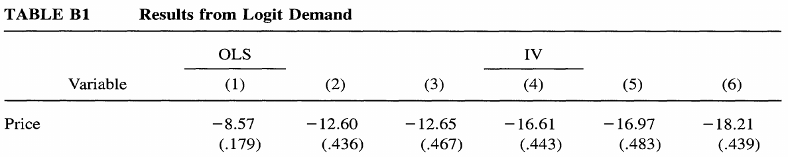
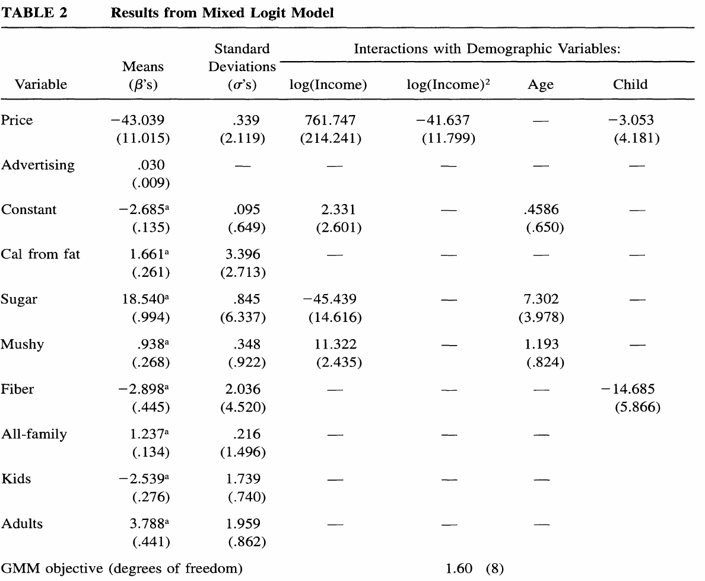
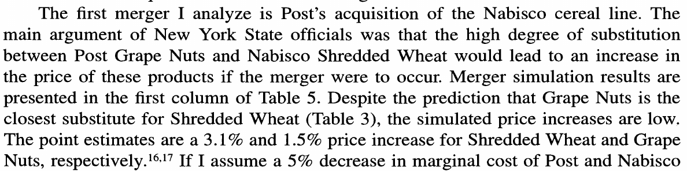

## Before class {.dense}

:::: {.columns}

::: {.column width="50%"}
**Assigned**

- Nevo and Whinston, “Taking the Dogma out of Econometrics: Structural Modeling and Credible Inference” [@nevo2010dogma]
- Nevo, “A Practitioner's Guide to Estimation of Random-Coefficients Logit Models of Demand” (optional) [@nevo2000practitioner]

Readings and course handouts are available on [Canvas](https://colostate.instructure.com/courses/230315/pages/readings).
:::

::: {.column width="50%"}
**Also used in these slides**

- Woerman, ResEcon 703 Week 1 slides, the source of this lecture's structure [@woerman2022structural]
- Example paper: Nevo, mergers in ready-to-eat cereal [@nevo2000mergers]
- Timmins and Schlenker, from Lecture 6.1 [@timmins2009reduced]
- Bellemare, on notation [@bellemare2020applied]
- BLP demand: @berry1994estimating; @blp1995automobile; @nevo2001cereal
- @miller2017millercoors; Conlon and Gortmaker [@conlon2020pyblp]
:::

::::

::: notes
Timing for 75 minutes: 5 minutes on notation, 15 minutes on what structural econometrics is and why to add structure, 15 minutes on constructing and estimating a structural model, 35 minutes on the Nevo example, and 5 minutes on using a structural model. The deck is longer than one class; the example section can be finished from the slides.

The order of sections follows Matt Woerman's Week 1 slides for ResEcon 703 at UMass Amherst (github.com/woerman/ResEcon703). The content and examples are rewritten for this course.
:::

## Latin letters mark what you observe; Greek letters mark what you estimate

| | Latin letters | Greek letters |
|---|---|---|
| **Examples** | $y$, $x$, $W$, $P$, $V$ | $\alpha$ alpha, $\beta$ beta, $\gamma$ gamma, $\delta$ delta, $\varepsilon$ epsilon |
| **Used for** | Variables you observe in the data | Parameters you estimate, and the error term you never observe |

- Latin letters are the letters of the English alphabet
- Fixed effects are parameters, so they get Greek letters: $\gamma_c$, $\delta_t$
- A Greek letter tells the reader the term is estimated

::: {.source}
Source: @bellemare2020applied, Section 5.1.
:::

::: notes
Check the equation you wrote at the end of Lecture 6.1 against this slide and the next one.
:::

## Subscripts tell the reader the level at which each term varies

$$
y_{cst} = \beta P_{st} + \gamma_c + \delta_t + \varepsilon_{cst}
$$

- One letter per dimension, used the same way throughout the paper: $c$ county, $s$ state, $t$ year
- Order from the smallest unit to the largest, with time last
- A term carries only the subscripts it varies over: a state policy is $P_{st}$
- A fixed effect's subscript says what it holds constant: $\gamma_c$ county, $\delta_t$ year
- The outcome's subscripts state the unit of observation: a county in a year

::: notes
Smallest to largest is Bellemare's rule. Time last is a common convention.

The subscript on the treatment also tells the reader where the identifying variation is. In this example the policy varies by state and year, which is also a natural starting point for the clustering level.
:::

# What is structural econometrics?

## A structural model recovers the parameters of behavior

- Definition: any empirical model that recovers the parameters of behavioral functions, such as demand and supply equations, utility functions, or cost structures
- It starts from a theoretical model and states what the researcher can and cannot observe
- What cannot be observed becomes a structural error, backed out of observed behavior
- The parameters are estimated with a procedure such as GMM or maximum likelihood

::: {.source}
Source: @timmins2009reduced, Section 2.
:::

::: notes
Nevo and Whinston (page 69): "Structural modeling attempts to use data to identify the parameters of an underlying economic model, based on models of individual choice or aggregate relations derived from them." Their footnote 1 (page 70) adds that a structural model is "an economic behavioral model that defines the relationship between exogenous and endogenous variables, both observed and unobserved by the researcher." They distinguish this from the econometrics textbook meaning of "structural."

Link to Unit 4: for Ethridge, a conceptual framework is an analysis of a specific problem using relevant theory and concepts. A theoretical model is a conceptual framework written in mathematics, with stated objectives, constraints, functional forms, and an equilibrium. Any paper can have a conceptual framework. A structural paper needs the mathematical version, because its equations are what get estimated.
:::

## A structural econometric model has three parts {.dense}

1. **Economic theory:** relates observed endogenous variables $y$ to observed exogenous variables $x$ and unobserved variables $\varepsilon$, through a functional form $g$ and unknown parameters $\theta$:
$$
y = g(x, \varepsilon; \theta)
$$
2. **Statistical assumptions:** a joint distribution for what is observed and what is not, $f(x, \varepsilon)$
3. **Estimating equation:** what the data are matched to, such as a likelihood function or a set of moment conditions

In the example later in this lecture: $g$ comes from utility and profit maximization, $\varepsilon$ includes unobserved product characteristics, and the estimating equation is a set of moment conditions.

::: {.source}
Source: adapted from @woerman2022structural, slide 11.
:::

::: notes
Endogenous variables are determined inside the model, such as prices and quantities in a market. Exogenous variables are determined outside it, such as costs or demographics.

A moment condition is an equation of the form "the average of something equals zero" that holds at the true parameters. The most familiar one is the IV condition: the instrument is uncorrelated with the error term. Estimation chooses the parameters that make the sample version of the condition as close to zero as possible.

The three parts line up with the three steps for constructing a model later in the lecture.
:::

## The term "reduced form" has two meanings

- **Textbook meaning:** solve a system of equations so the outcome depends only on exogenous variables
- **Recent meaning:** program evaluation or treatment effects, with attention to how the exogenous variable was assigned
- Avoids as many structural assumptions as possible, and still requires assumptions of its own
- The two approaches overlap, and many papers combine them

The designs from Lecture 6.1 are reduced form in the recent sense: fixed effects, quasi-experiments, regression discontinuity, and randomization.

::: {.source}
Sources: @timmins2009reduced, Section 3; @woerman2022structural, slide 12.
:::

::: notes
Woerman uses the term "nonstructural" for the same idea. Nonstructural models are usually grounded in theory, which decides what goes in $y$ and $x$, but the estimated relationship need not have an economic interpretation.

Timmins and Schlenker's example of the textbook meaning: demand and supply both depend on price; the reduced form eliminates price and writes equilibrium quantity as a function of the demand and supply shifters.

Where the climate designs from 6.1 fit: the panel weather model and long differences are reduced form in the recent sense. The Ricardian model estimates a hedonic-style relationship with an economic argument behind it; the methods map places it between the two.
:::

## One question answered both ways: how does a merger change prices?

**Reduced form.** Compare prices of the merging firms' products with prices of other products, before and after a merger that already happened. The estimate is the price effect of that merger. It does not say why prices changed, and it does not apply directly to a different merger.

**Structural.** Estimate how consumers substitute between products and how firms set prices, recover marginal costs, and solve for prices under the new ownership. The answer applies to a merger that has not happened, and it comes with a welfare measure. It holds products, firms, and pricing behavior fixed, and it needs credible instruments.

The example in this lecture, @nevo2000mergers, takes the structural route.

::: {.source}
Sources: @nevo2010dogma, pages 73 to 77; @woerman2022structural, slides 13, 14, 19, and 20.
:::

::: notes
The reduced-form example in Nevo and Whinston is Hastings (2004) on the ARCO acquisition of Thrifty gasoline stations, which compares stations near and far from the acquired stations. They call it careful design, then ask what it says about a merger of two large branded firms, or a merger in another region.

Woerman's version of this slide uses auctions: regressing the winning bid on the number of bidders gives a number, but even a causal estimate says nothing about bidders' valuations. A structural auction model recovers the distribution of valuations and can simulate a change in the number of bidders or the auction rules.

Nevo and Whinston's conclusion: each approach is useful in some cases and fails in others, depending on the question and the data.
:::

# Why add structure?

## Structure lets a paper estimate unobserved parameters, simulate counterfactuals, and test theories

- **Unobserved parameters:** marginal utility, marginal cost, risk preferences, discount rates, switching costs
- **Counterfactuals:** what would happen if the setting changed, including new policies and feedback loops
- **Welfare and who bears the cost:** effects in dollars, through a utility function, by type of consumer
- **Competing theories:** for example, do firms set prices or quantities?

::: {.source}
Sources: @woerman2022structural, slide 16; @timmins2009reduced, Section 2.1.
:::

::: notes
Counterfactuals require parameters that stay fixed under the simulated change; that is what "structural" parameters means here. Testing competing theories requires a model that states what each theory implies for the data.

A feedback loop is an outcome that changes the conditions that produced it, so agents re-optimize and markets re-equilibrate. Timmins and Schlenker's example is a fishery: fish stocks affect fishing effort, and effort affects stocks through the harvest. A merger has the same structure: the merged firm raises prices, consumers switch, rivals reset their prices, and those prices change the merged firm's demand.

Who bears the cost: Jacobsen (2008) models fuel-economy standards together with the used-car market and finds the cost falls on poorer households who buy used cars.

Unintended consequences: Ryan (2006) models entry in the cement industry and finds the 1990 Clean Air Act Amendments raised sunk entry costs, which reduced competition and left consumers worse off while incumbent firms gained.

Link to the methods map: these are the methods at the top of the map, where the outcome is not in the data.
:::

## Should you always add structure? The answer depends on the question, the data, and the setting

- **Costs of structure:** it needs economic theory that fits the setting, and often many assumptions to connect that theory to the data
- If those assumptions are unrealistic, the results are not credible, and the assumptions may be hard for readers to see
- **Strengths of reduced form, with a good research design:** causal estimates, fewer assumptions, and transparent estimation and results
- Without a good research design, the reduced-form advantage is smaller

::: {.source}
Source: @woerman2022structural, slide 17.
:::

::: notes
Ask: for your proposal, which of these points matters most?

Connect to Lecture 6.1: a good research design is the source of variation and the identifying assumption that make an estimate causal.
:::

## The two approaches differ in what they estimate and what they assume {.dense}

| | Reduced form | Structural |
|---|---|---|
| **Estimates** | High-level response parameters | Behavioral parameters, such as preferences and costs |
| **Credibility comes from** | The source of variation | The source of variation and the economic model |
| **Best suited to** | Establishing causality for a change in the data | Feedback loops, large policy changes, and welfare |
| **Main assumptions** | How treatment was assigned | Functional form, unobservables, and how agents behave (such as profit maximization) |
| **Counterfactual** | A comparison group, for a change in the data | A simulation of the model, including changes not in the data |
| **Main limit** | Harder to extend to changes not observed | Conclusions depend on the model being right |

: {tbl-colwidths="[20,36,44]"}

::: {.source}
Source: @timmins2009reduced, Sections 1 and 4.
:::

::: notes
Timmins and Schlenker say each approach "may be better suited to answering particular types of questions." The choice follows from the question.

Counterfactual and simulation are different ideas. A counterfactual is the scenario: what would happen under conditions we do not observe. A simulation is a calculation: solving a model under stated conditions. Reduced-form designs also estimate a counterfactual, because the control group stands in for what would have happened to the treated group. Timmins and Schlenker's point is about out-of-sample counterfactuals: "Counter-factual policy simulations that include out-of-sample predictions by definition require structural parameters."
:::

## Structure and credible design are complements

- **Structure can add credibility** when the question involves another setting, an out-of-sample counterfactual, or welfare
- **Good data help both approaches:** when the data do more of the work, the assumptions do less
- **Combining them:** a credible design estimates the overall effect; a structural model checks it and identifies the mechanism
- Reduced-form estimates can be inputs to a model or targets it must reproduce, and retrospective studies check model predictions

::: {.source}
Sources: @woerman2022structural, slides 18 and 21; @nevo2010dogma, pages 70 to 71 and 77; @timmins2009reduced, Section 4.
:::

::: notes
Nevo and Whinston: "Structural analysis is not a substitute for credible inference. Quite to the contrary, in general, structural analysis and credible identification are complements." Structural analysis has two steps: match observed behavior to a theoretical model to recover parameters, then use the model to predict responses to changes, assuming those parameters stay the same.

Timmins and Schlenker: "the most convincing evidence stems from contrasting various approaches." Nevo and Whinston's example of a retrospective study is Peters (2006), who compares airline merger simulations with what happened after the mergers.

Woerman calls merger analysis "a classic example of credibility through structure." The Nevo example below shows why.
:::

# How to construct a structural model

## Constructing a structural model takes three steps

1. **Start with economic theory:** the setting (markets, agents, information), the primitives (preferences, technology, endowments), exogenous variables, objectives and choice variables, and an equilibrium concept
2. **Turn it into an econometric model:** add unobservables for what the theory leaves out, such as researcher uncertainty, agent uncertainty, optimization error, or measurement error
3. **Estimate it:** choose functional forms, distributional assumptions, an estimation method, and specification tests

::: {.source}
Source: @woerman2022structural, slides 23 and 24.
:::

::: notes
Step 1 is the conceptual framework from Unit 4 written as a model. Primitives are the parts of the model that are taken as fixed and estimated: what consumers like, what firms can produce, and what agents start with.

These steps map onto a paper: Step 1 is the model section; Steps 2 and 3 are the estimation and identification section; the results come after. The next three slides apply the steps to models of increasing difficulty.
:::

## A simple structural model: a Cobb-Douglas production function {.dense}

We observe output $Y_t$, capital $K_t$, and labor $L_t$, and want the output elasticities of capital and labor.

1. **Theory:** $Y_t = A K_t^{\alpha} L_t^{\beta}$, which in logs is $\ln\, Y_t = \ln\, A + \alpha \ln\, K_t + \beta \ln\, L_t$
2. **Unobservable:** add $\varepsilon_t$ for measurement error, with $E[\varepsilon_t \mid K_t, L_t] = 0$
3. **Estimation:** OLS on

$$
\ln\, Y_t = \ln\, A + \alpha \ln\, K_t + \beta \ln\, L_t + \varepsilon_t
$$

Is the assumption in Step 2 reasonable? If $\varepsilon_t$ includes productivity the farmer knows when choosing inputs, then $K_t$ and $L_t$ are endogenous.

::: {.source}
Source: adapted from @woerman2022structural, slide 25.
:::

::: notes
The parameters $\alpha$ and $\beta$ come from the theory: they are the percent change in output from a 1 percent change in each input, and $\alpha + \beta$ measures returns to scale. That is what makes this a structural model, even though it is estimated with OLS.

The endogeneity question is the same one we will ask about price in demand: an agent chooses a variable knowing something the researcher does not see.
:::

## A more complex model: logit demand, inverted into a linear regression {.dense}

1. **Theory:** consumer $i$ buys the product $j$ with the highest utility, $u_{ijt} = x_{jt}\beta - \alpha p_{jt} + \xi_{jt} + \varepsilon_{ijt}$, or buys nothing
2. **Unobservables:** $\xi_{jt}$, product characteristics the researcher does not observe, and $\varepsilon_{ijt}$, an extreme-value shock for each consumer
3. **Estimation:** the shock gives a formula for market shares, which inverts into a linear equation; price needs instruments

$$
\ln\, s_{jt} - \ln\, s_{0t} = x_{jt}\beta - \alpha p_{jt} + \xi_{jt}
$$

Every consumer has the same tastes, $\alpha$ and $\beta$.

::: {.source}
Sources: @berry1994estimating; @nevo2000practitioner, pages 522 and 532.
:::

::: notes
$s_{jt}$ is the market share of product $j$ and $s_{0t}$ is the share that buys nothing, called the outside good.

How the equation is derived: the extreme-value assumption on $\varepsilon_{ijt}$ gives $s_{jt} = \exp(\delta_{jt}) / (1 + \sum_k \exp(\delta_{kt}))$, where $\delta_{jt}$ is the mean utility. Dividing by the outside share and taking logs gives the equation on the slide. The derivation notes show each step, with a numeric check: shares of 0.2 and 0.3 with an outside share of 0.5 give $\delta_1 = \ln(0.2/0.5) = -0.92$ and $\delta_2 = \ln(0.3/0.5) = -0.51$.

Why price needs instruments: firms know $\xi_{jt}$ when they set prices, so price is correlated with the error term. We return to this under identification.
:::

## Even more complex: with many products, demand needs structure on substitution {.dense}

A log-log demand system estimates one equation for each product $j$, with every price on the right side:

$$
\ln\, q_{jt} = \gamma_j + \sum_{k=1}^{100} \eta_{jk} \ln\, p_{kt} + \varepsilon_{jt}
$$

- $\eta_{jk}$: the percent change in the quantity of $j$ when the price of $k$ rises 1 percent
- With 100 products, a log-log demand system has at least 10,000 parameters
- BLP describes each product by its characteristics, so the number of parameters depends on the number of characteristics
- It uses market-level data on prices and quantities, and it allows for endogenous prices

::: {.source}
Sources: @nevo2000practitioner, pages 514 to 515; @blp1995automobile.
:::

::: notes
BLP stands for Berry, Levinsohn, and Pakes (1995), who estimate demand for automobiles.

A log-log demand system regresses the log quantity of each product on the logs of all prices, so each coefficient is an own-price or cross-price elasticity: 100 equations with 100 prices each. It has no utility function, so it looks like a regression a reduced-form paper would run. It is a demand equation, though, and it needs an exogenous source of variation for each price. A reduced-form design can estimate a few elasticities, for example from a tax or price change that affects one product. The problem on this slide is estimating all of them at once.

Nevo describes this system in words; the equation writes out his description. Nevo also notes that the symmetry and adding-up restrictions from theory still leave too many parameters.

Transition: logit solves the parameter problem with characteristics, but it has a cost, which the next slide shows.
:::

## Logit and random-coefficients logit differ in whether tastes vary across consumers {.dense}

| | Logit | Random-coefficients logit (BLP) |
|---|---|---|
| **Tastes** | Same for everyone: $\alpha$, $\beta$ | Vary across consumers: $\alpha_i$, $\beta_i$ |
| **How consumers differ** | Only through the shock $\varepsilon_{ijt}$ | Through tastes and the shock |
| **Market shares** | A closed-form formula | An average over consumers, computed numerically |
| **Substitution** | In proportion to market shares | Toward products with similar characteristics |
| **Estimation** | Linear instrumental-variables regression | GMM with a numerical search |

Logit is the special case of random coefficients in which every consumer has the same tastes.

::: {.source}
Source: @nevo2000practitioner, pages 522 to 526.
:::

::: notes
Nevo's example (page 523): when the price of Lucky Charms rises, logit predicts equal gains for Cap'n Crunch and Grape Nuts if they have similar shares. We expect more consumers to switch to Cap'n Crunch, another children's cereal. Logit cannot say that, because consumers differ only through an independent shock, so those who leave a product split across rivals in proportion to market shares.

Students will see "BLP" used for the random-coefficients logit estimated with instruments for price. BLP (1995) also add a supply side.
:::

## Types of structural models you may see {.dense}

| Topic | Structural models | What they recover |
|---|---|---|
| Consumer demand | Demand systems (AIDS, QUAIDS); discrete choice (logit to BLP) | Elasticities, substitution, welfare |
| Nonmarket values | Hedonic; Ricardian; travel cost; choice experiments | Willingness to pay |
| Producers | Production, cost, and profit functions; stochastic frontier | Returns to scale, efficiency |
| Firms and markets | Conduct and markups; equilibrium displacement | Markups, pass-through, incidence |
| Dynamics and risk | Real options; dynamic discrete choice; risk preferences and insurance demand | Value of waiting, risk aversion |
| Trade and policy | Structural gravity; spatial equilibrium; CGE | Trade costs, economy-wide effects |

: {tbl-colwidths="[20,50,30]"}

Each method has an example specification on the [methods map](https://laurenchenarides.github.io/csu-arec-570/files/includes/ag-econ-methods-map.html){target="_blank" rel="noopener"}.

::: notes
These are the structural methods on the methods map, grouped by what the paper studies. Students should find the row closest to their proposal. Each point on the map opens a card with an example specification, what it estimates, its key assumptions, and how it is estimated.

The Cobb-Douglas example sits in the Producers row. Logit and BLP sit in the Consumer demand row.
:::

# Structural estimation

## Some structural models reduce to a regression; others need structural estimation {.dense}

- **Regression:** the Cobb-Douglas model (OLS) and logit demand (instrumental variables). Fast, transparent, and easy to interpret
- **Structural estimation:** the model has no linear form, so the parameters are chosen to match the data directly
  - **Maximum likelihood:** the parameters that make the observed data most probable under the model
  - **GMM (generalized method of moments):** the parameters that bring the model's moment conditions closest to zero
  - **Simulation versions** of both, when the model's predictions have no formula and are averaged over simulated agents
- BLP is in the second group: shares are averages over simulated consumers, and GMM chooses the taste parameters

::: {.source}
Source: @woerman2022structural, slides 28 and 29.
:::

::: notes
Woerman's course covers these methods in detail; ours needs only the distinction, because a paper has to state which estimator it uses and why.

GMM in BLP: the moment condition is that the unobserved product characteristics are uncorrelated with the instruments. For each guess of the taste parameters, the software computes the implied unobserved characteristics and measures how far they are from satisfying that condition.
:::

## Numerical estimation can stop early, so report how the model was solved {.dense}

Estimation searches for the parameters that minimize the GMM objective. The optimizer stops when it is close enough, and that stopping rule is a choice.

| Same model, same data | Mean price coefficient | Mean own-price elasticity |
|---|---:|---:|
| Loose stopping rule (1E-4), as published | −32.4 | −3.70 |
| Tighter stopping rule (1E-5), as in our demo | −62.7 | −3.62 |
| Tighter stopping rule and better instruments | −27.5 | −3.69 |

- **How to read this:** the coefficient moves a lot, and the elasticity barely moves
- Report the optimizer, tolerances, starting values, and integration method
- Try several optimizers and starting values, and report the quantities that matter

::: {.source}
Source: @conlon2020pyblp, Table 7.
:::

::: notes
Conlon and Gortmaker re-estimate Nevo's model on his simulated data three times. They report nearly identical elasticities and markups despite different parameter estimates, and they point to the Price × Income terms, which are nearly collinear in the data. The first row uses Nevo's original settings; they note that those tolerances were too loose. "Better instruments" means an approximation to the feasible optimal instruments.

They also find that with these practices, estimates are stable across starting values and optimizers, which is better news than earlier work suggested [Knittel and Metaxoglou, 2014, as discussed in @conlon2020pyblp].

Transition: we now follow one structural paper from its question to its counterfactuals.
:::

# Example: Nevo (2000), mergers in ready-to-eat cereal

## Research question: what are the price and welfare effects of cereal mergers? {.dense}

{width="760" fig-alt="Abstract of Nevo (2000), RAND Journal of Economics, describing demand estimation and merger simulation for ready-to-eat cereal, applied to five mergers, two of which occurred."}

- **Two completed mergers:** Post (owned by Kraft) bought Nabisco's cereals in 1992, approved in 1995 after a challenge by New York; General Mills bought Chex from Ralston in 1996
- **One called off:** General Mills' 1992 bid for Nabisco, withdrawn over antitrust concerns
- **Two hypothetical:** Quaker Oats with Kellogg, and Quaker Oats with General Mills

::: {.source}
Source: @nevo2000mergers, pages 395 to 396.
:::

::: notes
This paper runs through the rest of the lecture. The order of the next slides follows the paper: setting, data, descriptive evidence, model, estimation and identification, results, and counterfactuals.

Nevo notes the analysis was done "without time pressure and using (almost) ideal premerger data," so it answers how well these methods perform under good conditions.
:::

## Setting: market concentration does not show how close brands are as substitutes {.dense}

- **Empirical question:** how much would prices rise if two cereal firms merged?
- **Traditional merger analysis:** define the market, then compute a concentration measure, such as the HHI, from market shares
- **Limit:** with differentiated products the market is hard to define, and the HHI is a reasonable guide only if products are equally spaced in their characteristics
- **Portfolio effect:** a firm that owns two substitutes charges more than two separate firms would, because some sales lost by one brand go to the other
- **Nevo's approach:** estimate how much brands substitute, such as Post Grape Nuts and Nabisco Shredded Wheat, then simulate post-merger prices

::: {.source}
Sources: @nevo2000mergers, pages 395 to 397; @nevo2001cereal, pages 307 to 308.
:::

::: notes
Food demand is a common application in agricultural economics, so the method may be useful for proposals on food retail or consumer demand.

The HHI (Herfindahl-Hirschman Index) is the sum of squared market shares, measured in percent, so it runs from 0 to 10,000. It uses shares only, and two brands with the same shares give the same HHI whether or not consumers treat them as close substitutes. Nevo cites Willig (1991): if demand is logit, relying on market shares for merger policy is sensible, because in logit all substitution patterns are determined by market shares. Nevo argues logit is inadequate for cereal.

The case: during the trial, New York's experts argued that Shredded Wheat and Grape Nuts were the main competitors in a small submarket, so the merger would reduce competition. Kraft's experts argued that private labels and other brands would prevent a price increase. Both sides used scanner data and econometric estimates.

The portfolio effect is the term in Nevo's Econometrica paper (2001). The merger paper applies the same logic to a change in ownership. Two brands already owned by the same firm, such as Cheerios and Wheaties at General Mills, already show this effect before any merger.
:::

## Data: supermarket scanner data on 24 brands in 45 cities over 20 quarters {.dense}

- **Prices and market shares:** IRI Infoscan scanner data, 1988 to 1992, by brand, city, and quarter; a market is a city in a quarter (900 markets)
- **Market size:** one serving per person per day; the share of the outside good is whatever is left
- **Product characteristics:** calories from fat, sugar, fiber, sogginess in milk ("mushy"), and market segment, read from cereal boxes
- **Advertising:** national media spending by brand
- **Demographics:** income, age, and children, drawn from the Current Population Survey for each city
- **Instruments:** prices of the same brand in other cities, and cost proxies such as city density and supermarket wages

::: {.source}
Source: @nevo2000mergers, pages 404 to 405 and 417.
:::

::: notes
The 24 brands cover 42 to 63 percent of cereal volume in each city and quarter, and the brands most relevant to the mergers are included.

Nevo's Table 1 reports that brand dummies explain 92 percent of the variation in price. Controlling for brand, most of the remaining variation is across cities. That variation has exogenous and endogenous sources, which is why instruments are needed.

Every data source has a role in the model: shares and prices for demand, characteristics for substitution, demographics for how tastes vary, and instruments for identification.
:::

## Descriptive evidence: cereal prices rose faster than inflation before the mergers {.dense}

:::: {.columns}

::: {.column width="52%"}
{width="560" fig-alt="Figure 3 of Nevo (2000): average price per pound of cereal by firm from 1988 to 1996, with separate lines for Kellogg, General Mills, Post, Quaker Oats, Ralston, Shredded Wheat, and private label."}
:::

::: {.column width="48%"}
- From 1988 to 1992, average cereal prices rose about 35%, while the CPI rose 21%
- Shredded Wheat rose 32% from mid-1990 to the merger announcement, against 7% to 12% for other companies
- After the merger, Shredded Wheat fell 8%, similar to other brands
- Nevo: "One has to be careful in drawing conclusions from these facts, since many things happened during this period"
:::

::::

::: {.source}
Source: @nevo2000mergers, pages 398 to 399, Figure 3.
:::

::: notes
This is the descriptive evidence a paper shows before the model: what happened to prices around the mergers. It motivates the question and shows why the raw data cannot answer it. Many things changed at once: private labels grew, coupons increased, and in 1996 Kraft announced a 20 percent price cut that rivals followed.

Read the figure with students: find the Shredded Wheat line, then the Post line, before and after 1993.
:::

## A reduced-form design Nevo could have run: difference in differences {.dense}

Nevo has no reduced-form regression. For the Post-Nabisco merger, it could look like this:

$$
\begin{aligned}
\ln\, p_{jct} = {} & \beta_1\, \mathbf{1}\{\text{Post}\}_j \times \mathbf{1}\{\text{Post-merger}\}_t + \beta_2\, \mathbf{1}\{\text{Nabisco}\}_j \times \mathbf{1}\{\text{Post-merger}\}_t \\
& + \beta_3\, \mathbf{1}\{\text{Post-merger}\}_t + \theta_{jc} + \tau t + \varepsilon_{jct}
\end{aligned}
$$

- **Coefficients of interest:** $\beta_1$ and $\beta_2$, the change in Post and Nabisco prices after the merger, relative to the change for other brands
- $\beta_3$: the change after the merger for all brands; $\theta_{jc}$: brand-by-city fixed effects; $\tau t$: a linear time trend
- **Identifying assumption:** without the merger, Post and Nabisco prices would have followed other brands
- **Threats:** Shredded Wheat's faster pre-merger growth, private labels, the 1996 price cuts, and rivals' price responses
- **Data needed:** city-level prices after 1992, which Nevo did not have

::: {.source}
Design adapted from @miller2017millercoors, equation (1).
:::

::: notes
This slide is our construction, written to show what the reduced-form step would look like. Subscripts: $j$ brand, $c$ city, $t$ quarter. Miller and Weinberg (2017) run this kind of regression for the MillerCoors joint venture, with separate indicators for the merging firms and the largest rival.

Reading the coefficients: $\beta_1$ is the percent change in the prices of Post's brands (Raisin Bran and Grape Nuts) and $\beta_2$ the change for Nabisco's brand (Shredded Wheat), each measured against other brands over the same period. The model's predictions give something to compare with: Nevo simulates increases of 3.1 percent for Shredded Wheat, 1.5 percent for Grape Nuts, and 0.9 percent for Post Raisin Bran.

Why a linear trend and no quarter fixed effects: quarter fixed effects would absorb $\mathbf{1}\{\text{Post-merger}\}_t$, so $\beta_3$ could not be estimated. Miller and Weinberg make the same choice and report that quarter fixed effects give nearly identical estimates of the coefficients of interest.

Rivals' price responses are a threat because the comparison brands are in the same market. If Kellogg or General Mills raised prices in response to the merger, the comparison group moved too, and $\beta_1$ and $\beta_2$ understate the effect. This is the feedback loop from earlier in the lecture, and it is one reason a structural model is useful here.

Connect to Lecture 6.1: this is the difference-in-differences design, and the threats are violations of parallel trends. Figure 3 already shows one: Shredded Wheat's price was rising faster than other brands before the merger.

Nevo says he lacks the detailed post-merger data used in estimation, so he compares predictions with aggregate post-merger prices instead. That comes at the end of the example.
:::

## Reduced form and structural analysis answer different parts of the merger question {.dense}

- **What the regression would give:** the price effect of one completed merger, under parallel trends
- **What it would leave out:** the General Mills bid that was called off and the two hypothetical mergers, which have no post-merger data
- It also would not separate the reasons for a price change: closeness of substitutes, cost savings, or a change in how firms compete
- **What the structural model adds:** demand, substitution, and marginal costs, so it can simulate any change in ownership and report welfare
- **How they fit together:** a reduced-form estimate for a completed merger is a check on the model's prediction

::: {.source}
Sources: @woerman2022structural, slide 40; @nevo2010dogma, pages 73 to 77.
:::

::: notes
Woerman's version of this slide for Miller and Weinberg: the reduced-form results are simple and transparent, but they do not capture consumer substitution patterns, which matter for how firms set prices. The structural model covers demand and supply, estimates how firms compete, and simulates counterfactuals.

Transition: the next slides write out Nevo's model.
:::

## Nevo's theoretical model: consumers, firms, and equilibrium {.dense}

| | Consumers | Firms |
|---|---|---|
| **Choice** | One brand, or none | Prices of their own brands |
| **Objective** | Maximize utility | Maximize profit: $\sum_{j \in F_f} (p_j - mc_j)\, M s_j(p)$ |
| **Take as given** | Income, products, and prices | Demand, marginal costs, and rivals' prices |

- **Equilibrium:** Bertrand-Nash; each firm's prices are optimal given rivals' prices, and shares equal what consumers choose at those prices
- **Researcher observes:** market shares, prices, and product characteristics
- **Researcher does not observe:** unobserved quality, individual tastes and shocks, and marginal cost

::: {.source}
Sources: @nevo2000mergers, pages 399 to 403; @blp1995automobile, Sections 2 and 3.
:::

::: notes
This is Step 1 of constructing a structural model. Here $F_f$ is the set of brands owned by firm $f$, and $M$ is the size of the market.

BLP's own summary (Section 8): the model is "four primitives and a Nash equilibrium assumption in prices." The primitives are the utility function, the cost function, the distribution of consumer characteristics, and the distribution of product characteristics.

Nevo estimates demand and uses the supply side to recover marginal costs; he notes the supply relation could also be estimated jointly with demand.
:::

## Demand: each consumer chooses the brand that gives the highest utility {.dense}

{width="760" fig-alt="Equation (1) of Nevo (2000): conditional indirect utility of consumer i from product j in market t equals x times beta-star-i plus alpha-star-i times price plus xi plus epsilon."}

- $x_{jt}$: observed characteristics, including advertising; $p_{jt}$: price
- $\xi_{jt}$: characteristics the researcher does not observe, modeled as a brand effect, a time effect, and a city-quarter deviation
- $\alpha_i^*$, $\beta_i^*$: each consumer's tastes, which vary with demographics and unobserved traits
- $\epsilon_{ijt}$: a mean-zero shock; buying nothing is the outside good
- Summing individual choices gives each brand's predicted market share, which is matched to the observed share

::: {.source}
Source: @nevo2000mergers, pages 400 to 401.
:::

::: notes
This is the utility function from the logit slide, with tastes that vary across consumers. Nevo's version leaves out income because it is the same for every option and cancels from the choice; the derivation notes show this step.

The brand effect in $\xi_{jt}$ is captured by brand dummy variables, which absorb all fixed brand quality, observed and unobserved. The city-quarter deviation is the error term in estimation.

Nevo assumes both firms and consumers observe $\xi_{jt}$ and take it into account. That assumption is why price is endogenous.
:::

## Random coefficients: $\Pi$ and $\Sigma$ measure how tastes vary across consumers {.dense}

Each consumer's taste for a characteristic, here sugar, has three parts:

$$
\beta_i^{\text{sugar}} = \beta^{\text{sugar}} + \pi_{\text{inc}}\, \text{income}_i + \pi_{\text{age}}\, \text{age}_i + \sigma\, v_i
$$

| Parameter | What it measures |
|---|---|
| $\beta^{\text{sugar}}$ | Taste of the average consumer |
| $\pi_{\text{inc}}$, $\pi_{\text{age}}$ (in $\Pi$) | How the taste changes with income and age |
| $\sigma$ (in $\Sigma$) | Spread of the taste among consumers with the same income and age |

: {tbl-colwidths="[30,70]"}

- Stacking these rows for price and every characteristic gives $\Pi D_i + \Sigma v_i$; logit sets $\Pi = 0$ and $\Sigma = 0$
- **Why substitution changes:** buyers of a sugary cereal tend to like sugar, so when its price rises they move to other sugary cereals

::: {.source}
Sources: @nevo2000mergers, pages 400 to 401; @nevo2000practitioner, pages 519 and 526.
:::

::: notes
$\Pi$ and $\Sigma$ are the random coefficients. They are the only new parameters relative to logit. $\Pi$ captures variation in tastes that comes from demographics the researcher observes. $\Sigma$ captures variation that remains among consumers with the same demographics. They are called random because each consumer's $D_i$ and $v_i$ are drawn from a distribution; we never observe a specific consumer's tastes.

Nevo uses log income, its square, age, and an indicator for children. Demographics are drawn from the CPS for each city, so cities with different demographics have different mixes of tastes.

The estimates come in the results section. Transition: the supply side next.
:::

## Supply: firms set prices, which recovers marginal costs and simulates the merger {.dense}

{width="780" fig-alt="Equation (4) of Nevo (2000): shares minus Omega-pre times price minus marginal cost equals zero, which implies the markup equation p minus mc equals Omega-pre inverse times s, and marginal cost equals p minus Omega-pre inverse times s."}

- Each multiproduct firm sets the prices of its brands to maximize joint profit (Bertrand-Nash)
- $\Omega^{pre}$ holds the slopes of demand for pairs of brands owned by the same firm
- **Marginal costs are not observed:** the demand estimates and this condition give $mc = p - \Omega^{pre}(p)^{-1} s(p)$
- **Merger:** keep the same $mc$, change ownership to $\Omega^{post}$, and solve for the new prices

::: {.source}
Source: @nevo2000mergers, pages 402 to 403.
:::

::: notes
This is the first-order condition of the firm's profit problem on the theoretical model slide, stacked for all brands.

Nevo lists the assumptions in the post-merger step: Bertrand-Nash before and after; the same costs, including manufacturer-retailer relations; the same characteristics and the same outside good. If pre-merger pricing were more collusive than Bertrand-Nash, he would overestimate marginal costs and the effects of the merger.
:::

## Estimation: back out the unobserved term from market shares, then use GMM {.dense}

In logit, observed market shares convert into a linear regression:

$$
\ln\, s_{jt} - \ln\, s_{0t} = x_{jt}\beta - \alpha p_{jt} + \xi_{jt}
$$

| | $\xi_{jt}$: unobserved product characteristics | $\varepsilon_{ijt}$: individual shock |
|---|---|---|
| **Varies by** | Product and market | Consumer, product, and market |
| **Known to** | Consumers and firms, so it affects price | The consumer only |
| **In estimation** | The error term in the regression | Averaged over consumers into the share formula |

: {tbl-colwidths="[20,42,38]"}

- **Random coefficients:** for each guess of the taste parameters, find the $\xi_{jt}$ that reproduce observed shares, and choose the guess that makes $\xi_{jt}$ uncorrelated with the instruments (GMM)
- In a paper, this gets one paragraph; the steps go in an appendix ([derivation notes](https://laurenchenarides.github.io/csu-arec-570/files/blp-derivation.html){target="_blank" rel="noopener"})

::: {.source}
Sources: @berry1994estimating; @nevo2000mergers, pages 405 and 417 to 418.
:::

::: notes
The point of this slide is the difference between the two unobserved terms. $\varepsilon_{ijt}$ differs across consumers, so with many consumers it averages out: it produces the share formula and then disappears from the equation. $\xi_{jt}$ is the same for every consumer of product $j$ in market $t$, so it does not average out. It stays in the equation as the error term. Firms know it when they set prices, which is why price is endogenous and the regression needs instruments. This is why $\xi_{jt}$ is called the structural error.

Nevo follows this approach (Appendix A): in logit, the procedure is two-stage least squares; in the full model, shares and the inversion are computed numerically. Because brand dummies absorb fixed characteristics, the mean tastes for those characteristics are recovered in a second step by regressing the brand effects on characteristics (a minimum distance procedure).

The random-coefficients loop, if students ask: (1) guess the parameters that describe how tastes vary; (2) find the mean utilities $\delta_{jt}$ that make predicted shares equal observed shares; (3) regress $\delta_{jt}$ on price and characteristics using instruments, and the residual is $\xi_{jt}$; (4) measure how far $\xi_{jt}$ is from being uncorrelated with the instruments, which is the GMM objective; (5) update the guess and repeat until the objective reaches a minimum.

Inference: report GMM standard errors for the parameters, and standard errors for the quantities the paper is about, such as elasticities. Nevo uses a parametric bootstrap for the confidence intervals on simulated price changes.

Transition: estimation gives us numbers. Identification asks what in the data determines them.
:::

## BLP identification has two parts: the price coefficient and substitution patterns {.dense}

| | Price coefficient | Substitution patterns |
|---|---|---|
| **Parameters** | Mean price sensitivity, $\alpha$ | How tastes vary across consumers |
| **Problem** | Endogeneity: price is correlated with $\xi_{jt}$ | Market shares are aggregates, so they do not show who switched to what |
| **What identifies it** | Instruments that shift price | How shares respond across products and markets |
| **Threats** | Instruments correlated with demand shocks | Too little variation in prices, characteristics, choice sets, or demographics |

Only the first part is an endogeneity problem. The second concerns which variation pins down the spread of tastes.

::: {.source}
Source: @nevo2000practitioner, pages 528 to 530.
:::

::: notes
Nevo frames these as two questions: first, how to deal with prices that are set by firms using information the researcher lacks; second, what in the data distinguishes logit from random-coefficients logit.

There is one more endogeneity concern: unobserved characteristics may be correlated with observed ones. Nevo handles this with brand fixed effects.

Both parts are estimated together, from the same GMM objective. We take them in turn.
:::

## Identification of the price coefficient: price is endogenous, so it needs instruments {.dense}

- Price is an equilibrium outcome: firms set markups knowing demand, so $p_{jt}$ is correlated with $\xi_{jt}$
- OLS biases the price coefficient toward zero, because high-$\xi_{jt}$ products have both higher prices and higher shares
- Identification requires instruments $Z_{jt}$ that shift price and satisfy $E[\xi_{jt} \mid Z_{jt}] = 0$

| Instrument | Why it moves price | Exclusion restriction |
|---|---|---|
| Cost shifters | Shift marginal cost | Uncorrelated with demand shocks |
| Characteristics of rival products (BLP) | Close rivals lower markups | Product characteristics are set before demand shocks are realized |
| Prices of the same brand in other markets (Hausman) | Same brand shares marginal cost across markets | Demand shocks are independent across markets |

: {tbl-colwidths="[32,30,38]"}

::: {.source}
Source: @nevo2000practitioner, pages 528 and 534 to 536.
:::

::: notes
This is the classic supply and demand identification problem: to trace out a demand curve, you need variation that shifts supply and leaves demand unchanged. The instruments play that role. It is the same endogeneity as the veterans DAG in Lecture 6.1: $\xi_{jt}$ is in the error term and also affects the treatment, here price.

Nevo and Whinston (page 76) say that in many cases the instruments are less than ideal. State that limitation in the section.

Transition: Nevo uses the third row, and checks it against the first.
:::

## In Nevo, instruments raise the price coefficient, and two instrument sets agree {.dense}

{width="820" fig-alt="Price row of Table B1 in Nevo (2000), logit demand: OLS coefficient minus 8.57, instrumental-variables coefficients from minus 12.60 to minus 18.21."}

- **Column 1, OLS:** median own-price elasticity of −1.60, and 4.4% of demands inelastic, which a profit-maximizing firm would not choose
- **Columns 2 to 6, IV:** prices of the same brand in other cities (2 and 4), cost proxies (3 and 5), or both (6); columns 4 to 6 add demographics
- The two instrument sets give nearly identical estimates, which supports the exclusion restriction
- **Threat to the Hausman instrument:** a national demand shock, such as news that fiber may reduce the risk of cancer, moves demand in every city

::: {.source}
Source: @nevo2000mergers, pages 405 to 406 and 418 to 420, Table B1.
:::

::: notes
A firm with market power always prices where demand is elastic, so an estimate that implies inelastic demand signals that the price coefficient is biased toward zero.

Nevo's identifying assumption: controlling for brand means and demographics, city-specific demand shocks are independent across cities. Then a brand's prices in other cities share its marginal cost and are uncorrelated with the local shock.

Nevo is careful about what the comparison shows: similar coefficients do not prove the instruments are valid, but they provide some support. This comparison is possible only in logit, because the cost proxies are too few to estimate the full model.
:::

## Identification of substitution patterns: compare how shares respond across products and markets {.dense}

Nevo's example: products A and B are similar, and B and C have the same market share. The price of A rises.

- **Logit predicts** equal changes in the shares of B and C
- **If B gains more than C**, the data favor random coefficients, and the size of the gap identifies the parameters in $\Sigma$
- **Demographics:** the parameters in $\Pi$ are identified by comparing markets with different demographics

Having many markets helps when they add variation in prices, characteristics, choice sets, and demographics. Nevo's cereal data have no variation in the choice set across markets, which he offers as a reason his estimates of $\Sigma$ are imprecise.

::: {.source}
Source: @nevo2000practitioner, pages 529 to 530 and 541.
:::

::: notes
The number of markets alone is the wrong test. What a section has to state is the comparison: which products, which changes, which markets. This is what "state which variation identifies which parameter" means in a structural paper.

Nevo adds that observing share changes as new products enter, or as characteristics change, is especially helpful.

In estimation, these comparisons enter through the same GMM moment conditions used for the price coefficient.
:::

## Demand results: tastes vary mostly with demographics {.dense}

:::: {.columns}

::: {.column width="58%"}
{width="570" fig-alt="Table 2 of Nevo (2000), results from the mixed logit model: means, standard deviations, and interactions with log income, its square, age, and child for price, advertising, constant, calories from fat, sugar, mushy, fiber, and segment dummies."}
:::

::: {.column width="42%"}
- **Read the sugar row:** the average consumer likes sugar (18.5), and the taste falls with income (−45.4)
- **Standard deviations** ($\sigma$'s) are mostly not significant, so demographics explain most of the variation in tastes
- **Price sensitivity** varies with income, and consumers with average income are the least sensitive
- The coefficients feed the elasticities and markups on the next slides
:::

::::

::: {.source}
Source: @nevo2000mergers, pages 406 to 407, Table 2.
:::

::: notes
The columns of Table 2 are the parameters from the random coefficients slide: Means are $\beta$, Standard Deviations are the diagonal of $\Sigma$, and the four interaction columns are the rows of $\Pi$.

Means marked "a" come from the second-step regression of brand effects on characteristics.

Coefficients alone are hard to interpret, so papers report what they imply. That is the job of the next two slides.
:::

## Elasticities: Grape Nuts is the closest substitute for Shredded Wheat {.dense}

| Percent change in the share of ... when the price of ... rises 1% | Grape Nuts | Shredded Wheat |
|---|---:|---:|
| N Shredded Wheat | **0.115** | −2.268 |
| P Grape Nuts | −2.096 | **0.070** |
| P Raisin Bran | 0.036 | 0.034 |
| GM Cheerios | 0.037 | 0.024 |
| K Corn Flakes | 0.000 | 0.001 |
| Outside good | 0.017 | 0.010 |

: {tbl-colwidths="[56,22,22]"}

- Each entry is the median over 900 city-quarter markets
- In logit, every entry in a column would be equal; here, substitution follows characteristics
- Shredded Wheat's 0.115 is the largest response to the price of Grape Nuts among all 24 brands

::: {.source}
Source: @nevo2000mergers, pages 407 to 409, Table 3 (selected rows and columns).
:::

::: notes
This table is a selection from Nevo's 25-by-24 table, chosen for the merger the state of New York challenged. N is Nabisco, P is Post, GM is General Mills, and K is Kellogg.

The table supports New York's argument that the two brands are close substitutes. The counterfactual slide shows that being the closest substitute does not by itself imply a large price increase.

Nevo also notes the own-price elasticities are not proportional to price, because buyers of different brands have different price sensitivity.
:::

## Supply-side results: recovered marginal costs and markups {.dense}

| Brand | Price (¢/serving) | Marginal cost, logit | Marginal cost, random coefficients | Margin, logit | Margin, random coefficients |
|---|---:|---:|---:|---:|---:|
| P Raisin Bran | 17.8 | 11.7 | 9.0 | 34.3% | 48.9% |
| P Grape Nuts | 23.6 | 17.5 | 13.5 | 25.8% | 43.8% |
| N Shredded Wheat | 27.5 | 21.5 | 16.6 | 21.9% | 39.2% |
| GM Cheerios | 18.8 | 12.5 | 6.7 | 34.0% | 63.9% |
| K Corn Flakes | 9.8 | 3.1 | 6.5 | 68.5% | 34.8% |

: {tbl-colwidths="[22,14,16,18,14,16]"}

- **Logit** gives every brand of a firm the same markup in cents: 6.1¢ for both Post brands
- **Random coefficients** let markups vary by brand; the average margin is about 50%, consistent with 15% to 20% pretax profits after fixed costs and advertising

::: {.source}
Source: @nevo2000mergers, pages 409 to 411, Table 4 (selected rows).
:::

::: notes
These are medians across the 45 cities in the last quarter of 1992. Marginal cost here is the cost of getting a box to the shelf, including transportation and the retailer's cost and markup.

Nevo does not estimate the supply side separately; he recovers costs from the pricing condition. A paper that estimates supply would report cost parameters here, as Miller and Weinberg do.

Nevo's checks on the recovered costs: brands we expect to be cheaper to make have lower costs (Corn Flakes below Frosted Flakes), and Kellogg's Raisin Bran is cheaper to get to the shelf than Post's. Kellogg's Rice Krispies is an outlier, which he notes as a possible sign of misspecification.
:::

## Simulation results: a merger simulation has four steps {.dense}

1. Start from the demand estimates
2. Recover marginal costs from firms' pricing conditions: $p - mc = \Omega^{-1} s(p)$
3. Change ownership: the merged firm sets the prices of both firms' products
4. Solve for new equilibrium prices, then compute shares and welfare

- State what is held fixed: current merger simulations hold products, firms, and pricing behavior fixed
- Report results under a range of assumptions, such as cost savings
- Validate the model: check that it predicts outcomes not used to estimate it

::: {.source}
Sources: @nevo2000mergers, pages 403 and 411; @nevo2010dogma, pages 75 to 77.
:::

::: notes
Step 2 is the supply slide. Nevo computes the new equilibrium in each of the 45 cities using data from the last quarter of 1992, and reports medians.

Nevo and Whinston give a validation example: Peters (2006) compares merger simulations with what actually happened after airline mergers and finds the simulations missed the size of several price changes.
:::

## Counterfactual: predicted price increases are small for Post-Nabisco and larger for the others {.dense}

| Merger | Largest predicted price increases (95% CI) |
|---|---|
| Post and Nabisco (approved) | Shredded Wheat 3.1% [1.6, 4.8]; Grape Nuts 1.5% [0.6, 2.2] |
| General Mills and Nabisco (called off) | Shredded Wheat 7.5% [4.0, 13.1] |
| General Mills and Chex (approved) | Chex 12.2% [7.9, 28.0] |
| Kellogg and Quaker Oats (hypothetical) | Cap'n Crunch 16.8%; Life 15.5% |
| General Mills and Quaker Oats (hypothetical) | Cap'n Crunch 29.1%; Life 23.8% |

: {tbl-colwidths="[38,62]"}

- A 5% cut in marginal cost offsets the Post-Nabisco increase; General Mills and Nabisco would need more than 10% for Shredded Wheat
- Consumer surplus falls by about \$14 million a year for Post-Nabisco and \$44 million for General Mills and Chex

::: {.source}
Sources: @nevo2000mergers, pages 411 to 415, Tables 5 to 7.
:::

::: notes
Nevo on Post-Nabisco: "Despite the prediction that Grape Nuts is the closest substitute for Shredded Wheat (Table 3), the simulated price increases are low." Being the closest substitute is a relative statement; the absolute amount of substitution is small, so little of Shredded Wheat's lost sales would be recaptured by Grape Nuts.

Welfare (Table 7, millions of dollars a year): consumer surplus falls by 13.98 (Post-Nabisco), 26.79 (General Mills-Nabisco), 43.70 (General Mills-Chex), 189.56 (Kellogg-Quaker), and 288.64 (General Mills-Quaker). Nevo notes the Chex merger had nonprice dimensions the model ignores, and the hypothetical mergers leave out several important brands, so those numbers are probably lower bounds.

Table 6 reports the cost reductions that would leave prices unchanged; for Post-Nabisco, 5.1 percent for Shredded Wheat.
:::

## Validation: predictions are close to prices after the two completed mergers {.dense}

{width="760" fig-alt="Text from Nevo (2000), page 411: New York argued that substitution between Grape Nuts and Shredded Wheat would raise prices; despite Grape Nuts being the closest substitute, simulated increases are 3.1 and 1.5 percent, offset by a 5 percent cost reduction."}

- **Shredded Wheat:** the 1995 price was about equal to 1993, consistent with the no-cost-savings prediction and almost exactly the prediction with 5% cost savings
- **Chex:** the price stayed flat while branded cereal prices fell about 8%, almost identical to the prediction with 5% cost savings
- Nevo lacks detailed post-merger data, so this check is informal

::: {.source}
Source: @nevo2000mergers, pages 411 and 416.
:::

::: notes
This is where the reduced-form design from earlier would fit: with post-merger scanner data, a difference-in-differences estimate for Post-Nabisco would be a formal test of the simulated 3.1 and 1.5 percent increases.

Nevo also compares predicted profits with the prices paid. Post paid $450 million for Nabisco's cereals; the predicted profits make it a reasonable investment, especially with cost savings.
:::

# Demo

## Demo: estimate this model yourself on Nevo's simulated cereal data {.dense}

{height="225" fig-alt="Two scatter plots of where sales lost by one sugary cereal go. Horizontal axis is the rival's market share and vertical axis is the percent of lost sales going to that rival. In the logit panel all rivals fall on a straight line through the origin, whatever their sugar content. In the random-coefficients panel sugary rivals lie well above low-sugar rivals with similar shares, and the largest sugary rival gets 20 percent."}

- **Work through it on your own:** logit, product fixed effects, instruments, random coefficients, then a merger simulation, in PyBLP
- **The figure:** where a sugary cereal's lost sales go. In logit, market share alone sets a rival's gain; with random coefficients, sugary rivals gain more
- The data are simulated and "should not be used for any analysis," so the numbers illustrate the method

[Open the cereal demand demo](https://laurenchenarides.github.io/csu-arec-570/files/cereal-demand-demo.html){target="_blank" rel="noopener"}

::: {.source}
Sources: @nevo2000practitioner, page 538; @conlon2020pyblp.
:::

::: notes
We do not run the demo in class. The demo page shows the code, the output, and how each number is calculated, and it explains how to run the script in VS Code. It runs in under a minute.

The figure is one cereal with 14 grams of sugar in one market: sugary rivals get 22.7 percent of its lost sales in logit and 40.5 percent with random coefficients. In the demo's merger of firms 1 and 2, the median price increase for merging products is 5.8 percent in logit and 11.6 percent with random coefficients.
:::

# Using a structural model

## A structural section reports five items

1. The model's primitives
2. Which variation identifies which parameter
3. The estimator in one paragraph, with details in an appendix
4. How well the model fits or validates
5. The counterfactuals it is used for

This is row 10 of the [empirical strategy checklist](https://laurenchenarides.github.io/csu-arec-570/files/empirical-strategy-checklist.html){target="_blank" rel="noopener"}.

::: notes
Each item maps to the Nevo example: the theoretical model, demand, and supply slides (1); the identification slides (2); the estimation slide (3); the validation slide (4); and the counterfactual slide (5).
:::

## What to think about when using a structural model

- **The question:** does it require a model? Name the reason: feedback, a new policy, welfare, or distribution
- **The parameters:** which ones does the model recover, and what variation identifies each one?
- **The assumptions:** which ones drive the counterfactual, and how do results change under alternatives?
- **The reduced-form evidence:** what credible estimate supports the model?
- **The validation:** does the model predict outcomes not used to estimate it?

::: notes
Students whose proposal is reduced form can use the first question to explain why their design answers the question without a model, and to name one counterfactual the design does not answer.
:::

## References {.smaller}

::: {style="font-size: 80%"}
::: {#refs}
:::
:::

## Course navigation

- [All lectures](https://laurenchenarides.github.io/csu-arec-570/lectures/lectures.html)
- [Schedule and preparation](https://laurenchenarides.github.io/csu-arec-570/2026/schedule.html)
- [Course reading list](https://laurenchenarides.github.io/csu-arec-570/2026/readings.html)
- [Empirical strategy checklist](https://laurenchenarides.github.io/csu-arec-570/files/empirical-strategy-checklist.html){target="_blank" rel="noopener"}
- [Methods map](https://laurenchenarides.github.io/csu-arec-570/files/includes/ag-econ-methods-map.html){target="_blank" rel="noopener"}
- [BLP derivation notes](https://laurenchenarides.github.io/csu-arec-570/files/blp-derivation.html){target="_blank" rel="noopener"}
- [Cereal demand demo](https://laurenchenarides.github.io/csu-arec-570/files/cereal-demand-demo.html){target="_blank" rel="noopener"}
- [Matt Woerman's ResEcon 703 materials](https://github.com/woerman/ResEcon703){target="_blank" rel="noopener"}
- [Download this lecture as a PDF](https://laurenchenarides.github.io/csu-arec-570/lectures/lecture6.2.pdf)
