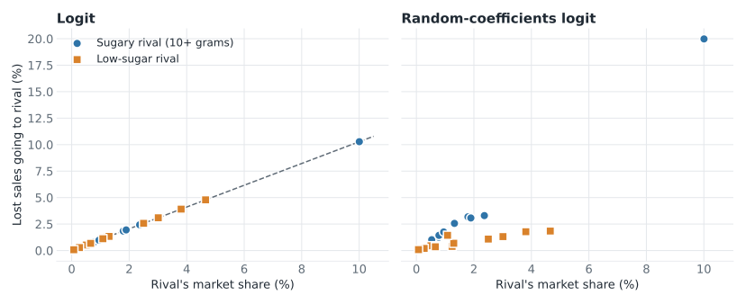
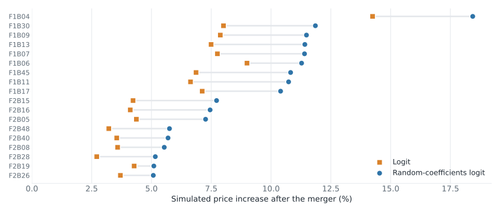

## Before class {.dense}

:::: {.columns}

::: {.column width="50%"}
**Assigned**

- Nevo and Whinston, “Taking the Dogma out of Econometrics: Structural Modeling and Credible Inference” [@nevo2010dogma]
- Nevo, “A Practitioner's Guide to Estimation of Random-Coefficients Logit Models of Demand” (optional) [@nevo2000practitioner]

Readings and course handouts are available on [Canvas](https://colostate.instructure.com/courses/230315/pages/readings).
:::

::: {.column width="50%"}
**Also used in these slides**

- Timmins and Schlenker, from Lecture 6.1 [@timmins2009reduced]
- Bellemare, on notation [@bellemare2020applied]
- BLP demand: @berry1994estimating; @blp1995automobile; @nevo2001cereal
- Conlon and Gortmaker, on best practices and PyBLP [@conlon2020pyblp]
:::

::::

::: notes
Timing for 75 minutes: 5 minutes on notation, 15 minutes on reduced-form and structural approaches, 35 minutes on BLP, 10 minutes on the cereal results, and 10 minutes on using a structural model.
:::

## Latin letters mark what you observe; Greek letters mark what you estimate

| | Latin letters | Greek letters |
|---|---|---|
| **Examples** | $y$, $x$, $W$, $P$, $V$ | $\alpha$ alpha, $\beta$ beta, $\gamma$ gamma, $\delta$ delta, $\varepsilon$ epsilon |
| **Used for** | Variables you observe in the data | Parameters you estimate, and the error term you never observe |

- Latin letters are the letters of the English alphabet
- Fixed effects are parameters, so they get Greek letters: $\gamma_c$, $\delta_t$
- A Greek letter tells the reader the term is estimated

Source: @bellemare2020applied, Section 5.1.

::: notes
Check the equation you wrote at the end of Lecture 6.1 against this slide and the next one.
:::

## Subscripts tell the reader the level at which each term varies

$$
y_{cst} = \beta P_{st} + \gamma_c + \delta_t + \varepsilon_{cst}
$$

- One letter per dimension, used the same way throughout the paper: $c$ county, $s$ state, $t$ year
- Order from the smallest unit to the largest, with time last
- A term carries only the subscripts it varies over: a state policy is $P_{st}$
- A fixed effect's subscript says what it holds constant: $\gamma_c$ county, $\delta_t$ year
- The outcome's subscripts state the unit of observation: a county in a year

::: notes
Smallest to largest is Bellemare's rule. Time last is a common convention.

The subscript on the treatment also tells the reader where the identifying variation is. In this example the policy varies by state and year, which is also a natural starting point for the clustering level.
:::

# Reduced-form and structural approaches

## A structural model recovers the parameters of behavior

- Timmins and Schlenker's definition: any empirical model that recovers the parameters of behavioral functions, such as demand and supply equations, utility functions, or cost structures
- It starts from a theoretical model and states what the researcher can and cannot observe
- What cannot be observed becomes a structural error, backed out of observed behavior
- The parameters are estimated with a procedure such as GMM or maximum likelihood

Source: @timmins2009reduced, Section 2.

::: notes
Nevo and Whinston's definition is close (page 70, footnote 1): "an economic behavioral model that defines the relationship between exogenous and endogenous variables, both observed and unobserved by the researcher." They distinguish this from the econometrics textbook meaning of "structural."

Link to Unit 4: for Ethridge, a conceptual framework is an analysis of a specific problem using relevant theory and concepts. A theoretical model is a conceptual framework written in mathematics, with stated objectives, constraints, functional forms, and an equilibrium. Any paper can have a conceptual framework. A structural paper needs the mathematical version, because its equations are what get estimated.
:::

## The term "reduced form" has two meanings

- **Textbook meaning:** solve a system of equations so the outcome depends only on exogenous variables
- **Recent meaning:** program evaluation or treatment effects, with attention to how the exogenous variable was assigned
- The goal is to avoid as many structural assumptions as possible
- Reduced-form studies still require assumptions of their own

The designs from Lecture 6.1 are reduced form in the recent sense: fixed effects, quasi-experiments, regression discontinuity, and randomization.

Source: @timmins2009reduced, Section 3.

::: notes
Timmins and Schlenker's example of the textbook meaning: demand and supply both depend on price; the reduced form eliminates price and writes equilibrium quantity as a function of the demand and supply shifters.

Where the climate designs from 6.1 fit: the panel weather model and long differences are reduced form in the recent sense. The Ricardian model estimates a hedonic-style relationship with an economic argument behind it; the methods map places it between the two.
:::

## The two approaches differ in what they estimate and what they assume {.dense}

| | Reduced form | Structural |
|---|---|---|
| **Estimates** | High-level response parameters | Behavioral parameters, such as preferences and costs |
| **Credibility comes from** | The source of variation | The source of variation and the economic model |
| **Best suited to** | Establishing causality for a change in the data | Feedback loops, large policy changes, and welfare |
| **Main assumptions** | How treatment was assigned | Functional form, unobservables, and how agents behave (such as profit maximization) |
| **Counterfactual** | A comparison group, for a change in the data | A simulation of the model, including changes not in the data |
| **Main limit** | Harder to extend to changes not observed | Conclusions depend on the model being right |

: {tbl-colwidths="[20,36,44]"}

Source: @timmins2009reduced, Sections 1 and 4.

::: notes
Ask: for your proposal, which row is the deciding one?

Timmins and Schlenker say each approach "may be better suited to answering particular types of questions." The choice follows from the question.

Counterfactual and simulation are different ideas. A counterfactual is the scenario: what would happen under conditions we do not observe. A simulation is a calculation: solving a model under stated conditions. Reduced-form designs also estimate a counterfactual, because the control group stands in for what would have happened to the treated group. Timmins and Schlenker's point is about out-of-sample counterfactuals: "Counter-factual policy simulations that include out-of-sample predictions by definition require structural parameters." "Simulated" also has two other uses in this lecture: the demo uses simulated data, and estimation averages over simulated consumers.
:::

## Structural models are used for feedback loops, new policies, and welfare

- **Feedback loops:** an outcome changes the conditions that produced it, so agents re-optimize and markets re-equilibrate
- **Large or new policies:** the change has not happened, or not at this scale
- **Welfare:** effects are converted to dollars through a utility function
- **Who bears the cost:** heterogeneity in preferences changes the distributional answer
- **Unintended consequences:** simulate the world with one piece of the policy turned off

Source: @timmins2009reduced, Section 2.1.

::: notes
Examples from Timmins and Schlenker for each point, if students ask.

Feedback loops: they use "feedback loops" and "feedback effects" for the same idea. Their example is a fishery: fish stocks affect fishing effort, and effort affects stocks through the harvest. A change in either sets in motion "the re-equilibration of the entire system." A merger has the same structure, although Timmins and Schlenker do not use it as an example: the merged firm raises prices, consumers switch, rivals reset their prices, and those prices change the merged firm's demand.

Who bears the cost: Jacobsen (2008) models fuel-economy standards together with the used-car market and finds the cost falls on poorer households who buy used cars.

Unintended consequences: Ryan (2006) models entry in the cement industry and finds the 1990 Clean Air Act Amendments raised sunk entry costs, which reduced competition and left consumers worse off while incumbent firms gained.

Link to the methods map: these are the methods at the top of the map, where the outcome is not in the data.
:::

## Structural analysis recovers parameters, then simulates counterfactuals

1. Match observed behavior to a theoretical model to recover parameters such as preferences and technology
2. Use the model to predict responses to changes, assuming those parameters are unchanged

Nevo and Whinston describe structural analysis and credible identification as complements: identification establishes what the data reveal, and the model extends those results to settings not observed. Timmins and Schlenker conclude that the most convincing evidence comes from contrasting approaches.

Sources: @nevo2010dogma, pages 70 to 71; @timmins2009reduced, Section 4.

::: notes
Nevo and Whinston: "Structural analysis is not a substitute for credible inference. Quite to the contrary, in general, structural analysis and credible identification are complements." The second step is the extrapolation that a treatment effect alone does not provide.

The complement runs both ways. Timmins and Schlenker note that reduced-form estimates of a response can be used inside a structural model to simulate policy. We return to this at the end of the lecture.
:::

## Comparing reduced-form and structural approaches to merger analysis {.dense}

| | Reduced form: treatment effect of a past merger | Structural: merger simulation |
|---|---|---|
| **Method** | Compare prices near and far from the merging firms, before and after | Estimate demand and pricing, then simulate joint pricing |
| **Strength** | Clear identification for that merger | Predicts a proposed merger, with welfare |
| **Limit** | Other mergers may not be similar; no welfare measure | Holds products, firms, and pricing behavior fixed; instruments are often imperfect |

Nevo and Whinston's conclusion: each is useful in some cases and fails in others, depending on the question and the data.

Source: @nevo2010dogma, pages 73 to 77.

::: notes
The treatment-effect example is Hastings (2004) on the ARCO acquisition of Thrifty gasoline stations. Nevo and Whinston call it careful design, then ask what it says about a merger of two large branded firms, or a merger in another region.

Their conclusion on page 80: "the future of econometrics and applied microeconomic work is in combining careful design, credible inference, robust estimation methods, and thoughtful modeling."

Transition: merger simulation is one use of a structural model. The next slide shows the range of models students will see.
:::

## Types of structural models you may see {.dense}

| Topic | Structural models | What they recover |
|---|---|---|
| Consumer demand | Demand systems (AIDS, QUAIDS); discrete choice (logit to BLP) | Elasticities, substitution, welfare |
| Nonmarket values | Hedonic; Ricardian; travel cost; choice experiments | Willingness to pay |
| Producers | Production, cost, and profit functions; stochastic frontier | Returns to scale, efficiency |
| Firms and markets | Conduct and markups; equilibrium displacement | Markups, pass-through, incidence |
| Dynamics and risk | Real options; dynamic discrete choice; risk preferences and insurance demand | Value of waiting, risk aversion |
| Trade and policy | Structural gravity; spatial equilibrium; CGE | Trade costs, economy-wide effects |

: {tbl-colwidths="[20,50,30]"}

Each method has an example specification on the [methods map](https://laurenchenarides.github.io/csu-arec-570/files/includes/ag-econ-methods-map.html){target="_blank" rel="noopener"}.

::: notes
These are the structural methods on the methods map, grouped by what the paper studies. Students should find the row closest to their proposal. Each point on the map opens a card with an example specification, what it estimates, its key assumptions, and how it is estimated.

Transition: BLP is one row of this table. We use it to show how a structural paper works.
:::

# BLP: one structural model

## BLP addresses the large number of cross-price effects in differentiated-product demand

- With 100 products, a log-log demand system has at least 10,000 parameters
- BLP describes each product by its characteristics, so the number of parameters depends on the number of characteristics
- It uses market-level data on prices and quantities, and it allows for endogenous prices
- **Running question:** how much would prices rise if two cereal firms merged?

Sources: @nevo2000practitioner, pages 514 to 515; @blp1995automobile.

::: notes
BLP stands for Berry, Levinsohn, and Pakes (1995), who estimate demand for automobiles. Nevo applies the method to ready-to-eat cereal [-@nevo2001cereal]. Food demand is a common application in agricultural economics, so the method may be useful for proposals on food retail or consumer demand.
:::

## The theoretical model behind BLP: consumers, firms, and equilibrium {.dense}

| | Consumers | Firms |
|---|---|---|
| **Choice** | One product, or none | Prices of their own products |
| **Objective** | Maximize utility | Maximize profit: $\sum_{j \in F_f} (p_j - mc_j)\, M s_j(p)$ |
| **Take as given** | Income, products, and prices | Demand, marginal costs, and rivals' prices |

- **Equilibrium:** Bertrand-Nash; each firm's prices are optimal given rivals' prices, and shares equal what consumers choose at those prices
- **Researcher observes:** market shares, prices, and product characteristics
- **Researcher does not observe:** unobserved quality, individual tastes and shocks, and marginal cost

Sources: @blp1995automobile, Sections 2 and 3; @nevo2001cereal.

::: notes
This is what a conceptual framework looks like when it is written as a model. It names the same items as Unit 4: agents, choices, objectives, constraints, and relationships. Here $F_f$ is the set of products owned by firm $f$, and $M$ is the size of the market.

BLP's own summary (Section 8): the model is "four primitives and a Nash equilibrium assumption in prices." The primitives are the utility function, the cost function, the distribution of consumer characteristics, and the distribution of product characteristics.

The next slides write out the consumer side. The firm side returns for the merger simulation. Nevo (2000, page 543) notes that a paper can use the supply side only to motivate instruments, without estimating it.

Transition: every structural paper turns its theoretical model into the same four choices.
:::

## A structural section states the same four choices as any empirical section

| Choice | In a structural paper |
|---|---|
| **Model** | The primitives: preferences, technology, and how agents interact |
| **Estimation and inference** | The estimator in one paragraph, with details in an appendix |
| **Identification** | Which variation identifies which parameter |
| **Reported results** | Fit or validation, and the counterfactuals the model is used for |

::: notes
This is the one slide drawn from the methods map's "Four choices" section. The next slides go through these four choices for BLP. BLP is one structural model; the choices apply to all of them, from demand systems to dynamic models.
:::

## Model: each consumer chooses the option that gives the highest utility {.dense}

$$
u_{ijt} = \alpha_i(y_i - p_{jt}) + x_{jt}\beta_i + \xi_{jt} + \varepsilon_{ijt}
$$

- $u_{ijt}$: utility of consumer $i$ from product $j$ in market $t$ (a city in a quarter)
- $y_i - p_{jt}$: income left after buying $j$; $\alpha_i$: marginal utility of income
- $x_{jt}$: observed characteristics, such as sugar content
- $\xi_{jt}$: characteristics the researcher does not observe, such as brand quality or promotions
- $\beta_i$: tastes for those characteristics; $\alpha_i$ and $\beta_i$ vary across consumers
- $\varepsilon_{ijt}$: a mean-zero shock
- Buying nothing is the outside good: $u_{i0t} = \alpha_i y_i + \varepsilon_{i0t}$

Summing individual choices gives each product's predicted market share. The data are the observed shares.

Source: @nevo2000practitioner, pages 517 to 520.

::: notes
Why income minus price: the consumer spends $y_i - p_{jt}$ on everything else, and each dollar of it is worth $\alpha_i$. Nevo notes this form comes from quasilinear utility, with no wealth effects, which is reasonable for cereal and unreasonable for cars.

The parameters of interest are the taste parameters. Everything the paper reports (elasticities, markups, welfare) is computed from them.

Latin letters are data, Greek letters are estimated. $\xi_{jt}$ is Greek because it is never observed: it is the structural error in Timmins and Schlenker's definition, backed out of observed shares.
:::

## Logit and random-coefficients logit differ in whether tastes vary across consumers {.dense}

| | Logit | Random-coefficients logit (BLP) |
|---|---|---|
| **Tastes** | Same for everyone: $\alpha$, $\beta$ | Vary across consumers: $\alpha_i$, $\beta_i$ |
| **How consumers differ** | Only through the shock $\varepsilon_{ijt}$ | Through tastes and the shock |
| **Market shares** | A closed-form formula | An average over consumers, computed numerically |
| **Substitution** | In proportion to market shares | Toward products with similar characteristics |
| **Estimation** | Linear instrumental-variables regression | GMM with a numerical search |

Logit is the special case of the utility function above in which every consumer has the same tastes.

Source: @nevo2000practitioner, pages 522 to 526.

::: notes
Students will see "BLP" used for the random-coefficients logit estimated with instruments for price. BLP (1995) also add a supply side. We start with logit because it can be derived by hand.
:::

## From the model to the estimating equation, in the logit case {.dense}

1. Choices depend on utility differences, and $\alpha y_i$ appears in every option, so income cancels
2. With the same tastes, utility is $u_{ijt} = \delta_{jt} + \varepsilon_{ijt}$, where mean utility is $\delta_{jt} = x_{jt}\beta - \alpha p_{jt} + \xi_{jt}$
3. Extreme-value shocks give a formula for shares:

$$
s_{jt} = \frac{\exp(\delta_{jt})}{1 + \sum_{k} \exp(\delta_{kt})} \qquad s_{0t} = \frac{1}{1 + \sum_{k} \exp(\delta_{kt})}
$$

4. Dividing the two and taking logs gives a linear equation in data and parameters:

$$
\ln s_{jt} - \ln s_{0t} = x_{jt}\beta - \alpha p_{jt} + \xi_{jt}
$$

[Open the derivation notes](https://laurenchenarides.github.io/csu-arec-570/files/blp-derivation.html){target="_blank" rel="noopener"}

Sources: @berry1994estimating; @nevo2000practitioner, pages 522 and 532.

::: notes
Answer the two questions students ask. Why $y_i - p_{jt}$: it is the money left for everything else. Where $y_i$ went: it is in the outside good too, so it does not affect which option is best. Income can still matter through $\alpha_i$ in the full model.

Numeric check from the notes: shares of 0.2 and 0.3 with an outside share of 0.5 give $\delta_1 = \ln(0.2/0.5) = -0.92$ and $\delta_2 = \ln(0.3/0.5) = -0.51$.

$\xi_{jt}$ is the error term in this regression, which is why it is called a structural error.
:::

## Estimation: back out the unobserved term, then use GMM {.dense}

**Logit:** the equation on the last slide is a linear instrumental-variables regression.

**Random coefficients:** shares have no closed form, so the estimator repeats a loop:

1. Guess the parameters that describe how tastes vary
2. Find the mean utilities $\delta_{jt}$ that make predicted shares equal observed shares
3. Regress $\delta_{jt}$ on price and characteristics using instruments; the residual is $\xi_{jt}$
4. Measure how far $\xi_{jt}$ is from being uncorrelated with the instruments (the GMM objective)
5. Update the guess and repeat until the objective reaches a minimum

In a paper, this gets one paragraph. The steps go in an appendix.

Sources: @berry1994estimating; @nevo2000practitioner, pages 530 to 533.

::: notes
Inference: report GMM standard errors for the parameters, and standard errors for the quantities the paper is about, such as elasticities.

Transition: estimation gives us numbers. Identification asks what in the data determines them.
:::

## BLP identification has two parts: the price coefficient and substitution patterns {.dense}

| | Price coefficient | Substitution patterns |
|---|---|---|
| **Parameters** | Mean price sensitivity, $\alpha$ | How tastes vary across consumers |
| **Problem** | Endogeneity: price is correlated with $\xi_{jt}$ | Market shares are aggregates, so they do not show who switched to what |
| **What identifies it** | Instruments that shift price | How shares respond across products and markets |
| **Threats** | Instruments correlated with demand shocks | Too little variation in prices, characteristics, choice sets, or demographics |

Only the first part is an endogeneity problem. The second concerns which variation pins down the spread of tastes.

Source: @nevo2000practitioner, pages 528 to 530.

::: notes
Nevo frames these as two questions: first, how to deal with prices that are set by firms using information the researcher lacks; second, what in the data distinguishes logit from random-coefficients logit.

There is one more endogeneity concern: unobserved characteristics may be correlated with observed ones. Nevo notes this is handled with instruments and, in cereal, brand fixed effects.

Both parts are estimated together, from the same GMM objective. We take them in turn.
:::

## Identification of the price coefficient: price is endogenous, so it needs instruments {.dense}

- Price is an equilibrium outcome: firms set markups knowing demand, so $p_{jt}$ is correlated with $\xi_{jt}$
- OLS biases the price coefficient toward zero, because high-$\xi_{jt}$ products have both higher prices and higher shares
- Identification requires instruments $Z_{jt}$ that shift price and satisfy $E[\xi_{jt} \mid Z_{jt}] = 0$

| Instrument | Why it moves price | Exclusion restriction |
|---|---|---|
| Cost shifters | Shift marginal cost | Uncorrelated with demand shocks |
| Characteristics of rival products (BLP) | Close rivals lower markups | Product characteristics are set before demand shocks are realized |
| Prices of the same brand in other markets (Hausman) | Same brand shares marginal cost across markets | Demand shocks are independent across markets |

: {tbl-colwidths="[32,30,38]"}

Source: @nevo2000practitioner, pages 528 and 534 to 536.

::: notes
This is the classic supply and demand identification problem: to trace out a demand curve, you need variation that shifts supply and leaves demand unchanged. The instruments play that role. It is the same endogeneity as the veterans DAG in Lecture 6.1: $\xi_{jt}$ is in the error term and also affects the treatment, here price.

Nevo's threat to the Hausman instrument: a finding that fiber may reduce the risk of cancer raises demand for high-fiber cereals in every city, so demand shocks are correlated across markets. Coordinated advertising across city borders would also violate the restriction. Nevo says resolving this requires comparing sets of instruments, additional data, and knowledge of the industry.

Nevo and Whinston (page 76) say that in many cases the instruments are less than ideal. State that limitation in the section.
:::

## Random coefficients let tastes vary, which changes substitution patterns

$$
\begin{pmatrix} \alpha_i \\ \beta_i \end{pmatrix} = \begin{pmatrix} \alpha \\ \beta \end{pmatrix} + \Pi D_i + \Sigma v_i
$$

- $\alpha$, $\beta$: mean tastes
- $D_i$: demographics, such as income, age, and children; $\Pi$: how tastes vary with them
- $v_i$: traits the researcher does not observe; $\Sigma$: how much tastes vary with them
- Logit sets $\Pi = 0$ and $\Sigma = 0$
- Consumers of a sugary cereal tend to like sugar, so when its price rises they move to other sugary cereals

Source: @nevo2000practitioner, pages 519 and 526.

::: notes
This is where the random coefficients enter. They are the terms $\Pi D_i$ and $\Sigma v_i$. They are called random because $v_i$ and $D_i$ are drawn from a distribution; we never observe a specific consumer's tastes.

Nevo's example (page 523): Lucky Charms and Cap'n Crunch are both children's cereals and Grape Nuts is a nutrition cereal. If Cap'n Crunch and Grape Nuts have similar shares, logit says a rise in the price of Lucky Charms raises both shares by the same amount. We expect more consumers to switch to Cap'n Crunch.

Why logit behaves this way: consumers differ only through the independent shock, so those who leave a product look like the average consumer, and their second choices follow market shares.
:::

## In logit, lost sales follow market shares; with random coefficients, they follow similarity {.dense}

{height="400" fig-alt="Two scatter plots of where sales lost by one sugary cereal go. Horizontal axis is the rival's market share and vertical axis is the percent of lost sales going to that rival. In the logit panel all rivals fall on a straight line through the origin, whatever their sugar content. In the random-coefficients panel sugary rivals lie well above low-sugar rivals with similar shares, and the largest sugary rival gets 20 percent."}

Lost sales from one cereal with 14 grams of sugar, in one market of the demo. Sugary rivals get 22.7% in logit and 40.5% with random coefficients.

::: notes
Each point is a rival product. In the left panel, share alone determines a rival's gain: rivals with similar shares gain about the same, whether or not they are sugary. In the right panel, sugar matters. Low-sugar rivals get 20.2 percent of lost sales in logit and 10.0 percent with random coefficients. The share going to no purchase falls from 57.0 to 49.5 percent. The product is F1B13 in market C01Q1; the demo page shows the calculation.

Why this matters: two products owned by merging firms are likely to be close substitutes. If the model cannot represent closeness, it misses the main force in the merger.
:::

## Identification of substitution patterns: compare how shares respond across products and markets {.dense}

Nevo's example: products A and B are similar, and B and C have the same market share. The price of A rises.

- **Logit predicts** equal changes in the shares of B and C
- **If B gains more than C**, the data favor random coefficients, and the size of the gap identifies the parameters in $\Sigma$
- **Demographics:** the parameters in $\Pi$ are identified by comparing markets with different demographics

Having many markets helps when they add variation in prices, characteristics, choice sets, and demographics. Nevo's cereal data have no variation in the choice set across markets, which he offers as a reason his estimates of $\Sigma$ are imprecise.

Source: @nevo2000practitioner, pages 529 to 530 and 541.

::: notes
The number of markets alone is the wrong test. What a section has to state is the comparison: which products, which changes, which markets. This is what "state which variation identifies which parameter" means in a structural paper.

Nevo adds that observing share changes as new products enter, or as characteristics change, is especially helpful.

In estimation, these comparisons enter through the same GMM moment conditions used for the price coefficient.
:::

## Results: a structural paper reports demand estimates, then simulation results {.dense}

| | Demand estimates | Simulation results |
|---|---|---|
| **Comes from** | Estimating the model on observed data | Solving the estimated model under a new scenario |
| **Reports** | Parameters and standard errors; elasticities; substitution; implied markups | Prices, quantities, profits, and consumer welfare under the scenario |
| **Check** | Are elasticities and markups sensible? | What is held fixed? Does the model predict well out of sample? |
| **In BLP (1995)** | Tables IV to VIII | Not simulated; Section 8 lists uses such as merger and trade policy |

The demand estimates are also a result in their own right. A paper can stop there.

Sources: @blp1995automobile, Sections 7 and 8; @nevo2010dogma, pages 75 to 77.

::: notes
Go slowly here if students have not seen BLP. The first column answers "what did we learn about consumers and firms?" The second answers "what would happen if?" Our demo does both: Steps 1 to 6 are demand estimates, and Step 7 is the simulation.

Coefficients alone are hard to interpret, so papers report what they imply. BLP report elasticities in Tables V and VI, substitution to the outside good in Table VII, and markups in Table VIII.
:::

## Simulation results: a merger simulation has four steps {.dense}

1. Start from the demand estimates
2. Recover marginal costs from firms' pricing conditions: $p - mc = \Omega^{-1} s(p)$
3. Change ownership: the merged firm sets the prices of both firms' products
4. Solve for new equilibrium prices, then compute shares and welfare

- State what is held fixed: current merger simulations hold products, firms, and pricing behavior fixed
- Report results under a range of assumptions
- Validate the model: check that it predicts outcomes not used to estimate it

Sources: @nevo2001cereal; @nevo2010dogma, pages 75 to 77; @timmins2009reduced, Section 2.

::: notes
$\Omega$ holds the slopes of demand for products owned by the same firm. Step 2 comes from the first-order condition of the firm's problem on the theoretical model slide. The demo page walks through it.

Nevo and Whinston give the validation example: Peters (2006) compares merger simulations with what actually happened after airline mergers and finds the simulations missed the size of several price changes. Retrospective studies are how the two approaches check each other.

Timmins and Schlenker suggest estimating with a subset of the data and checking the model's ability to predict behavior in the rest.
:::

# Demo: cereal results

## Demo: estimating cereal demand in steps, then simulating a merger

- **Data:** Nevo's simulated cereal data, 24 products in 94 markets (47 cities, 2 quarters)
- Nevo: the data are "not real and should not be used for any analysis," so the numbers here illustrate the method
- **Demand estimates:** logit by OLS, add product fixed effects, add instruments, add random coefficients
- **Simulation:** a merger of firms 1 and 2
- **Software:** PyBLP in Python; the script runs in under a minute

[Open the cereal demand demo](https://laurenchenarides.github.io/csu-arec-570/files/cereal-demand-demo.html){target="_blank" rel="noopener"}

Sources: @nevo2000practitioner, page 538; @conlon2020pyblp.

::: notes
We read the results in class. The demo page shows the code, the output, and how each number is calculated, and it explains how to run the script in VS Code.

Firms 1 and 2 are the two largest firms in the simulated data, with about 75 percent of sales.
:::

## Demand estimates: product fixed effects triple the price coefficient, because quality was omitted {.dense}

| Specification (all three are logit) | Price coefficient |
|---|---:|
| OLS, no product fixed effects | −10.1 |
| OLS, product fixed effects | −29.0 |
| Instrumental variables, product fixed effects | −30.0 |

- Better cereals cost more, so without fixed effects a high price partly signals high quality
- Product fixed effects absorb a product's fixed quality, which is part of $\xi_{jt}$
- **The instruments are for price.** In @nevo2001cereal, they are prices of the same brand in other cities and cost proxies
- Random coefficients come next; these rows address the price coefficient only

::: notes
This is the selection problem from Lecture 6.1 in a demand setting: price and unobserved quality move together, so the comparison across products mixes the effect of price with the effect of quality.

The demo file has 20 instrument columns that are not labeled. In these simulated data they explain 97 percent of the within-product variation in price, so the instrumented price is close to the actual price. That is why the coefficient barely moves. In real data, instruments can change the estimate by much more.
:::

## Demand estimates: random coefficients change substitution far more than own-price elasticities {.dense}

| | Logit | Random-coefficients logit |
|---|---:|---:|
| Mean price coefficient | −30.0 | −62.7 |
| Median own-price elasticity | −3.65 | −3.61 |
| Largest rival response ÷ smallest | 1.0 | 6.2 |
| Median margin | 31.6% | 33.7% |

- Elasticities and margins are what the estimates imply; the demo page shows each calculation
- The second row barely moves, and the third row moves a lot

::: notes
Row three: when one product's price rises, logit makes every rival respond in the same proportion (ratio of 1). With random coefficients, the most affected rival responds about 6 times as much as the least affected, in the median case, in one market.

The coefficients in row one are not directly comparable: with random coefficients, price sensitivity also depends on the interactions with demographics.

Margins come from the firm's pricing condition; marginal costs are not in the data.
:::

## Simulation results: two models with the same own-price elasticity give different merger predictions

| Merger of firms 1 and 2 | Logit | Random-coefficients logit |
|---|---:|---:|
| Median price change, merging firms | 5.8% | 11.6% |
| Median price change, other firms | 0.1% | 0.4% |
| Change in consumer surplus | −11.6% | −13.6% |

The counterfactual depends on how the model lets consumers substitute, which is an assumption the section has to state and defend.

::: notes
Why the merger result doubles: merging firms raise prices more when their products are close substitutes for each other, because more of the lost sales stay within the merged firm. Logit cannot represent that closeness. In market C01Q1, the median merging product sends 56 percent of lost sales to no purchase in logit and 42 percent with random coefficients, and 18 percent to the merger partner in logit and 22 percent with random coefficients.

The takeaway for writing: two models can fit one summary statistic and still disagree on the counterfactual. That is why a structural section states its assumptions and reports results under alternatives.
:::

## Simulation results: the predicted increase is higher for every merging product {.dense}

{height="400" fig-alt="Dumbbell chart of simulated price increases for the 18 products of the merging firms in one market. Each row is a product with a square for the logit prediction and a circle for the random-coefficients prediction. The circle is to the right of the square for every product. Median predicted increases in this market are 5.5 percent for logit and 9.1 percent for random coefficients."}

One market of the demo. Median predicted increase: 5.5% in logit and 9.1% with random coefficients.

::: notes
Each row is one product owned by firm 1 or firm 2, in market C01Q1. Medians here differ from the table, which covers all 94 markets. The distance between the two points is the part of the answer that comes from the substitution assumption.
:::

# Using a structural model

## A structural section reports five items

1. The model's primitives
2. Which variation identifies which parameter
3. The estimator in one paragraph, with details in an appendix
4. How well the model fits or validates
5. The counterfactuals it is used for

This is row 10 of the [empirical strategy checklist](https://laurenchenarides.github.io/csu-arec-570/files/empirical-strategy-checklist.html){target="_blank" rel="noopener"}.

::: notes
Each item maps to the BLP section: the theoretical model and model slides, the identification slides, the estimation slide, and the two results slides. Transition: item 3 needs one more slide, because results from numerical estimation depend on how the model was solved.
:::

## Numerical estimation can stop early, so report how the model was solved {.dense}

Estimation searches for the parameters that minimize the GMM objective. The optimizer stops when it is close enough, and that stopping rule is a choice.

| Same model, same data | Mean price coefficient | Mean own-price elasticity |
|---|---:|---:|
| Loose stopping rule (1E-4), as published | −32.4 | −3.70 |
| Tighter stopping rule (1E-5), as in our demo | −62.7 | −3.62 |
| Tighter stopping rule and better instruments | −27.5 | −3.69 |

- **How to read this:** the coefficient moves a lot, and the elasticity barely moves
- Report the optimizer, tolerances, starting values, and integration method
- Try several optimizers and starting values, and report the quantities that matter

Source: @conlon2020pyblp, Table 7.

::: notes
This slide supports item 3 on the previous slide: what goes in the appendix, and why. Conlon and Gortmaker re-estimate Nevo's model on his simulated data three times. They report nearly identical elasticities and markups despite different parameter estimates, and they point to the Price × Income terms, which are nearly collinear in the data. The first row uses Nevo's original settings; they note that those tolerances were too loose. "Better instruments" means an approximation to the feasible optimal instruments.

They also find that with these practices, estimates are stable across starting values and optimizers, which is better news than earlier work suggested [Knittel and Metaxoglou, 2014, as discussed in @conlon2020pyblp].
:::

## Pairing reduced-form evidence with a structural model is good practice

- A credible design shows that the response exists in the data
- Reduced-form estimates can serve as inputs to the model or as targets it must reproduce
- Retrospective studies check the accuracy of model predictions
- Reporting why the approaches agree or disagree gives the reader more confidence than either one alone

Sources: @timmins2009reduced, Sections 1 and 4; @nevo2010dogma, page 77.

::: notes
Timmins and Schlenker: "the most convincing evidence stems from contrasting various approaches." They give the example of reduced-form estimates of the effect of amenities on infant health or crop yields being used in structural models to simulate policy responses.

Nevo and Whinston's example of a retrospective study is Peters (2006) on airline mergers. On the methods map, this approach appears as "Reduced-form estimates as model targets" and "Out-of-sample validation."
:::

## What to think about when using a structural model

- **The question:** does it require a model? Name the reason: feedback, a new policy, welfare, or distribution
- **The parameters:** which ones does the model recover, and what variation identifies each one?
- **The assumptions:** which ones drive the counterfactual, and how do results change under alternatives?
- **The reduced-form evidence:** what credible estimate supports the model?
- **The validation:** does the model predict outcomes not used to estimate it?

::: notes
Students whose proposal is reduced form can use the first question to explain why their design answers the question without a model, and to name one counterfactual the design does not answer.
:::

## References {.smaller}

::: {#refs}
:::

## Course navigation

- [All lectures](https://laurenchenarides.github.io/csu-arec-570/lectures/lectures.html)
- [Schedule and preparation](https://laurenchenarides.github.io/csu-arec-570/2026/schedule.html)
- [Course reading list](https://laurenchenarides.github.io/csu-arec-570/2026/readings.html)
- [Empirical strategy checklist](https://laurenchenarides.github.io/csu-arec-570/files/empirical-strategy-checklist.html){target="_blank" rel="noopener"}
- [Methods map](https://laurenchenarides.github.io/csu-arec-570/files/includes/ag-econ-methods-map.html){target="_blank" rel="noopener"}
- [BLP derivation notes](https://laurenchenarides.github.io/csu-arec-570/files/blp-derivation.html){target="_blank" rel="noopener"}
- [Cereal demand demo](https://laurenchenarides.github.io/csu-arec-570/files/cereal-demand-demo.html){target="_blank" rel="noopener"}
- [Download this lecture as a PDF](https://laurenchenarides.github.io/csu-arec-570/lectures/lecture6.2.pdf)
