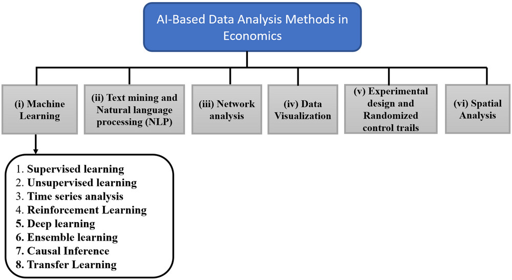
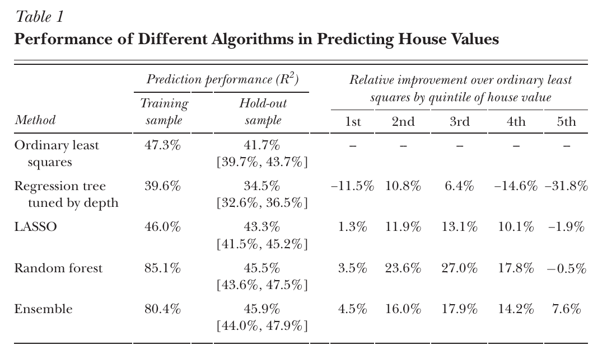
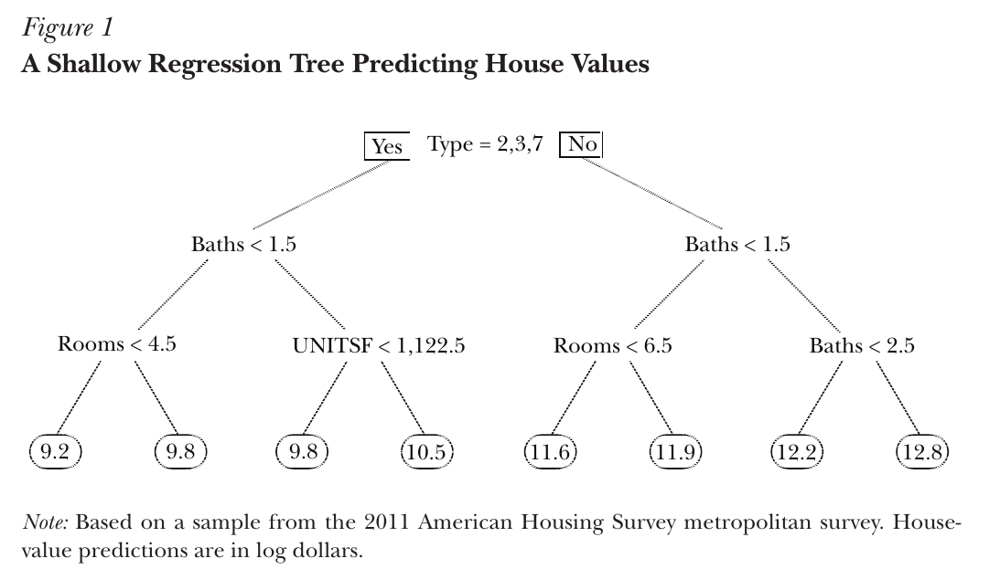

## Before class

- Athey and Imbens, “The State of Applied Econometrics: Causality and Policy Evaluation” [@athey2017state]
- Athey and Imbens, “Machine Learning Methods That Economists Should Know About” [@athey2019machine]
- Mullainathan and Spiess, “Machine Learning: An Applied Econometric Approach” [@mullainathan2017machine]

Readings and course handouts are available on [Canvas](https://colostate.instructure.com/courses/230315/pages/readings).

## Example papers in this lecture

- Background: @einav2014economics; @bahoo2025artificial
- Overview for agribusiness: @maruejols2025machine
- Prediction: @zhao2025food
- Prediction within a larger analysis: @li2025attribute; @belloni2014inference
- Heterogeneous treatment effects: @stetter2022machine
- Further reading: Bittmann's guide from OLS to causal machine learning [@bittmann2025practical]

::: notes
- Timing: 10 minutes on background, 10 on core concepts, 40 on the three roles (about 13 each), 15 on reporting.
- The aim is for students to read, evaluate, and write the methods section of a paper that uses these tools, whether or not they use them in their own work.
:::

## Machine learning in a nutshell

**If you take away one idea today:** A prediction method learns from observations we already have, then we check how well it predicts observations it has not seen

1. Choose the outcome to predict and the information available when a prediction is made
2. Fit a prediction rule using one group of observations
3. Compare its predictions with actual outcomes in a separate group
4. Report how much better it performs than a simple benchmark

In a causal study, machine learning can help account for differences between groups before estimating an effect

::: notes
- A prediction rule might be a regression, a tree, or an average of many trees
- The separate group provides evidence about performance on new observations from a similar setting
- Prediction accuracy alone does not identify a causal effect
:::

## How does Facebook recognize faces in photos?

Algorithms use a large dataset of photos labeled as having a face or not to estimate a function $f(x)$ that predicts the presence $y$ of a face from pixels $x$.

This similarity to econometrics raises questions:

- Are these algorithms merely applying standard techniques to novel and large datasets?
- If there are fundamentally new empirical tools, how do they fit with what we know?
- As empirical economists, how can we use them?

::: {.source}
Source: @mullainathan2017machine, page 87.
:::

::: notes
- Mullainathan and Spiess open with this example because the setup is familiar to economists: an outcome $y$, inputs $x$, and a function to estimate.
- The difference is in the goal. A face detector is judged only on whether it labels new photos correctly; no one asks for the coefficient on a particular pixel.
- Transition: the next slide states that difference formally.
:::

## Two goals: prediction and parameter estimation

Many economic applications estimate a parameter, such as a treatment effect or price sensitivity

Supervised machine learning methods are often designed to predict an outcome accurately for new observations

Economists can also use prediction methods within procedures that estimate effects

This lecture covers where these methods came from, the three roles they play in empirical economics, and how a methods section reports them

::: {.source}
Source: @mullainathan2017machine, pages 87 to 88.
:::

::: notes
- The designs in 6.1 and the models in 6.2 recover parameters: a treatment effect, a price coefficient, an elasticity
- Prediction is the direct goal in Role 1 and a component of the effect-estimation procedure in Role 3
- Transition: these methods developed largely outside economics, which explains much about how economists use them.
:::

## Evaluating predictions and parameters

| | Prediction, $\hat{y}$ | Parameter estimation, $\hat{\beta}$ |
|---|---|---|
| **Target** | The outcome for a new observation | An effect or behavioral parameter |
| **Common techniques** | LASSO, random forests, and other prediction methods | OLS, IV, difference in differences, and structural models |
| **Evaluation** | Accuracy on data not used in estimation | Identification: the source of variation and its assumptions |
| **Verifiability** | Directly testable: predictions and outcomes are both observed | Rests on assumptions about the data-generating process |

: {tbl-colwidths="[20,40,40]"}

::: {.source}
Source: @mullainathan2017machine, pages 88 and 92.
:::

::: notes
- Prediction quality can be measured against held-out outcomes. A causal effect relies on assumptions because the counterfactual outcome is never observed
- For prediction, ask what a household's risk of food insecurity is. For parameter estimation, ask how much a program changed outcomes
- OLS can also predict, and causal forests adapt tree methods to estimate heterogeneous treatment effects. The table classifies methods by their usual role in this lecture
- The research question determines how a method is used. Later we will use machine learning tools inside an effect-estimation procedure
- This is why machine learning papers report out-of-sample performance and causal papers report an identification strategy.
- Transition: three ways economics papers combine the two.
:::

# Background

## Machine learning's use in applied economics grew over the past 20 years {.dense}

| Period | Development |
|---|---|
| 1984 to 2001 | Regression trees (Breiman et al., 1984), the LASSO (Tibshirani, 1996), and random forests (Breiman, 2001) |
| 1990s | Neural networks studied in econometrics, but they "did not catch on at the time" |
| 2001 | Breiman's "two cultures": statistics relied on data models, while an algorithmic culture grew in other fields |
| 2014 | Early reviews for economists: Varian; Einav and Levin; Belloni, Chernozhukov, and Hansen |
| 2017 to 2019 | Mullainathan and Spiess; causal forests (Wager and Athey); Athey and Imbens's review for economists |
| 2020 to 2025 | Reviews and special issues in agricultural and applied economics: @storm2020machine; @maruejols2025machine |

: {tbl-colwidths="[20,80]"}

::: {.source}
Sources: @athey2019machine, pages 686 to 688, 696 to 698, and 701; @mullainathan2017machine, page 87; @storm2020machine; @maruejols2025machine.
:::

::: notes
- The methods themselves are older; their adoption in applied economics grew across the 2000s and 2010s.
- Athey and Imbens open with Breiman (2001): one culture "assumes that the data are generated by a given stochastic data model"; the other "uses algorithmic models and treats the data mechanism as unknown." Econometrics belongs to the first culture.
- Statistics has since absorbed the algorithmic approach; Athey and Imbens note that "the adoption of these methods in economics has been slower."
- The dates for the original methods come from the citations in Athey and Imbens.
- Transition: why adoption was slow, and why it accelerated.
:::

## Why economists adopted machine learning

1. **More readily available access to "big data"**

   - Properties: many units, many variables per unit, and unstructured sources such as satellite images and text
   - Challenge organizing and studying this type of data (or even to decide which variables to construct) without a simplifying conceptual framework
   - Better data allow for (1) sharper tests of existing models, (2) tests of theories that had previously been difficult to assess, and (3) assistance choosing controls or functional forms

2. **Prediction questions**

   - Some policy problems require an accurate forecast and no causal parameter

::: {.source}
Sources: @athey2019machine, pages 686 to 687; @mullainathan2017machine, pages 88, 98, and 102, @einav2014economics
:::

::: notes
- Einav and Levin describe the shift from small government surveys to administrative and private-sector data with near-universal coverage. They argue that economic models become more useful with such data, because they tell the researcher which variables to construct.
- An example of a prediction question, from Mullainathan and Spiess: a judge deciding on bail must predict whether a defendant will return for trial. The decision requires a forecast, and no causal parameter (Kleinberg et al., as discussed on page 102).
- Transition: why economics was slower to adopt these tools than statistics.
:::

## Why adoption was slow

Economics journals emphasize formal properties of estimators, such as consistency and asymptotic normality, which early machine learning methods did not provide

However, recent work established inference for adapted methods, including double selection and causal forests

::: {.source}
Sources: @athey2019machine, pages 686 to 687; @mullainathan2017machine, pages 88, 98, and 102.
:::

::: notes
- Athey and Imbens: machine learning research focuses on "working properties of algorithms in specific settings," with formal results such as error rates, while econometrics focuses on large-sample properties of estimators and tests.
- The methods economists now use are often adaptations: they modify machine learning algorithms to deliver valid confidence intervals for causal parameters. Two appear later in this lecture.
- Transition: where machine learning sits among the AI-based methods economists now use.
:::

## Machine learning within the AI-based tool landscape

{height="430" fig-alt="Diagram of AI-based data analysis methods in economics: machine learning, text mining and natural language processing, network analysis, data visualization, experimental design and randomized control trials, and spatial analysis. Machine learning is divided into supervised learning, unsupervised learning, time series analysis, reinforcement learning, deep learning, ensemble learning, causal inference, and transfer learning."}

::: {.source}
Source: @bahoo2025artificial, Section 4.3 and Figure 6.
:::

::: notes
- Bahoo et al. review 2,231 articles on AI in economics published from 1990 to 2024 and classify the methods those articles use. This figure is their summary.
- This lecture covers supervised learning (prediction), ensemble learning (random forests), and causal machine learning.
- The categories reflect how the literature labels its methods, and the boundaries are loose: their machine learning branch lists ARIMA forecasting under time series, and RCTs and difference in differences under causal inference. Those are standard econometric tools. The point to take from the figure is the breadth of methods now described as AI, more than the exact classification.
- Transition: three roles machine learning plays in the papers students will read.
:::

# How machine learning works

## How a house-price prediction rule learns

Imagine we have recent home sales and want to predict the sale price of another house

1. For each sold house, record its sale price and characteristics such as size and location
2. Set aside some houses before fitting a model
3. Use the remaining houses to fit a rule that turns characteristics into predicted prices
4. Measure each mistake by comparing a prediction with the actual sale price

For a house that sold for **$300,000**, a prediction of **$320,000** misses by **$20,000**

Is this rule sufficient, or should it be adjusted to reduce the average mistake on the houses used for fitting?

::: {.source}
Source: @mullainathan2017machine, page 89
:::

::: notes
- The observed price is $y$, the house characteristics are $x$, and the fitted prediction is $\hat f(x)$
- A loss function gives a score to each mistake. Absolute error scores this example as 20,000 dollars. Squared error gives larger mistakes more weight
- The observations used for fitting form the training sample
:::

## How do we score a house-price prediction?

Suppose a house sold for **$300,000** and a rule predicted **$320,000**

| Loss function | Score for this house | What it emphasizes |
|---|---:|---|
| Absolute error | $\lvert 320-300\rvert=20$ thousand dollars | The size of each miss |
| Squared error | $(320-300)^2=400$ squared thousand dollars | Large misses receive more weight |

A **loss function** assigns a score to each prediction error. We choose a rule to reduce average loss across the training houses

::: {.source}
Source: @mullainathan2017machine, page 89
:::

::: notes
- The dollar amounts in the formulas are measured in thousands, so squared error has squared units
- Squared error is the loss used in least squares. A different loss function can make a different prediction rule preferable
- Transition: the average loss we care about concerns future houses
:::

## Why we keep some houses aside

**Expected loss** is average loss on future houses. We cannot calculate it directly because their sale prices are unknown

1. **Train:** choose the rule that reduces average loss on the houses used for fitting, called empirical loss
2. **Test:** predict the prices of the houses set aside earlier
3. **Compare:** use their average loss to estimate performance on new houses

The next paper reports held-out $R^2$ as a summary of predictive fit. Higher held-out $R^2$ means better predictions relative to predicting the same average for every house

::: {.source}
Source: @mullainathan2017machine, pages 89 to 90
:::

::: notes
- The reading calls the average error on training observations empirical loss and the desired average error on new observations expected loss
- The held-out houses provide an estimate of out-of-sample loss, provided they represent the houses to which we will apply the rule
- Set the test houses aside before choosing the prediction method or its settings
:::

## An example: predicting house values with OLS and machine learning {.dense}

:::: {.columns}

::: {.column width="56%"}
{width="100%" fig-alt="Table 1 of Mullainathan and Spiess (2017): training-sample and hold-out-sample R-squared for ordinary least squares, a regression tree, LASSO, a random forest, and an ensemble, with relative improvement over OLS by quintile of house value."}
:::

::: {.column width="44%"}
1. Start with 51,808 homes from the 2011 American Housing Survey, including each home's value and 150 characteristics
2. Use 10,000 homes to fit OLS and several machine learning methods
3. Ask each fitted method to predict values for the other 41,808 homes
4. Compare those predictions with the homes' observed values using $R^2$

The random forest explains **45.5%** of the variation in held-out values, compared with **41.7%** for OLS. Its training $R^2$ was **85.1%**
:::

::::

::: {.source}
Source: @mullainathan2017machine, pages 89 to 90 and Table 1.
:::

::: notes
- The outcome in the paper is log house value. The slide describes the task as predicting house values to keep the sequence clear
- Mullainathan and Spiess draw two lessons from the table. Training performance overstates performance on the held-out homes, especially for flexible methods: the random forest's $R^2$ falls from 85.1% to 45.5%. On held-out data, the forest performs better than OLS even with a moderate sample and a limited number of variables
- The bracketed numbers are 95% confidence intervals for hold-out performance.
- The right-hand columns show that the gains are uneven across the distribution of house values: the forest improves most in the middle quintiles.
- Transition: why a tree can fit so well in sample and so much worse out of sample.
:::

## How a regression tree predicts {.dense}

:::: {.columns}

::: {.column width="56%"}
{width="100%" fig-alt="Figure 1 of Mullainathan and Spiess (2017): a shallow regression tree that splits on house type, number of bathrooms, number of rooms, and unit square footage, ending in eight leaves with predicted log house values from 9.2 to 12.8."}
:::

::: {.column width="44%"}
1. Start with all houses in one group
2. Find the single yes-or-no split, on one variable, that best separates high-value from low-value houses (here, house type)
3. Repeat the search within each new group (bathrooms, then rooms or square footage)
4. Stop at a set depth; the prediction for a house in a final group (a leaf) is that group's average value
:::

::::

::: {.source}
Source: @mullainathan2017machine, pages 90 to 91 and Figure 1.
:::

::: notes
- Read the leftmost path: a house of type 2, 3, or 7, with fewer than 1.5 bathrooms and fewer than 4.5 rooms, is predicted to have a log value of 9.2.
- Mullainathan and Spiess show that each leaf is a product of dummy variables: $x_1 = \mathbf{1}\{\text{Type} = 2,3,7\} \times \mathbf{1}\{\text{Baths} < 1.5\} \times \mathbf{1}\{\text{Rooms} < 4.5\}$, with coefficient 9.2. A tree is therefore a regression on interactions that the algorithm chooses itself.
- This is the advantage over OLS, where the researcher must decide which interactions to include.
- Transition: the risk that comes with that flexibility.
:::

## Why stop a tree from dividing further?

1. A tree can keep dividing the training houses into smaller groups
2. With enough divisions, it can nearly memorize their sale prices
3. Those very specific groups may predict poorly for houses the tree has not seen
4. We limit the number of divisions and require several houses in each final group

Fitting the training houses closely while predicting new houses poorly is called **overfitting**

::: {.source}
Source: @mullainathan2017machine, pages 91 to 93 and Table 2.
:::

::: notes
- Mullainathan and Spiess call a tree that fits each observation "perfect overfit"
- Limiting the number of divisions is a form of regularization: the method gives up some training fit to improve predictions on new observations
- The forest's large drop in $R^2$ from training to test data illustrates this concern
:::

## How do we choose when a tree should stop?

1. Keep the test houses aside until the final evaluation
2. Divide the training houses into several groups
3. Fit a short tree on all but one group, then check its predictions for the group left out
4. Repeat with each group left out, then repeat the process for deeper trees
5. Choose the depth with the smallest average prediction error
6. Fit a tree of that depth on all training houses and evaluate it once on the test houses

This repeated check within the training data is called **cross-validation**

::: {.source}
Sources: @mullainathan2017machine, pages 92 to 93; @bittmann2025practical, Section 3.
:::

::: notes
- Mullainathan and Spiess describe this as creating "an out-of-sample experiment inside the original sample"
- The training groups are called folds, often five or ten
- It works because prediction quality is observable: both the prediction and the outcome are in the data. Parameter estimation has no equivalent check.
- The test sample is used once. If it informs the choice of settings, it no longer measures out-of-sample performance.
- With panel or spatial data, folds should respect that structure, for example by training on earlier years and testing on later ones.
- Transition: one expression that covers trees, the LASSO, and forests.
:::

## How do the methods differ?

Each method fits a rule on training data and checks it on held-out data

| Method | Prediction rule | How flexibility is limited |
|---|---|---|
| OLS | Weighted sum of characteristics | Chosen characteristics and interactions |
| Regression tree | Yes-or-no splits | Maximum splits and minimum group size |
| LASSO | Weighted sum of characteristics | Some weights shrink to zero |
| Random forest | Average of many trees | Limits on each tree and averaging |

::: {.source}
Sources: @mullainathan2017machine, pages 92 to 94 and Table 2; @athey2019machine, pages 690 and 695 to 699.
:::

::: notes
- Mullainathan and Spiess summarize these methods as a choice of prediction error measure, class of rules, and limit on complexity
- Cross-validation helps choose settings such as tree depth or the amount of LASSO shrinkage
- LASSO uses a penalty on the absolute sizes of coefficients. A larger penalty shrinks more coefficients toward zero and can remove variables from the fitted rule
- A forest fits many trees on different samples and subsets of characteristics, then averages their predictions
- Transition: the first role, where prediction is the objective.
:::

## Examples of how machine learning is used in empirical economics

**1. Prediction as the objective:** Predicts an outcome, such as household food insecurity

**2. Prediction within a larger analysis:** Selects the variables that enter an economic model or a treatment-effect regression

**3. Heterogeneous treatment effects:** Estimates how a treatment effect varies across farms or households

::: {.source}
Sources: @mullainathan2017machine; @athey2019machine, pages 686 to 688; @maruejols2025machine.
:::

::: notes
- Each role has its own section later in the lecture, with one published paper.
- In roles 2 and 3, the machine learning step sits inside a causal or structural analysis, so the identification questions from 6.1 still apply.
- Transition: first, an application where predicting the outcome is the objective
:::

# Role 1: Prediction as the objective

## Zhao et al. (2025): predicting which households are calorie poor

The question is whether information a program could collect can identify rural households with inadequate calorie intake

1. Use three days of food records to calculate calorie intake for each of 1,080 households
2. Mark a household as calorie poor if its intake falls below the study's threshold
3. Record household, village, and food-market characteristics that might help predict that outcome
4. Fit a random forest, LASSO, and a logit model using 756 households
5. Predict calorie poverty for the other 324 households and compare predictions with their measured outcomes

::: {.source}
Source: @zhao2025food, Sections 3 to 5.
:::

::: notes
- Step 2 matters as much as the algorithm: a different calorie threshold changes who counts as calorie poor. The households are in Jilin, Shandong, and Hubei, and 61.1% of the full sample meets the paper's definition
- The forest uses 93 trees, chosen using observations left out when each tree was fit. The paper also reports sensitivity, specificity, and the area under the ROC curve
- Out-of-bag error is the random forest's built-in version of a hold-out sample: each tree is fit on a bootstrap sample, and the observations left out of that sample are used to measure its error.
- The authors oversample the smaller class (SMOTE) because the two classes are unequal in size.
- Transition: the results.
:::

## How much does the random forest improve prediction?

| Model (test sample) | Accuracy |
|---|---:|
| Random forest | 65.7% |
| LASSO | 61.1% |
| Logit benchmark | 58.9% |

: {tbl-colwidths="[70,30]"}

Accuracy is the share of test households classified correctly. The forest exceeds the logit benchmark by 6.8 percentage points

::: {.source}
Source: @zhao2025food, Sections 3 to 5 and Table 3
:::

::: notes
- The paper also reports sensitivity, specificity, and the area under the ROC curve (0.62 for both the forest and the LASSO, against 0.5 for random classification).
- The paper reports that 61.1% of the full sample is calorie poor. A rule that always predicts calorie poor could serve as another benchmark, but its accuracy in the test sample is not reported
- The authors recommend choosing the classification cut-off according to a program's coverage: a lower cut-off catches more food-insecure households at the cost of more false alarms.
- Transition: what a prediction paper can conclude about the determinants of food insecurity.
:::

## What can a predictor ranking tell us?

Zhao et al. find that household income and access to food markets help predict calorie poverty

- A predictor can be useful because it moves with another factor that the data do not measure
- Correlated predictors can replace one another, so the variables chosen by LASSO may change when the training sample changes
- The ranking tells us which information helps classify households in this dataset

::: {.source}
Sources: @zhao2025food, Section 5.2; @mullainathan2017machine, page 97, Figure 2; @stetter2022machine, page 740, footnote 17.
:::

::: notes
- Zhao et al.'s discussion moves from variables that predict food insecurity to variables that "significantly influence" it. That shift is where a reader should ask for an identification strategy
- Mullainathan and Spiess show that LASSO selects different variables across ten random partitions of the same data. Stetter et al. also warn against a causal reading of variable importance
- The instability arises because correlated predictors are close substitutes in prediction; small changes in the sample change which one the LASSO retains.
- Transition: the second role, where prediction is one step in a larger analysis.
:::

# Role 2: Prediction within a larger analysis

## Li and Yu (2025): selecting apple attributes

The question is how much consumers value apple attributes such as origin, size, and production method

1. Ask 100 consumers to choose among two apples and a no-purchase option in four scenarios
2. Record each apple's attributes and price in every choice
3. Use LASSO to select attributes that help predict choices, while always retaining price
4. Fit a choice model with the retained attributes and calculate willingness to pay from its coefficients

::: {.source}
Source: @li2025attribute, Sections 2 and 3.
:::

::: notes
- The paper interprets the removed attributes as possible evidence of attribute non-attendance, meaning that some respondents may not use those attributes in their choices
- Ten-fold cross-validation chooses the amount of LASSO shrinkage; price is exempt from shrinkage. The final model is a conditional logit
- Willingness to pay for attribute $k$ is $-\beta_k/\beta_{\text{price}}$: how many euros a consumer would give up for the attribute, holding utility constant
- Transition: how the estimates change.
:::

## Why are Organic and Japan omitted?

LASSO shrinks attribute coefficients toward zero. The authors choose the penalty using **tenfold cross-validation**

At the chosen penalty, **Organic** and **Japan** reach zero. They contribute the weakest additional signals for predicting choices after the other recorded attributes are considered

**Price stays in the model** because the authors exempt it from the penalty. The price coefficient is needed to calculate willingness to pay

This selection describes the fitted model for these respondents. It does not establish that every respondent ignored either attribute

::: {.source}
Source: @li2025attribute, Section 3.1, Figure 2, and Table 4
:::

::: notes
- The authors' Shapley-value check also ranks Japan and Organic lowest among the attributes
- Tenfold cross-validation selects the penalty that minimizes mean cross-validated error
- The authors suggest attribute non-attendance as one interpretation, but selection alone cannot establish an individual respondent's reasoning
:::

## LASSO changes willingness-to-pay estimates

Willingness to pay relative to China, in euros per kg

| Apple attribute | All attributes | After LASSO |
|---|---:|---:|
| France | 1.20 | 1.53 |
| Italy | 1.42 | 1.40 |
| Small apples | 1.30 | 1.41 |
| Organic | −0.04 | excluded |

: {tbl-colwidths="[56,22,22]"}

- **All attributes:** a conditional logit with every attribute
- **After LASSO:** the same model without the two attributes the LASSO excluded (Organic and Japan)

::: {.source}
Source: @li2025attribute, Section 3, Tables 6 and 7.
:::

::: notes
- The economic estimates change: the premium for French apples rises from €1.20 to €1.53 per kilogram, and the premium for small apples from €1.30 to €1.41.
- Dropping Organic and Japan lowers the log-likelihood only slightly (from −403.62 to −409.61), which the authors take as evidence the two attributes add little.
- A question for discussion: the LASSO excludes Organic for the whole sample, so the paper cannot report willingness to pay for organic apples, the attribute most relevant to policy. Is that trade-off appropriate?
- Transition: the same logic applied to the choice of control variables.
:::

## Why select controls for both equations?

Belloni et al. revisit the relationship between **earlier abortion rates** and **later crime rates** across states

A state characteristic may be related to both rates. For example, an initial state condition could predict how abortion rates change and how crime rates change over time

If controls are selected only for predicting crime, the procedure might omit a variable that strongly predicts abortion rates and also matters for crime

**Double selection** retains controls selected from either prediction step before estimating the abortion-rate coefficient

::: {.source}
Source: @belloni2014inference, Sections 1 and 7
:::

::: notes
- Earlier abortion rates are constructed to reflect the age groups associated with later crime; the application reports violent crime, property crime, and murder separately
- The concern is omitted-variable bias: a shared state factor can make the abortion-rate coefficient absorb part of that factor's association with crime
- An initial condition is a state's starting level of a variable, such as its initial abortion rate or income
:::

## Belloni et al. (2014): double selection in practice

The application has **576 state-year observations** and **251 candidate controls**, including initial conditions, interactions, and trends

1. Use LASSO to find controls that predict the relevant abortion rate
2. Use LASSO again to find controls that predict the crime rate
3. Combine the controls selected in either step
4. Regress the crime rate on the abortion rate and those controls using OLS

The final models include **8 to 14** of the 251 candidate controls, depending on the crime outcome

The estimates for violent crime and murder become imprecise after the selected controls are included

::: {.source}
Source: @belloni2014inference, Sections 1, 2.2, and 7.
:::

::: notes
- The application covers 48 states over 12 years. The 251 controls supplement time effects included in every model
- The property crime estimate remains close to the original study but is significant only at the 10% level; the violent crime and murder estimates become imprecise
- Selection on observables is the identifying assumption. LASSO makes the choice among a large set of proposed controls systematic and reproducible
- Transition: the third role.
:::

# Role 3: Heterogeneous treatment effects

## How does prediction help estimate an effect?

Suppose larger farms are more likely to join a program and also use more fertiliser. A direct comparison of participants and other farms mixes those farm differences with the program effect

1. Use farm characteristics to predict participation and expected fertiliser use
2. Account for those expected differences when comparing participants with other farms
3. Use many trees to find groups of farms where the adjusted comparison differs

The result estimates an **average program effect for farms with similar characteristics**

::: {.source}
Sources: @athey2019machine, pages 701 to 704; @stetter2022machine, Sections 2.3 and 4.1 to 4.3.
:::

::: notes
- Prediction is an intermediate step. The outcome of interest is a treatment-effect estimate, not a forecast of future fertiliser use
- In the paper, forests estimate participation and outcomes from observed characteristics. A causal forest then uses the remaining variation to estimate how effects differ across farms
- The comparison is credible only if observed characteristics account for selection into the program and comparable participants and nonparticipants exist for the farms studied
:::

## Stetter et al. (2022): do program effects differ across farms?

The study asks whether participation in an agri-environment scheme changes farm outcomes, and whether the change differs by farm characteristics

1. Start with 2,758 Bavarian farms in 2014, including 1,641 program participants
2. Record farm and county characteristics, participation, and four environmental outcomes
3. Use the characteristics to predict which farms participate and what outcomes to expect
4. Account for those predicted differences when comparing participants with other farms
5. Use a causal forest to estimate how the effect varies across groups of farms

::: {.source}
Source: @stetter2022machine, Sections 2.3, 4.1, and 4.2.
:::

::: notes
- The study uses more than 130 farm and county characteristics. In the paper, the participation prediction is $\hat e(x)$ and the outcome prediction is $\hat m(x)$
- The group effect is the conditional average treatment effect, $\tau(x)=E[Y_i(1)-Y_i(0)\mid X_i=x]$, using the potential outcomes from Lecture 6.1
- Steps 3 to 4 follow the logic of partialling out the farm characteristics from both participation and outcomes, then relating what remains. The forests allow flexible relationships
- A regression tree splits to predict the outcome; a causal forest splits to separate farms with different treatment effects.
- Settings are tuned by cross-validation. The participation and outcome forests use 5,000 trees each; the causal forest uses 100,000 for stable estimates.
- Transition: what they find.
:::

## Which farms have estimated benefits from the schemes?

| Outcome | Share with a detectable improvement |
|---|---|
| Fertiliser expenditure | 33%, a reduction of €14 per hectare among them |
| Land-use diversity | 55%, a small increase |
| Pesticide expenditure | 7% |
| Emissions | Under 1%; about 4% show detectable increases |

: {tbl-colwidths="[35,65]"}

Estimated effects vary by location, farm size, and yield potential. The authors use these differences to discuss how payments might be targeted

::: {.source}
Source: @stetter2022machine, Sections 5.2, 5.3, and 6 and Table 3.
:::

::: notes
- "Detectable" means the reported confidence interval excludes zero. The emissions outcome is greenhouse gas emissions
- €14 per hectare corresponds to about 13 kg of nitrogen per hectare at the paper's 2014 price.
- The authors use Shapley values to measure how much each group of characteristics contributes to the variation in estimated effects; farm type contributes little.
- The share of farms with significant effects depends on the precision of each farm-level estimate; a farm without a significant effect may still have a nonzero effect.
- Transition: the source of identification.
:::

## How do the authors support the comparison?

The causal forest compares farms after accounting for their recorded characteristics. The authors examine two conditions

1. **Comparable farms:** after accounting for recorded characteristics, participation is as good as randomly assigned
2. **Both options are possible:** farms with similar characteristics could participate or stay out of the program

The authors exclude 23 farms that lack a suitable comparison and check how their findings respond to alternative assumptions about missing factors

::: {.source}
Source: @stetter2022machine, Sections 4.3 and 5.1.
:::

::: notes
- The formal names are selection on observables and overlap. Estimated participation probabilities range from 0.27 to 0.86 for retained farms
- The authors argue that many recorded characteristics can stand in for unobserved factors such as environmental attitudes. They acknowledge that omitted confounders could still bias the estimates
- They report placebo tests and simulations with omitted confounders
- Transition: what a methods section must report in all three roles.
:::

# Reporting a machine learning method

## What to report in a machine learning methods section {.dense}

| Item | Example |
|---|---|
| 1. What the method does in the study | Zhao et al. use it to predict calorie poverty |
| 2. What is predicted and which information is used | Calorie poverty from household and market characteristics |
| 3. Which observations are used for fitting and testing | 70% training, 30% test |
| 4. How method settings are chosen | Cross-validation; number of trees |
| 5. How well it performs on test observations | Classification accuracy, compared with logit |
| 6. If effects are claimed, what supports the causal comparison | Stetter et al. discuss comparable farms and overlap |
| 7. How another researcher could repeat the analysis | Software, package versions, random seed, and code |

: {tbl-colwidths="[50,50]"}

::: {.source}
Sources: @zhao2025food; @li2025attribute; @stetter2022machine; @athey2019machine, pages 686 to 687.
:::

::: notes
- Items 1 to 5 describe the prediction step. Item 6 is essential when the paper interprets a result as an effect
- Athey and Imbens: researchers "should articulate clearly the goals of their analysis and why certain properties of algorithms and estimators may or may not be important." Item 1 does that.
- Item 7 matters for replication, as in Unit 5: results depend on random sample splits, so report the software, versions, and random seed.
- Transition: questions for the proposal.
:::

## What to consider for your proposal

- **The role:** does the question concern predicting an outcome, selecting variables, or how an effect varies?
- **The claim:** does the conclusion require a causal effect? If so, what is the design, and where does machine learning enter it?
- **The benchmark:** which simpler model or rule should the method outperform?
- **The evidence:** which out-of-sample measure, or which identification check, will the paper report?

::: notes
- Most proposals in this course will not use machine learning, but every student should be able to locate items 1 to 7 in a paper that does.
- Students who use these methods should state the role in the first sentence of the methods section.
:::

## References {.smaller}

::: {style="font-size: 80%"}
::: {#refs}
:::
:::

## Course navigation

- [All lectures](https://laurenchenarides.github.io/csu-arec-570/lectures/lectures.html)
- [Schedule and preparation](https://laurenchenarides.github.io/csu-arec-570/2026/schedule.html)
- [Course reading list](https://laurenchenarides.github.io/csu-arec-570/2026/readings.html)
- [Empirical strategy checklist](https://laurenchenarides.github.io/csu-arec-570/files/empirical-strategy-checklist.html){target="_blank" rel="noopener"}
- [Methods map](https://laurenchenarides.github.io/csu-arec-570/files/includes/ag-econ-methods-map.html){target="_blank" rel="noopener"}
- [Bittmann (2025), a practical guide from OLS to causal machine learning](https://doi.org/10.22434/IFAMR.1087){target="_blank" rel="noopener"}
- [Download this lecture as a PDF](https://laurenchenarides.github.io/csu-arec-570/lectures/lecture6.3.pdf)
