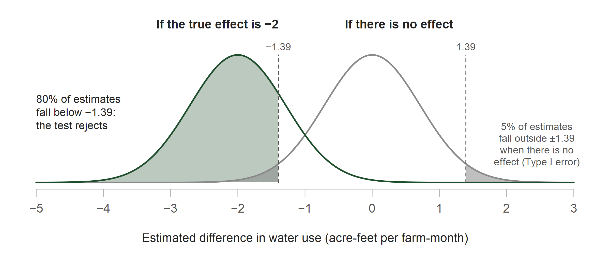

## Before class

**Read**

- Gibson, “Are You Estimating the Right Thing? An Editor Reflects” [@gibson2019estimating]
- Kim, “Tackling False Positives in Business Research” [@kim2019falsepositives]

**Additional readings on experiments and qualitative research**

- Falk and Heckman on laboratory experiments [@falk2009lab]
- Starr on qualitative and mixed methods [@starr2014qualitative]

Readings and course handouts are available on [Canvas](https://colostate.instructure.com/courses/230315/pages/readings)

::: notes
The two required readings frame the second half of today. Gibson asks whether an estimate measures the quantity and the population named in the research question. Kim asks how often a study would report an effect that is not there, and what a study needs in order to detect an effect that is there. Falk and Heckman and Starr support the first half, where we compare experiments, interviews, and mixed methods.
:::

## Methods covered in Unit 6

- **6.1** Used reduced-form comparisons and developed an estimating equation and identifying assumption from a research question
- **6.2** Estimated structural parameters from a model of behavior and used the model to examine counterfactuals
- **6.3** Used machine learning for prediction and within other empirical analyses

**6.4** covers experiments, qualitative and mixed methods, and the measurement and statistical decisions that support a conclusion

::: notes
So far in Unit 6 we have covered three ways to use observational data. In 6.1 we wrote an estimating equation and stated the identifying assumption. In 6.2 we estimated a model of behavior and used it for counterfactuals. In 6.3 we used machine learning for prediction.

Today adds two things. First, methods where the researcher creates the variation, through an experiment, or collects accounts of decisions, through interviews. Second, the measurement and statistical decisions that any of these methods requires before a result can support a conclusion. Students can use both in the empirical strategy section of their workshop plans.
:::

## Our hypothetical example

**Setting:** Irrigation districts deliver surface water to member farms. In a drought year, the districts cut allocations and want farms to use less water without building new infrastructure

**Problem:** Farms see their water use on a seasonal bill, after most irrigation decisions are made

**Proposed program:** Mail each farm a monthly report of its water use, compared with similar farms nearby. Producing and mailing the reports costs the districts money

**Policy question:** Does offering farms a monthly water-use report reduce irrigation water use enough to justify its cost?

::: {.source}
Related evidence on feedback reports: Allcott (2011) on household electricity use; Ferraro and Price (2013) on residential water use
:::

::: notes
We will use one hypothetical example for the whole lecture. The districts, farms, and numbers are made up, but the policy problem is a familiar one.

Here is the setting. Irrigation districts deliver water to member farms. In a drought year, the districts have less water to deliver and want farms to use less without paying for new canals, meters, or storage.

The problem is information. Farms see how much water they used on a seasonal bill, which arrives after most irrigation decisions have already been made.

The proposed program is a monthly report. Each farm receives its own water use for the month and a comparison with similar farms nearby. Reports like this have reduced household electricity use and residential water use in large field experiments, such as Allcott's work on home energy reports and Ferraro and Price on residential water in Georgia. Whether they change irrigation decisions on working farms is an open question.

The reports are not free. So the districts' question has two parts: does the report reduce water use, and is the reduction large enough to justify the cost? Keep that second part in mind, because it returns when we plan the sample size.
:::

## Following the example through the lecture

1. **Choose a design:** Which method fits the districts' question? Field and lab experiments, interviews, and mixed methods
2. **Are we estimating the right thing?** Which farms and which measure of water use? (Gibson)
3. **Plan the sample:** How many completed surveys does the study need? (Kim)
4. **Interpret the results:** What do the data support once they arrive? (Kim)

All numbers are hypothetical

::: notes
The lecture follows the example in the order a research team would work.

First, we choose a design. The districts want the effect of a policy, so we start with experiments, then add what interviews can contribute.

Second, before any statistics, we ask Gibson's question: are we estimating the right thing? That means checking which farms the data cover and whether the survey measures the water use the districts care about.

Third, we plan the sample. This is where Kim's reading comes in: how do we limit false positives, and how many completed surveys do we need to detect an effect that matters?

Fourth, we interpret the results after the data arrive, including what to do when far fewer farms respond than planned.

A decision at each stage constrains the next one. The outcome measure determines how data are collected. The collection method determines the response rate. The response rate determines how precise the estimate can be.
:::

# Choose a design

## Quantitative and qualitative evidence

| Approach | Evidence | Research use |
|---|---|---|
| Quantitative | Numerical measures from surveys, records, or experiments | Estimate patterns, effects, parameters, or predictions |
| Qualitative | Interviews, field observations, or documents | Document decisions and the processes that produce them |
| Mixed methods | Numerical and qualitative evidence | Examine a question using measured outcomes and accounts of decisions |

::: notes
Start with the kinds of evidence available. Quantitative evidence is numerical: survey responses, administrative records, or outcomes measured in an experiment. We use it to estimate patterns, effects, parameters, or predictions.

Qualitative evidence comes from interviews, field observations, or documents. We use it to document how people make decisions and why.

Mixed methods combine the two in one study.

These categories describe forms of evidence, not whole studies. A survey can include numerical and open-ended questions, and an experiment can include interviews. Whatever the form, we still ask how the sources were selected, how things were measured, and how the evidence was analyzed.
:::

## Select a method to match the research task

| Research task | Evidence or method |
|---|---|
| Estimate a policy effect | Random assignment or an observational comparison with a stated identifying assumption |
| Estimate preferences | Choice data and a model of consumer or producer behavior |
| Predict a future outcome | A prediction rule evaluated with held-out observations |
| Document a decision process | Interviews, fieldwork, or case studies |
| Test a response to an incentive | A field or lab experiment |

::: notes
The research task determines the method. This table connects the methods from earlier in the unit to today.

To estimate a policy effect, we need random assignment or an observational comparison with a stated identifying assumption, as in 6.1. To estimate preferences, we need choice data and a model of behavior, as in 6.2. To predict an outcome, we need a prediction rule tested on held-out data, as in 6.3. To document how decisions are made, we use interviews, fieldwork, or case studies. To test how people respond to an incentive, we can run a field or lab experiment.

The districts' question is about a policy effect, and the districts control who receives the report. That means they can randomize it. So we start with a field experiment.
:::

## Field experiment (1/3)

The districts control who receives the report, so they can randomly assign the offer

| Design element | Hypothetical study |
|---|---|
| Eligible farms | Farms on the districts' customer lists |
| Assignment | Random offer of the report at the farm level |
| Outcome | Total monthly water use in acre-feet per farm-month, collected in a follow-up survey |
| Effect of interest | A reduction of **2 acre-feet per farm-month** would justify the cost of the program |

::: notes
Here is the design. The eligible farms are the farms on the districts' customer lists. The districts randomly choose which farms are offered the report, one farm at a time. The outcome is total monthly water use, in acre-feet per farm-month, which the team collects through a follow-up survey.

The last row is new and it matters for the rest of the lecture. Before the study begins, the districts compare the cost of the program with the value of the water saved. Suppose they conclude that a reduction of 2 acre-feet per farm-month would justify the cost. That number comes from the policy question, not from any data on the report. We will use it as the effect the study needs to be able to detect.

Notice also that the outcome comes from a survey. Random assignment makes the two groups comparable at the start, but a follow-up survey means some farms will not respond. That creates a problem we return to at the end.
:::

## Field experiment (2/3)

1. Assign eligible farms to the offer or comparison group
2. Survey both groups about subsequent monthly water use
3. Compare group means to estimate the effect of **being offered** the report
4. Document report delivery, survey response, and departures from assignment

The estimate applies to the offer among farms included in the experiment

Extrapolation to other districts or a mandatory reporting program requires evidence about those settings (i.e., generalizability)

::: notes
The study runs in four steps. Assign farms at random. Survey both groups about water use afterward. Compare the group averages. Document what actually happened: whether reports were delivered, which farms responded to the survey, and any farms that ended up in the wrong group.

Step 3 says "being offered" on purpose. Some farms that are offered the report will not read it. Comparing groups by assignment estimates the effect of the offer, which is called the intention-to-treat effect. That is the policy-relevant quantity here, because the districts can offer reports but cannot make farms read them.

The result applies to the offer among farms in this experiment. Applying it to other districts, or to a program that requires reporting, takes evidence about those settings. That is the generalizability question.

One design detail: if the districts assigned whole districts instead of individual farms, the effective sample size would be much smaller and the inference would change.
:::

## Field experiment (3/3)

The analysis subtracts mean water use in the comparison group from mean water use in the group offered the report

$$
\widehat{\tau}=\overline{Y}_{\text{offer}}-\overline{Y}_{\text{comparison}}
$$

A negative $\widehat{\tau}$ indicates lower reported use among farms offered the report. With comparable follow-up in both assigned groups, the difference estimates the effect of the offer

Before computing $\widehat{\tau}$, the team must decide what it measures, for which farms, and how many completed surveys it requires

::: notes
This is the estimator. Tau hat is average water use among farms offered the report minus average water use among comparison farms. Because the report is meant to reduce use, we expect a negative number. A value of minus 2 would mean farms offered the report used 2 acre-feet less per month on average.

Random assignment is what lets us read this difference as the effect of the offer. That holds as long as the two groups are followed up in comparable ways.

We will not see an actual value of tau hat until the last section. Before computing it, the team has three decisions to make: what the survey measures, which farms the data represent, and how many completed surveys the study needs. The next sections take those up in order.
:::

## Lab experiments

Falk and Heckman's gift-exchange experiment examines whether workers respond to higher wages with higher effort

1. Participants act as firms or workers
2. A firm offers a wage; a worker who accepts chooses an effort level that is costly to provide
3. The experiment specifies the available choices, minimum effort, and payoff rules

**What the lab adds:** Control over choices, information, and payoffs, so researchers can vary one feature at a time and replicate the design

**What it leaves out:** The field setting and the population named in the policy question. Falk and Heckman argue that generalizability is a question for any single study, lab or field

::: {.source}
Source: @falk2009lab, discussion of the gift-exchange experiment
:::

::: notes
A lab experiment takes the same logic into a controlled setting. Falk and Heckman discuss the gift-exchange experiment. Participants play firms or workers. A firm offers a wage. A worker who accepts then chooses how much effort to provide, and effort is costly to the worker. Since nothing forces the worker to provide more than the minimum, standard self-interest predicts minimum effort at any wage. In these experiments, effort tends to rise with the wage, which is evidence of reciprocity.

What the lab adds is control. The researcher sets the choices, the information, and the payoffs, so they can change one feature at a time and other researchers can repeat the design exactly.

What it leaves out is the field setting and the population in the policy question. Falk and Heckman's argument is that this concern applies to any single study. A field experiment in one set of districts also has to be extended to other settings with care.

For our example, a lab version might give participants a water budget and a payoff rule, then vary whether they see feedback on their use. That would test whether feedback changes choices under controlled rules. It would not tell the districts how their farms respond, which is what they asked.
:::

## Interviews

**Research use:** Interviews can document whether farms received and understood the report, how they used it, and which irrigation changes were feasible

**Study procedures**

- Recruit across farm size, crop, water rights, and location
- Document the interview guide and follow-up questions
- Describe recording, transcription, and coding
- Examine accounts that challenge the proposed explanation

**Reporting:** State the recruitment criteria and evidence for each interpretation

::: {.source}
Source: @starr2014qualitative, Sections 2 and 3
:::

::: notes
The experiment tells us whether the offer changed water use. It does not tell us why. Interviews can fill that gap. Did farms receive the report? Did they understand it? What did they change, and what could they not change because of crop, equipment, or water rights?

Starr describes what makes interview evidence credible. Recruit farms that differ in the ways that matter: size, crop, water rights, and location. Write down the interview guide and the follow-up questions. Describe how interviews were recorded, transcribed, and coded. Look for accounts that cut against your explanation, not only ones that support it.

When reporting, state how farms were recruited and what evidence supports each interpretation.

One limit to state clearly: interviews selected this way can show the range of experiences, but they cannot tell us what share of all farms had each experience. That requires a sampling design built for estimating prevalence.
:::

## Mixed methods designs

Interviews (qualitative) combined with the follow-up survey (quantitative) in different sequences

| Sequence in the water-use study | Contribution |
|---|---|
| Interviews before the survey | Identify how farms track water use and refine the survey measure |
| Interviews after the survey | Investigate why some farms used the report and others did not |
| Concurrent interviews | Compare accounts of irrigation changes with reported water use |

The interviews examine how farms responded to the report. The survey comparison estimates the effect of offering it

::: {.source}
Source: @starr2014qualitative, Section 2
:::

::: notes
Mixed methods combine the two kinds of evidence. Here, that means interviews alongside the follow-up survey, and the order matters.

Interviews before the survey can show how farms actually keep track of water use, which helps write a survey question farms can answer accurately. Interviews after the survey can explain a result, for example why some farms acted on the report and others did not. Interviews at the same time as the survey let us check farms' accounts of what they changed against the water use they report.

Each part answers a different question. The interviews describe how farms responded. The survey comparison estimates the effect of the offer.
:::

# Are we estimating the right thing?

## Four questions to ask of any estimate

:::: {.columns}

::: {.column width="50%"}
**Who is covered?**

- Population: Units of interest
- Example: Farms on district customer lists

**What was recorded?**

- Measure: Recorded indicator of a concept
- Example: Survey-reported water use
:::

::: {.column width="50%"}
**Compared with whom?**

- Comparison: Groups whose outcomes are compared
- Example: Farms offered a report and farms not offered one

**What narrows the claim?**

- Limits: Conditions that restrict the conclusion
- Example: Missing survey responses or unlisted farms
:::

::::

::: {.source}
Source: @gibson2019estimating
:::

::: notes
Before any statistical test, Gibson asks a simpler question: are we estimating the right thing? A precise estimate of the wrong quantity, or for the wrong population, does not answer the research question.

Four questions help. Who is covered: which units are in the data? For us, farms on the districts' customer lists. What was recorded: how is the concept measured? For us, water use as farms report it on a survey. Compared with whom: which groups are compared? Farms offered the report and farms not offered it. What narrows the claim: what limits the conclusion? Farms that did not answer the survey and farms that are not on the lists.

One more term. The farms that complete the follow-up survey form the analytic sample. That group may differ from all eligible farms.

The next two slides take the first two questions in turn.
:::

## Population represented in the data

- **Included:** Farms served by participating districts appear on the customer lists
- **Possibly excluded:** Farms relying entirely on private wells or other suppliers may be absent
- **Population claim:** An estimate for farms on the lists requires additional evidence before applying it to all farms in the region

Gibson's distinction between **registered** and **resident** households illustrates how a data source can omit members of the population named in the research question

::: {.source}
Source: @gibson2019estimating, pages 331 to 332
:::

::: notes
Start with who is covered. The customer lists include farms that buy water from the participating districts. Farms that rely only on private wells, or that buy from other suppliers, are not on the lists.

So the experiment estimates the effect for farms on the lists. Before applying that estimate to every farm in the region, we would need evidence that unlisted farms would respond the same way.

Gibson makes the same point with households. A list of registered households is not the same as the households actually living in a place. A sample drawn from the registry misses residents who are not registered. The general lesson: check whether the data source covers the population named in your research question.
:::

## Measurement and interpretation

The outcome of interest is **total irrigation water use**. Suppose instead the follow-up survey asked only about **district deliveries**. That question records one source of water and omits withdrawals from private wells

If farms substitute groundwater for district water after receiving the report, district deliveries could decline while total water use remains unchanged

Gibson's food example makes the same point: one week's purchases omit food consumed from household stocks

::: {.source}
Source: @gibson2019estimating, discussion of food purchases and consumption
:::

::: notes
Now, what was recorded. Our design asks for total irrigation water use. Suppose instead the survey asked only how much water the district delivered.

Many farms have their own wells. A farm that receives the report might use less district water and pump more groundwater instead. District deliveries would fall, and the study would report a reduction, while total water use did not change at all. The estimate would be precise and still wrong for the districts' question, if that question is about total water use.

Gibson gives a parallel example with food. A survey of one week's food purchases misses food eaten from what the household already had at home. Purchases are not the same as consumption.

The survey wording determines which quantity the estimate measures. Check it against the concept in the research question.
:::

# Plan the sample

## What would justify a claim of an effect?

- **Test level (α):** The chance of rejecting no effect when there is no effect. Choosing α = 0.05 sets the Type I error rate at 5%
- **Power (1 − β):** The chance of rejecting no effect when a 2-unit reduction is present. Collecting more outcomes raises power and lowers the Type II error rate β
- **Confidence interval:** Show which effect sizes are consistent with the observed difference
- **Response check:** Compare response across assigned groups to test whether missing surveys change the comparison

The test level and power target are set before data collection. The confidence interval and response check are reported after

::: notes
Suppose the study finds that farms offered the report used less water. What would justify claiming the report works? Four things, two set before data collection and two reported after.

The test level, alpha, is the chance of rejecting "no effect" when the report truly has no effect. That mistake is a Type I error, or a false positive. We choose alpha directly. Setting alpha at 0.05 means the Type I error rate is 5%.

Power is the chance of rejecting "no effect" when the report truly reduces use by 2 acre-feet. Missing a real effect is a Type II error, or a false negative, and its probability is called beta. Power equals 1 minus beta. Unlike alpha, we cannot set beta directly. We lower it by collecting more outcomes. That is why the sample size calculation exists.

After the data arrive, the confidence interval shows which effect sizes are consistent with what we observed, and the response check tests whether the farms that answered the survey still form comparable groups.

The goal is to limit false positives while making effects that matter detectable.
:::

## False positives, false negatives, and power

Test the null hypothesis of **no effect of the offer** against a specified alternative: the districts' threshold of a **2 acre-foot reduction per farm-month**

| Decision | No effect is present | A 2-unit reduction is present |
|---|---|---|
| Reject no effect | False positive (Type I error) | Detect the reduction |
| Do not reject | Correct non-rejection | False negative (Type II error) |

At α = 0.05, if the report has no effect, the test wrongly rejects in 5% of repeated studies. With 80% power, if the true effect is a 2-unit reduction, the test rejects in 80% of repeated studies (β = 0.20)

::: {.source}
Source: @kim2019falsepositives, Section 2
:::

::: notes
This table lays out the four possible outcomes. The columns are the truth, which we never observe. The rows are what the test decides.

If there is no effect and we reject, that is a false positive, a Type I error. If there is a 2-unit reduction and we do not reject, that is a false negative, a Type II error. The other two cells are correct decisions.

What does "repeated studies" mean? Imagine running this same experiment many times, each time with a new random assignment and a new set of survey responses. Each run produces a different estimate and a different test decision. Alpha and power describe how often the test rejects across all those runs. If the report does nothing, 5% of runs would reject. If the report truly reduces use by 2 acre-feet, 80% of runs would reject, and 20% would miss it. That 20% is beta, the Type II error rate. Power and beta always add to 1, so 80% power means beta equals 0.20.

Beta is tied to a specific true effect. The 0.20 is the chance of missing a reduction of exactly 2 acre-feet with this design. With the same 253 farms per group, a true reduction of 1 acre-foot would be missed about 71% of the time, and a reduction of 3 acre-feet about 1% of the time. The design is built so that beta is 0.20 at the smallest effect the districts care about. Larger effects are missed less often.

Beta also applies only when there is a real effect. If the report does nothing, a Type II error is impossible, and the only mistake the test can make is a false positive, at rate alpha.

Power is therefore a property of the design, not of any single estimate. It depends on the effect size, the sample size, how much water use varies, and alpha. In a few slides I will show where the 80% comes from.

A practical point from Kim: when a result is not significant, look at the confidence interval and at the effect sizes the study had power to detect before concluding there is no effect.
:::

## Sample size depends on the research objective

For a survey that **describes average water use**, choose a sample size based on the desired precision of the estimated mean

For the **report experiment**, choose a sample size that can detect a specified difference between assigned groups. That calculation uses the effect size, variation in water use, test level, and power target

::: {.source}
Sources: Lecture 5.1; @kim2019falsepositives, Section 3.5
:::

::: notes
Now we turn the concepts into a sample size. How we choose a sample size depends on what the study is for.

In Lecture 5.1 we chose a sample size for a descriptive survey. If the goal is to describe average water use, the question is how precise the estimated mean needs to be.

Our experiment has a different goal: detecting a difference between two groups. That calculation needs four inputs. The effect size we want to detect, how much water use varies across farms, the test level, and the power target. The next three slides fill in each one.
:::

## Choosing an effect and power target

The districts set the effect of interest during the design: a reduction of **2 acre-feet per farm-month** would justify the cost of the report program

An **80% power target** is a common planning convention. If the true effect is a 2-unit reduction, the planned study would detect it in about four out of five repetitions under the assumed design. A 90% target would require more completed observations

Both choices come from the policy question and the feasible sample size, and both are fixed before any outcomes are observed. An effect size chosen after seeing an estimate no longer describes what the study was designed to detect

::: {.source}
Source: [J-PAL, Power calculations](https://www.povertyactionlab.org/resource/power-calculations)
:::

::: notes
The first input is the effect size. We already have it: the districts said a 2 acre-foot reduction per farm-month would justify the cost of the program. A smaller effect would not be worth the cost, so the study does not need to detect anything smaller.

The second choice is the power target. Eighty percent is a common convention. It means accepting a 20% chance of missing a real 2-unit effect. A 90% target lowers that risk to 10%, but it requires more completed surveys.

Both choices are made before any outcomes come in. If the team waited to see the estimate and then chose an effect size to match, the power calculation would no longer describe what the study was designed to detect. That is one of the habits Kim warns against.
:::

## Inputs to the power calculation

The calculation begins with the effect the study needs to detect: **2 acre-feet less water use per farm-month**

- **Outcome variation:** Assume a standard deviation of 8 acre-feet in each group, based on pilot or prior data
- **Test level:** Use a two-sided 5% test
- **Power target:** Plan for an 80% chance of detecting the 2-unit reduction if it is present
- **Design:** Compare equal-sized groups of independently assigned farms

Assignment by district or correlated outcomes within districts would require a calculation that accounts for clustering

::: {.source}
Source: @kim2019falsepositives, Sections 2 and 3.5
:::

::: notes
Here are all the inputs in one place. The effect is 2 acre-feet. The standard deviation of monthly water use is 8 acre-feet in each group. In practice, that number comes from a pilot or from prior data on similar farms. The test is two-sided at 5%. The power target is 80%. The two groups are the same size, and each farm is assigned independently.

Notice how large the variation is compared with the effect. Farms differ by about 8 acre-feet a month, and we want to detect a 2 acre-foot change. That ratio is what drives the sample size.

If the districts assigned whole districts instead of farms, or if farms in the same district had similar water use, we would need a clustered calculation, which requires more farms.
:::

## Completed surveys needed for 80% power

With a 2-unit effect, standard deviation of 8, and a two-sided 5% test, an approximate two-group calculation is

$$
n\approx\frac{2(8)^2(1.96+0.84)^2}{(2)^2}\approx 251
$$

Base R's two-sample $t$ calculation gives **252.13**, so the study plans for **253 completed surveys per group**

::: {.source}
Illustrative calculation: `power.t.test(delta = 2, sd = 8, sig.level = .05, power = .80, type = "two.sample")`
:::

::: notes
Here is the calculation. In the numerator: 2 times the variance, 8 squared, times the square of 1.96 plus 0.84. The 1.96 comes from the two-sided 5% test. The 0.84 comes from the 80% power target. In the denominator: the effect size squared, 2 squared. The result is about 251 per group.

R's power.t.test function does the same calculation using the t distribution and gives 252.13. We round up to 253 completed surveys per group.

Two cautions. These are completed surveys, not invitations. And the formula assumes independent farms and equal group sizes.
:::

## Why 253 surveys per group give 80% power

{height=400px fig-alt="Two bell-shaped curves showing where the estimated difference in water use would fall across repeated studies with 253 farms per group. The gray curve, centered at zero, shows estimates if the report has no effect; 5 percent of its area lies outside plus or minus 1.39. The green curve, centered at minus 2, shows estimates if the true effect is minus 2; 80 percent of its area lies below minus 1.39, where the test rejects no effect."}

With 253 farms per group, the standard error of the difference is 0.71. The test rejects when the estimate falls below −1.39 or above 1.39 (1.96 × 0.71)

::: {.source}
Illustrative calculation. A simulation of 10,000 repeated experiments rejects in 80.5% of runs when the true effect is −2 and in 5.0% when there is no effect
:::

::: notes
This figure answers the question: how do we know the test rejects in about 80 of 100 repetitions?

Each curve shows where the estimated difference would land if we repeated the experiment many times with 253 farms per group. The estimate varies from run to run because each run draws a different random assignment and different survey responses. How spread out the curves are is set by the standard error, 0.71.

The gray curve is what we would see if the report has no effect. It is centered at zero. The test rejects when the estimate is far from zero, below minus 1.39 or above 1.39. That cutoff is 1.96 times the standard error. Only 5% of the gray curve lies beyond those cutoffs. That is the Type I error rate.

The green curve is what we would see if the true effect is minus 2. It is centered at minus 2. The shaded part, 80% of the curve, lies below minus 1.39, so in those runs the test rejects. That shaded area is the power. The other 20%, between minus 1.39 and about zero, are the runs where a real effect is missed.

We can also check this by simulation. I simulated 10,000 experiments with these assumptions. When the true effect was minus 2, the test rejected in 80.5% of them. When there was no effect, it rejected in 5.0%.

Keep this picture in mind. With fewer completed surveys, both curves get wider, the cutoff moves farther from zero, and less of the green curve falls past it. That is what happens next.
:::

## Planning the survey contacts

The power calculation gives the number of **observed outcomes** needed: 253 farms per group. Because the outcome comes from a follow-up survey, the team must invite more farms than that

Suppose a pilot with similar farms suggests a **40% response rate**

$$
\text{Invitations per group}=\left\lceil\frac{253}{0.40}\right\rceil=633
$$

The team would invite **633 farms in each group** (1,266 in total). This calculation checks whether the customer lists and fieldwork budget can supply the planned number of completed outcomes

The 40% response rate is an illustrative pilot assumption, not a general benchmark

::: notes
The power calculation tells us how many completed surveys we need: 253 per group. Not every invited farm will respond, so we have to invite more.

Suppose a pilot with similar farms had a 40% response rate. Divide 253 by 0.40 and round up: 633 invitations per group, or 1,266 in total.

This step is also a feasibility check. Do the customer lists contain at least 1,266 eligible farms? Can the budget cover that many contacts?

The 40% is an assumption for this example, not a standard. Response rates vary widely across populations and survey modes. This simple version also assumes every invited farm is eligible. When reporting actual response rates, use a stated definition that accounts for ineligible and unknown cases.
:::

## What reviewers examine in a power calculation

There is no single power cutoff for every study. Reviewers examine the basis for the calculation

1. Why the specified effect size matters for the research or policy question
2. How the assumed variation in water use was estimated
3. Whether the calculation reflects assignment, clustering, and expected survey response
4. Whether the eligible farm lists can produce the required completed sample

After data collection, report the realized sample and the precision of the estimated effect

::: {.source}
Sources: [J-PAL, Power calculations](https://www.povertyactionlab.org/resource/power-calculations); [course empirical strategy checklist](../files/empirical-strategy-checklist.qmd)
:::

::: notes
This slide summarizes the planning section from a reviewer's point of view. There is no single power number that every study must reach. Reviewers want to see where each input came from.

One: why does the effect size matter? For us, it is the districts' cost threshold of 2 acre-feet. Two: where did the standard deviation come from? For us, 8 acre-feet from pilot data. Three: does the calculation match the design, including farm-level assignment, any clustering, and the expected response rate? Four: can the customer lists supply 633 invitations per group?

After data collection, report the sample you actually obtained and the precision of the estimate. That is where the next section begins.
:::

## Multiple testing and false positives

The districts may also want to know whether the report changes irrigation scheduling and crop choice. Testing **three outcomes** creates three opportunities to reject a true null hypothesis

If the three tests were independent and each used a 5% level, the chance of at least one false positive would be

$$
1-(1-0.05)^3\approx 0.14
$$

The outcomes may be correlated, so this value is illustrative. Before analysis, identify the primary outcome, then report all tested outcomes and explain any adjustment for multiple comparisons

::: {.source}
Source: @kim2019falsepositives, discussion of multiple testing
:::

::: notes
One more planning decision. The districts may also want to know whether the report changed when farms irrigate, or which crops they planted. That makes three outcomes and three tests.

Each test has a 5% chance of a false positive. If the tests were independent, the chance that at least one of the three produces a false positive is 1 minus 0.95 cubed, about 14%. With 20 outcomes, it would be about 64%.

The outcomes here are probably correlated, so 14% is only illustrative. The practical steps are the same either way. Before analysis, name the primary outcome; here it is total water use. Report every outcome you tested, not only the significant ones. If you adjust for multiple testing, say how. The simplest adjustment, Bonferroni, divides 0.05 by the number of tests, so each of three tests would use about 0.017.

Naming the primary outcome is a planning decision. If it is chosen after the results are in, it becomes a way to pick the outcome with the smallest p-value.
:::

# Interpret the results

## Random variation and survey response

Farms were randomly assigned to the report or comparison group. The follow-up survey records water use only for farms that respond. Before interpreting the difference between groups, ask

1. **Random variation:** Could another assignment produce a different group difference? A confidence interval or test quantifies this uncertainty
2. **Selective response:** Do respondents differ from farms that did not answer? Compare response rates and available farm characteristics by assigned group

::: notes
Now the data have arrived. Before reading anything into the difference between groups, ask two separate questions.

First, random variation. A different random assignment would have produced a somewhat different difference. The confidence interval and the test describe how large that variation is. This is the spread we saw in the curves.

Second, selective response. We only observe water use for farms that answered the survey. If the farms that answered differ from those that did not, and especially if that pattern differs between the two groups, the comparison may no longer be between comparable groups. Check this by comparing response rates in each group, and by comparing respondents with the customer lists on whatever farm characteristics the lists contain.

These are different problems. A confidence interval addresses the first. It does nothing about the second.
:::

## If survey response is 8%

At the planned **40% response rate**, 633 invitations would yield about **253 completed surveys per group** and 80% power under the stated assumptions

Suppose the realized response rate is **8%**. The same invitations yield about **51 completed surveys per group**, and power to detect the 2-unit effect falls to about **24%**

To obtain 253 completions at an 8% rate, the team would need about **3,163 invitations per group**. The customer lists may contain fewer eligible farms

::: {.source}
Illustrative calculation: R `power.t.test(n = 51, delta = 2, sd = 8, sig.level = .05, type = "two.sample")`
:::

::: notes
Suppose the survey goes out and only 8% of farms respond, not the 40% the pilot suggested.

633 invitations times 0.08 is about 51 completed surveys per group, about one-fifth of the plan. Power to detect the 2 acre-foot effect falls from 80% to about 24%. If the report truly works as well as the districts need, this study would detect it about one time in four.

Go back to the curves. With 51 farms per group, the standard error rises from 0.71 to 1.58. Both curves get much wider, and the rejection cutoff moves out to about minus 3.1. Only about a quarter of the green curve now falls beyond it.

To reach 253 completions at 8%, the team would need about 3,163 invitations per group. The customer lists may not have that many eligible farms. So a low response rate is not only an inference problem. It can make the planned study infeasible.
:::

## Nonresponse and interpretation

There is no universal expected response rate. Use a pilot or comparable survey to plan invitations. An 8% rate calls for evidence about who responded

- Compare respondents with the customer lists on available farm characteristics
- Report response rates separately for the offer and comparison groups
- Examine whether follow-up or weighting changes the estimate

Selective response can bias the estimated effect if it changes the comparability of the assigned groups. A larger invitation list alone does not resolve that concern

::: {.source}
Source: [AAPOR, *Response Rate Overview*](https://aapor.org/wp-content/uploads/2022/12/Response-Rates-Overview-508.pdf)
:::

::: notes
There is no single response rate that makes a survey acceptable. Plan with a pilot or a comparable survey. But a rate as low as 8% calls for evidence about who responded.

Three checks. Compare the farms that responded with the full customer lists on whatever the lists record, such as farm size or past deliveries. Report response rates separately for the offer group and the comparison group. Check whether extra follow-up with nonrespondents, or weighting, changes the estimate.

Here is the concern. Suppose farms that cut their water use after receiving the report were more willing to answer the survey. Then the respondents in the offer group would overstate the effect. Random assignment made the groups comparable at the start, but selective response can undo that among respondents.

Inviting more farms raises the number of responses, but it does not fix this. If the same kinds of farms respond, the bias remains. AAPOR makes the related point that a response rate alone does not measure nonresponse bias.
:::

## Precision after an 8% response rate

With about **51 farms per group**, suppose the estimate is $\widehat{\tau}=-1.5$ acre-feet per farm-month and the standard deviation is 8 in each group. The approximate standard error is

$$
SE\approx\sqrt{\frac{8^2}{51}+\frac{8^2}{51}}=1.58
$$

An approximate 95% interval is **−1.5 ± 1.96(1.58) = [−4.6, 1.6]** acre-feet. The data remain compatible with no effect and with reductions larger than the 2-unit threshold set during planning

The small completed sample explains both the fall to 24% power and the wide interval. The interval describes sampling uncertainty among respondents; it does not address selective response

::: notes
Now we finally have an estimate. Suppose farms offered the report used 1.5 acre-feet less per month than comparison farms.

The estimate is minus 1.5, not minus 2, and that is deliberate. The 2 came from the districts' cost threshold before any data existed. The minus 1.5 comes from the data. They are different quantities, and it helps to keep them separate.

The standard error uses the standard deviation of 8 and the 51 farms in each group. It comes to 1.58. The 95% confidence interval is minus 1.5 plus or minus 1.96 times 1.58, which runs from minus 4.6 to 1.6.

Read the interval as the range of effects consistent with the data. It includes zero, so we cannot rule out no effect. It also includes reductions of 3 or 4 acre-feet, larger than the districts' threshold. The data cannot tell those apart.

The small sample causes both problems: the low power and the wide interval. And this interval only describes random variation among respondents. It does not correct for selective response.
:::

## Why consider an equivalence test?

The estimate is not statistically distinguishable from zero, and the districts are considering ending the report program

The 95% interval **[−4.6, 1.6]** still includes reductions greater than 2 acre-feet. The study has not ruled out a benefit large enough to justify the program

To support a claim that the effect is negligible, the team must specify what size of change would matter and test whether the data rule out effects that large

**Equivalence testing** addresses that question

::: {.source}
Source: @kim2019falsepositives, Section 3.7
:::

::: notes
Suppose the districts see that the result is not significant and conclude the report does not work, so they plan to end the program.

That conclusion does not follow. Not rejecting "no effect" is not the same as showing the effect is zero. The interval still includes reductions larger than 2 acre-feet, which would justify the program. The study has not ruled out the benefit the districts were looking for.

To claim the effect is negligible, the team has to say what "negligible" means in acre-feet and then test whether the data rule out anything larger. That is what an equivalence test does, and it is the subject of Kim's section 3.7.
:::

## Equivalence test for the water-use report

1. Before analysis, define **−1 to 1 acre-foot** as a negligible change in monthly use
2. For a 5% equivalence test, calculate a **90% confidence interval**. The entire interval must lie inside the negligible range
3. With 51 respondents per group, the approximate interval is **[−4.1, 1.1]** acre-feet

The interval extends below −1. The data leave open reductions larger than 1 acre-foot, so they do not establish a negligible effect

::: {.source}
Source: @kim2019falsepositives, Section 3.7
:::

::: notes
Here is how it works. Before analysis, the team decides that any change between minus 1 and plus 1 acre-foot is too small to matter. Like the 2-unit threshold, that range comes from the policy question, not from the data.

An equivalence test runs two one-sided tests: is the effect above minus 1, and is it below plus 1? Each uses a 5% level, and both must reject. That works out to a simple rule: compute a 90% confidence interval, and conclude equivalence only if the whole interval lies inside minus 1 to 1.

Our 90% interval is minus 1.5 plus or minus 1.645 times 1.58, which runs from minus 4.1 to 1.1. It extends well below minus 1. The data still allow reductions larger than 1 acre-foot, so they do not show the effect is negligible.

So this study supports neither conclusion. It cannot show the report works, and it cannot show the report does not work. That is what an underpowered study usually produces. The fix was in the planning: the response rate, and the number of completed surveys. This interval also assumes that the farms that responded still form comparable groups.
:::

# Check-in

## What your empirical strategy should state {.dense}

| Decision | State in the plan |
|---|---|
| Population and sampling frame | Which units the data cover and which they omit |
| Outcome measure | How the recorded measure relates to the concept in the question |
| Comparison | Which groups are compared and the identifying assumption |
| Sample size | Effect of interest, assumed variation, test level, power target, and expected response |
| Primary outcome | Which outcome is tested first and how additional tests are handled |
| A null result | Which effect sizes the confidence interval rules out |

::: {.source}
Source: [course empirical strategy checklist](../files/empirical-strategy-checklist.qmd)
:::

::: notes
This table pulls the lecture together into what belongs in your own empirical strategy section.

State which units your data cover and which they leave out. Explain how your recorded measure relates to the concept in your question. Name the comparison and the identifying assumption behind it. If you are collecting data, give the inputs to your sample size calculation: the effect size and why it matters, the assumed variation and its source, the test level, the power target, and the expected response rate. Name your primary outcome and how you will handle additional tests. And say in advance how you will interpret a result that is not significant: which effect sizes would your confidence interval need to rule out?

Use this as a checklist as we hear the reports. Each row corresponds to one section of today's lecture.
:::

## Report from Tuesday's methods workshop

Students who did not receive feedback on Tuesday can report their current methods plan

::: notes
Reserve the final 20 to 25 minutes. Allow about two minutes for each report and a few minutes for feedback, adjusting to the number of students who still need a turn.

Return first to those who did not receive feedback in Tuesday's lab.

1. State the research question and one hypothesis
2. Describe the observations, central measures, and proposed method
3. Name one design or inference decision on which you want feedback

After each report, discuss the outcome measure, proposed comparison, and one design choice that needs further work

:::

## References {.smaller}

::: {#refs}
:::

## Course navigation

- [All lectures](https://laurenchenarides.github.io/csu-arec-570/lectures/lectures.html)
- [Schedule and preparation](https://laurenchenarides.github.io/csu-arec-570/2026/schedule.html)
- [Methods workshop preparation](https://laurenchenarides.github.io/csu-arec-570/2026/methods-workshop.html)
- [Course reading list](https://laurenchenarides.github.io/csu-arec-570/2026/readings.html)
